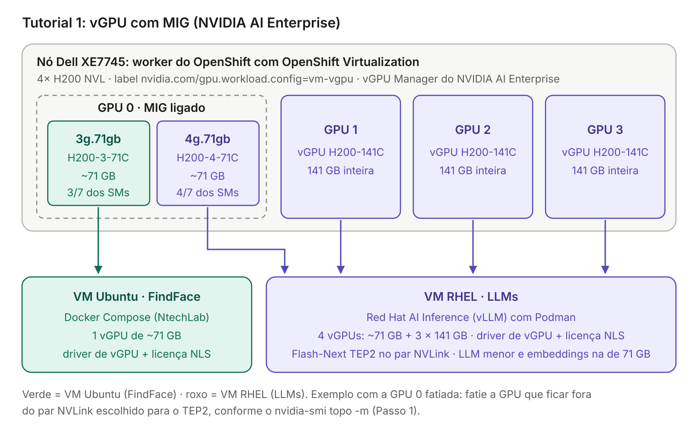

# Tutorial 1: H200 em duas VMs com vGPU e MIG (com NVIDIA AI Enterprise)

Este tutorial divide o nó com 4× H200 NVL entre duas VMs do **OpenShift Virtualization**:

- **VM Ubuntu (FindFace):** uma fatia MIG de **\~71 GB** da GPU 0.
- **VM RHEL (LLMs):** todo o resto: a outra fatia MIG da GPU 0 (\~71 GB) e as GPUs 1, 2 e 3 inteiras.

Fatias MIG da mesma GPU só podem ir para **VMs diferentes** com **NVIDIA vGPU**, que exige licença do **NVIDIA AI Enterprise**. Sem essa licença, use o [Tutorial 2](4.%20tutorial-passthrough-vms.md) (GPUs inteiras por passthrough).



> **Por que \~71 GB e não 72 GB ou 48 GB:** a H200 só tem perfis MIG fixos (1g.18gb, 1g.35gb, 2g.35gb, 3g.71gb, 4g.71gb e 7g.141gb). O menor que comporta a meta de 48 GB do FindFace é o **3g.71gb**, entregue à VM como o vGPU **H200-3-71C**. A outra metade (4g.71gb, vGPU **H200-4-71C**) tem a mesma memória e mais processamento (4/7 dos SMs), por isso vai para os LLMs.

## Índice

- [Visão geral](#visão-geral)
- [Impacto no desenho do README](#impacto-no-desenho-do-readme)
- [Pré-requisitos](#pré-requisitos)
- [Passo 1: mapear o NVLink com `nvidia-smi topo -m`](#passo-1-mapear-o-nvlink-com-nvidia-smi-topo--m)
- [Passo 2: BIOS do Dell](#passo-2-bios-do-dell)
- [Passo 3: MachineConfigPool próprio e IOMMU](#passo-3-machineconfigpool-próprio-e-iommu)
- [Passo 4: tirar os workloads de GPU do nó](#passo-4-tirar-os-workloads-de-gpu-do-nó)
- [Passo 5: imagem do vGPU Manager](#passo-5-imagem-do-vgpu-manager)
- [Passo 6: OpenShift Virtualization e o HyperConverged](#passo-6-openshift-virtualization-e-o-hyperconverged)
- [Passo 7: ClusterPolicy do GPU Operator](#passo-7-clusterpolicy-do-gpu-operator)
- [Passo 8: layout dos vGPUs e labels do nó](#passo-8-layout-dos-vgpus-e-labels-do-nó)
- [Passo 9: conferir os vGPUs no nó](#passo-9-conferir-os-vgpus-no-nó)
- [Passo 10: liberar os vGPUs para as VMs](#passo-10-liberar-os-vgpus-para-as-vms)
- [Passo 11: criar as duas VMs](#passo-11-criar-as-duas-vms)
- [Passo 12: VM Ubuntu (FindFace)](#passo-12-vm-ubuntu-findface)
- [Passo 13: VM RHEL (LLMs)](#passo-13-vm-rhel-llms)
- [Verificação final](#verificação-final)
- [Problemas comuns](#problemas-comuns)
- [Itens a validar](#itens-a-validar)
- [Referências](#referências)

## Visão geral

| Item | VM Ubuntu (FindFace) | VM RHEL (LLMs) |
| --- | --- | --- |
| Sistema | Ubuntu 24.04 | RHEL 9 |
| GPU entregue | 1 vGPU **H200-3-71C** (MIG 3g.71gb da GPU fatiada) | 1 vGPU **H200-4-71C** (MIG 4g.71gb da GPU fatiada) + 3 vGPUs **H200-141C** (GPUs inteiras, time-sliced) |
| Memória de GPU vista na VM | \~71 GB | \~71 GB + 3 × 141 GB |
| Workloads | FindFace Multi (Docker Compose, como a NtechLab suporta) | Qwen3.8-Flash-Next em TEP2 nas duas GPUs do par NVLink; LLM menor e embeddings na de \~71 GB |
| Driver na VM | Driver de vGPU para guest (NVIDIA AI Enterprise) + licença do NVIDIA License System | Igual |
| Runtime de containers | Docker + NVIDIA Container Toolkit | Podman + NVIDIA Container Toolkit (CDI) |

**Por que as GPUs inteiras também vão como vGPU:** uma VM não pode receber vGPU e passthrough ao mesmo tempo. Como a VM RHEL recebe a fatia H200-4-71C (vGPU), as outras três GPUs também precisam chegar a ela como vGPU, no perfil de GPU inteira **H200-141C**.

**Por que H200-141C e não MIG 7g.141gb nas GPUs inteiras:** a comunicação direta entre GPUs (P2P pelo NVLink), de que o TEP2 do Flash-Next depende, só funciona entre vGPUs **time-sliced**. vGPUs baseados em MIG não fazem P2P, e P2P via PCIe também não é suportado em vGPU.

## Impacto no desenho do README

Este tutorial é uma **alternativa** ao layout da Parte 1 do [README](README.md), em que o nó H200 roda pods (Flash-Next pelo llm-d e FindFace como StatefulSets). Com o nó em modo `vm-vgpu`:

- **Nenhum pod usa as H200.** Um nó roda só um tipo de workload de GPU: containers, VMs com passthrough ou VMs com vGPU. O node pool `h200-nvl` do Run:ai fica sem GPUs; zere as cotas dos projetos `flashnext` e `findface` nesse pool.
- **O Flash-Next sai do llm-d/KServe** e passa a rodar na VM RHEL com o Red Hat AI Inference (vLLM). A publicação desse endpoint pelo MaaS ou pelo Connectivity Link não faz parte deste tutorial e precisa ser validada.
- **O FindFace inteiro vai para a VM Ubuntu,** com Docker Compose, do jeito que a NtechLab suporta. No README ele tinha 2 H200 (extraction-api e video-worker); aqui os dois componentes dividem \~71 GB. Meça com carga real.

## Pré-requisitos

| Item | Detalhe |
| --- | --- |
| OpenShift | 4.22 com o Dell como **worker bare metal** (RHCOS) |
| OpenShift Virtualization | Operador instalado e `HyperConverged` criado |
| NVIDIA GPU Operator | **25.10 ou superior** (vGPU baseado em MIG no OpenShift Virtualization). O README já usa a linha 26.7 |
| Licença | **NVIDIA AI Enterprise** com acesso ao driver do **vGPU Manager para KVM (AIE)** e ao **driver de guest Linux** do mesmo branch |
| Servidor de licenças | NVIDIA License System: DLS (local) ou CLS (nuvem), com o **client configuration token** (`.tok`) gerado |
| Registry privado | Para a imagem do vGPU Manager (Passo 5) |
| Compatibilidade | Confirme na matriz do NVIDIA AI Enterprise que a **H200 NVL** e a versão do OpenShift estão suportadas com vGPU baseado em MIG |
| RAM do nó | Soma da RAM das duas VMs mais folga. A VM RHEL precisa de \~96 GiB só para a tabela N-gram do Flash-Next |

## Passo 1: mapear o NVLink com `nvidia-smi topo -m`

Faça este passo **antes** de mudar o modo do nó, enquanto ele ainda está em modo container (Etapa 2 do README). O resultado decide **qual GPU será fatiada** e **qual par vai para o TEP2**.

```bash
# pod do driver no nó Dell
POD=$(oc get pods -n nvidia-gpu-operator -l app=nvidia-driver-daemonset \
  --field-selector spec.nodeName=<no-dell> -o name | head -1)

oc exec -n nvidia-gpu-operator $POD -- nvidia-smi topo -m
oc exec -n nvidia-gpu-operator $POD -- nvidia-smi --query-gpu=index,pci.bus_id,uuid,serial --format=csv
```

Exemplo de saída (ilustrativo; a sua depende do bridge e dos slots):

```text
        GPU0    GPU1    GPU2    GPU3
GPU0     X      NV18    SYS     SYS
GPU1    NV18     X      SYS     SYS
GPU2    SYS     SYS      X      NV18
GPU3    SYS     SYS     NV18     X
```

| Valor na matriz | Significado |
| --- | --- |
| `NV#` (ex.: `NV18`) | As duas GPUs estão ligadas por NVLink; o número é a quantidade de links |
| `PIX`, `PXB` | Ligadas só por PCIe, passando por um ou mais switches PCIe |
| `PHB`, `NODE`, `SYS` | Ligadas só por PCIe, passando pela CPU (no mesmo socket ou entre sockets) |

**Como decidir:**

| O que a matriz mostra | GPU a fatiar | Par do TEP2 (Flash-Next) |
| --- | --- | --- |
| Pares (ex.: `NV#` só em 0-1 e 2-3) | Uma GPU de um par (ex.: GPU 0) | O **outro** par (ex.: GPUs 2 e 3) |
| `NV#` entre todas (bridge de 4 vias) | Qualquer uma | Quaisquer duas das três restantes |
| Nenhum `NV#` (sem bridge) | Qualquer uma | Quaisquer duas; o TEP2 fica só com PCIe, mais lento. Com vGPU não há P2P via PCIe |

Anote o **índice** da GPU que será fatiada (vai no Passo 8) e o **UUID** de cada GPU (serve para conferir dentro das VMs). Neste tutorial, o exemplo fatia a **GPU 0**.

> Com vGPU, a regra do passthrough ("GPUs ligadas por NVLink vão para a mesma VM") não se aplica. Aqui o NVLink importa só para o desempenho do TEP2.

## Passo 2: BIOS do Dell

Ative no BIOS do XE7745 (AMD EPYC):

- **IOMMU** (às vezes chamado AMD-Vi).
- **SR-IOV:** o vGPU em GPUs Ampere ou mais novas usa SR-IOV.
- **Above 4G Decoding:** a H200 expõe janelas de memória PCIe (BAR) muito grandes.

## Passo 3: MachineConfigPool próprio e IOMMU

Aplicar um `MachineConfig` no papel `worker` reinicia **todos** os workers. Crie um pool só para o Dell:

```yaml
apiVersion: machineconfiguration.openshift.io/v1
kind: MachineConfigPool
metadata:
  name: gpu-virt
spec:
  machineConfigSelector:
    matchExpressions:
      - key: machineconfiguration.openshift.io/role
        operator: In
        values: [worker, gpu-virt]
  nodeSelector:
    matchLabels:
      node-role.kubernetes.io/gpu-virt: ""
```

```bash
oc apply -f mcp-gpu-virt.yaml
oc label node <no-dell> node-role.kubernetes.io/gpu-virt=
```

Argumentos de kernel do IOMMU (AMD):

```yaml
apiVersion: machineconfiguration.openshift.io/v1
kind: MachineConfig
metadata:
  name: 100-gpu-virt-iommu
  labels:
    machineconfiguration.openshift.io/role: gpu-virt
spec:
  config:
    ignition:
      version: 3.2.0
  kernelArguments:
    - amd_iommu=on
    - iommu=pt
```

```bash
oc apply -f mc-gpu-virt-iommu.yaml
oc get mcp gpu-virt -w        # aguarde UPDATED=True (o nó reinicia)

# conferir
oc debug node/<no-dell> -- chroot /host sh -c 'cat /proc/cmdline; dmesg | grep -i -e AMD-Vi -e IOMMU | head'
```

## Passo 4: tirar os workloads de GPU do nó

Ao mudar o modo do nó, o recurso `nvidia.com/gpu` some dele. Antes:

1. Escale para zero os workloads que usam as H200 (Flash-Next e FindFace do layout do README).
2. No Run:ai, zere as cotas de `flashnext` e `findface` no node pool `h200-nvl`. Faça o mesmo nas `ResourceQuota` dos namespaces.
3. Confirme que nenhum pod do nó pede GPU:

```bash
oc get pods -A --field-selector spec.nodeName=<no-dell> -o wide
```

## Passo 5: imagem do vGPU Manager

O GPU Operator não distribui o driver do vGPU Manager: você monta a imagem a partir do driver baixado do portal do NVIDIA AI Enterprise (arquivo `NVIDIA-Linux-x86_64-<versao>-vgpu-kvm-aie.run`). Siga o procedimento da NVIDIA para OpenShift (*Building the vGPU Manager image*) na versão do seu GPU Operator. Em linhas gerais:

```bash
git clone https://github.com/NVIDIA/gpu-driver-container.git
cd gpu-driver-container/vgpu-manager/rhel9        # RHCOS do OpenShift 4.22 é baseado em RHEL 9
cp <pasta-download>/NVIDIA-Linux-x86_64-<versao>-vgpu-kvm-aie.run ./

export PRIVATE_REGISTRY=<registry>/<org>
export VERSION=<versao-do-driver>
export OS_TAG=rhcos4.22

podman build --build-arg DRIVER_VERSION=${VERSION} \
  -t ${PRIVATE_REGISTRY}/vgpu-manager:${VERSION}-${OS_TAG} .
podman push ${PRIVATE_REGISTRY}/vgpu-manager:${VERSION}-${OS_TAG}
```

Crie o pull secret no namespace do GPU Operator:

```bash
oc create secret docker-registry vgpu-registry-secret -n nvidia-gpu-operator \
  --docker-server=<registry> --docker-username=<usuario> --docker-password=<senha>
```

## Passo 6: OpenShift Virtualization e o HyperConverged

O **HyperConverged** é o objeto de configuração principal do OpenShift Virtualization: um único recurso, `kubevirt-hyperconverged`, no namespace `openshift-cnv`. Edite pela CLI (`oc edit hyperconverged kubevirt-hyperconverged -n openshift-cnv`) ou pelo console (*Operators → Installed Operators → OpenShift Virtualization → OpenShift Virtualization Deployment → kubevirt-hyperconverged → YAML*).

Desligue a criação de *mediated devices* pelo OpenShift Virtualization, porque quem cria os vGPUs é o GPU Operator:

```bash
oc patch hyperconverged kubevirt-hyperconverged -n openshift-cnv --type=json \
  -p '[{"op":"add","path":"/spec/featureGates/disableMDevConfiguration","value":true}]'
```

## Passo 7: ClusterPolicy do GPU Operator

O cluster já tem uma `ClusterPolicy` (Etapa 2 do README). Edite-a (`oc edit clusterpolicy gpu-cluster-policy`) e **acrescente** os campos abaixo, sem apagar o resto. Os nós RTX continuam em modo container, com o driver normal.

```yaml
spec:
  sandboxWorkloads:
    enabled: true
    defaultWorkload: container        # os outros nós continuam com pods
  vgpuManager:
    enabled: true
    repository: <registry>/<org>
    image: vgpu-manager
    version: <versao-do-driver>       # o operador acrescenta -rhcos4.22 à tag
    imagePullSecrets:
      - vgpu-registry-secret
  vgpuDeviceManager:
    enabled: true
    config:
      name: vgpu-devices-config       # ConfigMap do Passo 8
      default: default
  migManager:
    enabled: true
  sandboxDevicePlugin:
    enabled: true
  vfioManager:
    enabled: true
```

## Passo 8: layout dos vGPUs e labels do nó

O layout é definido por GPU, no ConfigMap do **vGPU Device Manager**. Troque `[0]` e `[1, 2, 3]` pelos índices que você escolheu no Passo 1.

```yaml
apiVersion: v1
kind: ConfigMap
metadata:
  name: vgpu-devices-config
  namespace: nvidia-gpu-operator
data:
  config.yaml: |
    version: v1
    vgpu-configs:
      default:
        - devices: all
          vgpu-devices:
            "H200-141C": 1
      dell-h200-findface:
        - devices: [0]                # GPU fatiada (fora do par do TEP2)
          vgpu-devices:
            "H200-3-71C": 1           # MIG 3g.71gb -> VM Ubuntu (FindFace)
            "H200-4-71C": 1           # MIG 4g.71gb -> VM RHEL
        - devices: [1, 2, 3]          # GPUs inteiras, time-sliced (P2P pelo NVLink)
          vgpu-devices:
            "H200-141C": 1
```

```bash
oc apply -f vgpu-devices-config.yaml

oc label node <no-dell> --overwrite nvidia.com/gpu.workload.config=vm-vgpu
oc label node <no-dell> --overwrite nvidia.com/vgpu.config=dell-h200-findface
```

> **Atenção:** a documentação da Red Hat mostra um único perfil por nó (`nvidia.com/vgpu.config=<perfil>`). Misturar, no mesmo nó, uma GPU com MIG e outras inteiras é aceito pelo formato do vGPU Device Manager, mas **valide em laboratório** (veja [Itens a validar](#itens-a-validar)).

## Passo 9: conferir os vGPUs no nó

```bash
oc get pods -n nvidia-gpu-operator -o wide | grep <no-dell>
# esperados: nvidia-vgpu-manager-daemonset, nvidia-vgpu-device-manager,
#            nvidia-sandbox-device-plugin-daemonset, nvidia-sandbox-validator

oc get node <no-dell> -o jsonpath='{.metadata.labels.nvidia\.com/vgpu\.config\.state}'; echo
# esperado: success

# recursos que o nó passou a anunciar (anote os nomes exatos)
oc get node <no-dell> -o json | jq '.status.allocatable | with_entries(select(.key|startswith("nvidia.com/")))'
# esperado, por exemplo:
#   "nvidia.com/NVIDIA_H200-3-71C": "1"
#   "nvidia.com/NVIDIA_H200-4-71C": "1"
#   "nvidia.com/NVIDIA_H200-141C": "3"

# MIG e vGPUs vistos pelo host
VGPU=$(oc get pods -n nvidia-gpu-operator -l app=nvidia-vgpu-manager-daemonset \
  --field-selector spec.nodeName=<no-dell> -o name | head -1)
oc exec -n nvidia-gpu-operator $VGPU -- nvidia-smi mig -lgi -i 0     # GPU 0: 3g.71gb e 4g.71gb
oc exec -n nvidia-gpu-operator $VGPU -- nvidia-smi vgpu
oc exec -n nvidia-gpu-operator $VGPU -- nvidia-smi topo -m           # mesma topologia do Passo 1
```

## Passo 10: liberar os vGPUs para as VMs

No `HyperConverged`, em `spec.permittedHostDevices.mediatedDevices`, uma entrada por tipo de vGPU. Use os nomes anotados no Passo 9.

```yaml
spec:
  permittedHostDevices:
    mediatedDevices:
      - mdevNameSelector: NVIDIA H200-3-71C
        resourceName: nvidia.com/NVIDIA_H200-3-71C
        externalResourceProvider: true
      - mdevNameSelector: NVIDIA H200-4-71C
        resourceName: nvidia.com/NVIDIA_H200-4-71C
        externalResourceProvider: true
      - mdevNameSelector: NVIDIA H200-141C
        resourceName: nvidia.com/NVIDIA_H200-141C
        externalResourceProvider: true
```

`externalResourceProvider: true` diz ao OpenShift Virtualization que quem anuncia esses dispositivos é o GPU Operator.

## Passo 11: criar as duas VMs

As GPUs entram em `spec.template.spec.domain.devices.gpus`. A VM precisa estar **parada** para receber ou trocar GPUs.

**VM Ubuntu (FindFace)**, com 1 vGPU H200-3-71C:

```yaml
apiVersion: kubevirt.io/v1
kind: VirtualMachine
metadata:
  name: vm-findface
  namespace: findface-vm
spec:
  runStrategy: Halted
  dataVolumeTemplates:
    - metadata:
        name: vm-findface-root
      spec:
        source:
          registry:
            url: docker://quay.io/containerdisks/ubuntu:24.04
        storage:
          resources:
            requests:
              storage: 300Gi          # dimensione pelo cache e pelos dados do FindFace
  template:
    spec:
      nodeSelector:
        kubernetes.io/hostname: <no-dell>
      domain:
        cpu:
          cores: 16                   # conforme o dimensionamento da NtechLab
        memory:
          guest: 64Gi
        firmware:
          bootloader:
            efi:
              secureBoot: false       # o driver da NVIDIA é compilado na VM (módulo não assinado)
        devices:
          gpus:
            - name: gpu-findface
              deviceName: nvidia.com/NVIDIA_H200-3-71C
          disks:
            - name: rootdisk
              disk: { bus: virtio }
            - name: cloudinit
              disk: { bus: virtio }
          interfaces:
            - name: default
              masquerade: {}
      networks:
        - name: default
          pod: {}
      volumes:
        - name: rootdisk
          dataVolume:
            name: vm-findface-root
        - name: cloudinit
          cloudInitNoCloud:
            userData: |
              #cloud-config
              user: ubuntu
              ssh_authorized_keys:
                - <sua-chave-publica>
```

**VM RHEL (LLMs)**, com 1 vGPU H200-4-71C e 3 vGPUs H200-141C:

```yaml
apiVersion: kubevirt.io/v1
kind: VirtualMachine
metadata:
  name: vm-llms
  namespace: llms-vm
spec:
  runStrategy: Halted
  dataVolumeTemplates:
    - metadata:
        name: vm-llms-root
      spec:
        sourceRef:
          kind: DataSource
          name: rhel9
          namespace: openshift-virtualization-os-images
        storage:
          resources:
            requests:
              storage: 1Ti            # pesos dos modelos (o Flash-Next FP8 tem ~173 GiB)
  template:
    spec:
      nodeSelector:
        kubernetes.io/hostname: <no-dell>
      domain:
        cpu:
          cores: 32
        memory:
          guest: 256Gi                # ~96 GiB só para a tabela N-gram do Flash-Next
        firmware:
          bootloader:
            efi:
              secureBoot: false
        devices:
          gpus:
            - name: gpu-mig
              deviceName: nvidia.com/NVIDIA_H200-4-71C
            - name: gpu-a
              deviceName: nvidia.com/NVIDIA_H200-141C
            - name: gpu-b
              deviceName: nvidia.com/NVIDIA_H200-141C
            - name: gpu-c
              deviceName: nvidia.com/NVIDIA_H200-141C
          disks:
            - name: rootdisk
              disk: { bus: virtio }
            - name: cloudinit
              disk: { bus: virtio }
          interfaces:
            - name: default
              masquerade: {}
      networks:
        - name: default
          pod: {}
      volumes:
        - name: rootdisk
          dataVolume:
            name: vm-llms-root
        - name: cloudinit
          cloudInitNoCloud:
            userData: |
              #cloud-config
              user: cloud-user
              ssh_authorized_keys:
                - <sua-chave-publica>
```

```bash
oc new-project findface-vm; oc new-project llms-vm
oc apply -f vm-findface.yaml -f vm-llms.yaml
virtctl start vm-findface -n findface-vm
virtctl start vm-llms -n llms-vm
oc get vmi -A -o wide
```

Como cada tipo de vGPU existe só na GPU certa, a VM Ubuntu sempre recebe a fatia 3g.71gb e a VM RHEL recebe a 4g.71gb e as três GPUs inteiras.

## Passo 12: VM Ubuntu (FindFace)

Acesse com `virtctl ssh ubuntu@vm-findface -n findface-vm` (ou `virtctl console`).

**12.1 Driver de vGPU para guest.** Use o pacote Linux de guest do portal do NVIDIA AI Enterprise, do **mesmo branch** do vGPU Manager:

```bash
sudo apt-get update
sudo apt-get install -y build-essential dkms linux-headers-$(uname -r)
sudo apt-get install -y ./nvidia-linux-grid-<versao>_amd64.deb
sudo reboot

nvidia-smi       # deve mostrar 1 GPU "NVIDIA H200-3-71C" com ~71 GB
```

**12.2 Licença.** Copie o token do NVIDIA License System e reinicie o serviço de licença:

```bash
sudo cp client_configuration_token_*.tok /etc/nvidia/ClientConfigToken/
sudo chmod 744 /etc/nvidia/ClientConfigToken/*.tok
sudo systemctl restart nvidia-gridd
nvidia-smi -q | grep -i -A2 license      # esperado: Licensed
```

Sem licença, o vGPU entra em modo restrito e o desempenho cai. A VM precisa alcançar o DLS (ou o CLS) pela rede.

**12.3 Docker e NVIDIA Container Toolkit:**

```bash
# Docker Engine (repositório oficial; use a versão exigida pela NtechLab, se houver)
sudo install -m 0755 -d /etc/apt/keyrings
sudo curl -fsSL https://download.docker.com/linux/ubuntu/gpg -o /etc/apt/keyrings/docker.asc
echo "deb [arch=$(dpkg --print-architecture) signed-by=/etc/apt/keyrings/docker.asc] https://download.docker.com/linux/ubuntu $(. /etc/os-release && echo $VERSION_CODENAME) stable" \
  | sudo tee /etc/apt/sources.list.d/docker.list
sudo apt-get update
sudo apt-get install -y docker-ce docker-ce-cli containerd.io docker-compose-plugin

# NVIDIA Container Toolkit
curl -fsSL https://nvidia.github.io/libnvidia-container/gpgkey \
  | sudo gpg --dearmor -o /usr/share/keyrings/nvidia-container-toolkit-keyring.gpg
curl -s -L https://nvidia.github.io/libnvidia-container/stable/deb/nvidia-container-toolkit.list \
  | sed 's#deb https://#deb [signed-by=/usr/share/keyrings/nvidia-container-toolkit-keyring.gpg] https://#g' \
  | sudo tee /etc/apt/sources.list.d/nvidia-container-toolkit.list
sudo apt-get update && sudo apt-get install -y nvidia-container-toolkit
sudo nvidia-ctk runtime configure --runtime=docker
sudo systemctl restart docker

sudo docker run --rm --gpus all ubuntu nvidia-smi    # deve mostrar a H200-3-71C
```

**12.4 FindFace.** Instale o FindFace Multi com o instalador e o Docker Compose da NtechLab. Nos serviços de GPU (`findface-extraction-api` e `findface-video-worker`), garanta o acesso à GPU, por exemplo:

```yaml
services:
  findface-extraction-api:
    deploy:
      resources:
        reservations:
          devices:
            - driver: nvidia
              count: all          # a VM só tem a fatia de ~71 GB
              capabilities: [gpu]
```

Os dois serviços dividem os \~71 GB. Acompanhe com `nvidia-smi` durante o teste de carga e confirme com a NtechLab o suporte a H200 (Hopper) e a vGPU.

## Passo 13: VM RHEL (LLMs)

Acesse com `virtctl ssh cloud-user@vm-llms -n llms-vm`.

**13.1 Registro e pacotes base:**

```bash
sudo subscription-manager register        # ou chave de ativação
sudo dnf install -y kernel-devel-$(uname -r) kernel-headers gcc make elfutils-libelf-devel podman
```

**13.2 Driver de vGPU para guest e licença:**

```bash
# desativar o nouveau
echo -e "blacklist nouveau\noptions nouveau modeset=0" | sudo tee /etc/modprobe.d/blacklist-nouveau.conf
sudo dracut --force && sudo reboot

sudo sh ./NVIDIA-Linux-x86_64-<versao>-grid.run --silent
sudo cp client_configuration_token_*.tok /etc/nvidia/ClientConfigToken/
sudo chmod 744 /etc/nvidia/ClientConfigToken/*.tok
sudo systemctl restart nvidia-gridd

nvidia-smi --query-gpu=index,name,memory.total,uuid --format=csv
# esperado: 1 GPU "NVIDIA H200-4-71C" (~71 GB) e 3 GPUs "NVIDIA H200-141C" (~141 GB)
nvidia-smi -q | grep -i -A2 license
```

**13.3 `nvidia-smi topo -m` dentro da VM.** O comando também mostra a topologia NVLink entre os vGPUs da VM. Os índices dentro da VM **não** são os do host: use esta matriz para escolher o par do TEP2.

```bash
nvidia-smi topo -m
```

- Escolha como par do TEP2 as duas GPUs **H200-141C** com `NV#` entre elas.
- A GPU **H200-4-71C** (\~71 GB) fica para o LLM menor e os embeddings. Ela não faz P2P e não deve entrar no TEP2.
- Se nenhum par mostrar `NV#`, o TEP2 vai se comunicar pela memória do host (bem mais lento). Veja [Problemas comuns](#problemas-comuns).

**13.4 NVIDIA Container Toolkit com CDI (Podman):**

```bash
curl -s -L https://nvidia.github.io/libnvidia-container/stable/rpm/nvidia-container-toolkit.repo \
  | sudo tee /etc/yum.repos.d/nvidia-container-toolkit.repo
sudo dnf install -y nvidia-container-toolkit
sudo nvidia-ctk cdi generate --output=/etc/cdi/nvidia.yaml
nvidia-ctk cdi list           # nvidia.com/gpu=0..3 e nvidia.com/gpu=all
```

**13.5 Red Hat AI Inference.** Exemplo com o par do TEP2 nas GPUs `1` e `2` da VM e a fatia de \~71 GB na GPU `0`. Troque pelos índices do 13.3. Confirme que a versão do vLLM da imagem suporta o Qwen3.8-Flash-Next (a receita pede 0.30.0 ou superior; risco 6 do README).

```bash
podman login registry.redhat.io

# Flash-Next em TEP2 no par NVLink
sudo podman run -d --name flashnext \
  --device nvidia.com/gpu=1 --device nvidia.com/gpu=2 \
  --security-opt=label=disable --shm-size=16g -p 8000:8000 \
  -v /var/lib/models:/models:Z \
  registry.redhat.io/rhaii/vllm-cuda-rhel9:<versao> \
  --model /models/Qwen3.8-Flash-Next-FP8 \
  --tensor-parallel-size 2 --enable-expert-parallel \
  --gpu-memory-utilization 0.90

# LLM menor ou embeddings na fatia de ~71 GB
sudo podman run -d --name llm-menor \
  --device nvidia.com/gpu=0 \
  --security-opt=label=disable --shm-size=8g -p 8001:8000 \
  -v /var/lib/models:/models:Z \
  registry.redhat.io/rhaii/vllm-cuda-rhel9:<versao> \
  --model /models/<modelo-menor> \
  --gpu-memory-utilization 0.90
```

A terceira GPU inteira fica livre para outro modelo ou para expansão.

**Para subir no boot,** transforme cada container num serviço Quadlet, por exemplo `/etc/containers/systemd/flashnext.container`:

```ini
[Container]
Image=registry.redhat.io/rhaii/vllm-cuda-rhel9:<versao>
AddDevice=nvidia.com/gpu=1
AddDevice=nvidia.com/gpu=2
SecurityLabelDisable=true
ShmSize=16g
PublishPort=8000:8000
Volume=/var/lib/models:/models:Z
Exec=--model /models/Qwen3.8-Flash-Next-FP8 --tensor-parallel-size 2 --enable-expert-parallel --gpu-memory-utilization 0.90

[Service]
Restart=always

[Install]
WantedBy=multi-user.target
```

```bash
sudo systemctl daemon-reload && sudo systemctl start flashnext
```

## Verificação final

- [ ] `nvidia-smi topo -m` do host (Passo 1) e o da VM RHEL (13.3) batem com o par escolhido para o TEP2.
- [ ] Label `nvidia.com/vgpu.config.state=success` no nó.
- [ ] VM Ubuntu: `nvidia-smi` mostra só a H200-3-71C (\~71 GB), licenciada.
- [ ] VM RHEL: `nvidia-smi` mostra a H200-4-71C e três H200-141C, licenciadas.
- [ ] `curl http://<ip-vm-llms>:8000/v1/models` e `:8001/v1/models` respondem.
- [ ] FindFace processando com carga real, sem estourar os \~71 GB.

## Problemas comuns

| Sintoma | Causa provável | O que fazer |
| --- | --- | --- |
| `vgpu.config.state` em `failed` | Perfil inexistente, layout misto não aceito ou GPU ocupada | Logs do `nvidia-vgpu-device-manager`; teste o perfil único no nó; se o misto não funcionar, use o plano B em [Itens a validar](#itens-a-validar) |
| VM `Pending` ou erro "insufficient nvidia.com/..." | Nome do recurso diferente do anunciado, ou falta `externalResourceProvider: true` | Compare o Passo 9 com o Passo 10 |
| `nvidia-smi` na VM mostra "Unlicensed" | Token ausente ou VM sem acesso ao DLS/CLS | Confira o token, a rede até o servidor de licenças e `journalctl -u nvidia-gridd` |
| Driver de guest não carrega | Secure Boot ligado ou branch diferente do vGPU Manager | `secureBoot: false` e driver de guest do mesmo branch |
| TEP2 lento | Par sem NVLink ou P2P indisponível nessa combinação | `nvidia-smi topo -m` na VM; `nvidia-smi topo -p2p r`; troque o par |
| Pods de outros nós sem GPU | `defaultWorkload` errado na `ClusterPolicy` | `sandboxWorkloads.defaultWorkload: container` |

## Itens a validar

| Item | Por quê | Plano B |
| --- | --- | --- |
| Layout misto no mesmo nó (GPU com MIG + GPUs inteiras time-sliced) | A documentação da Red Hat mostra um perfil por nó | Todas as GPUs com MIG: fatiada com `H200-3-71C` + `H200-4-71C` e as outras três com `H200-7-141C`. **Custo:** sem P2P, o TEP2 fica bem mais lento |
| P2P/NVLink entre vGPUs H200-141C no OpenShift Virtualization | O P2P em vGPU só é suportado em algumas combinações de hypervisor e GPU | Medir o TEP2 na VM; se não houver P2P, comparar com o Tutorial 2, em que o passthrough mantém o NVLink nativo |
| Suporte da H200 NVL a vGPU baseado em MIG na versão do driver AIE | Matriz de suporte por versão | Ajustar a versão do driver e do GPU Operator |
| FindFace em vGPU e em H200 | A NtechLab recomenda L4 (Ada) | Validar com a NtechLab |
| vLLM da imagem do Red Hat AI Inference com o Flash-Next | Arquitetura nova (risco 6 do README) | Imagem com vLLM 0.30.0 ou superior |

## Referências

- [OKD 4.22: Configuring virtual GPUs](https://docs.okd.io/4.22/virt/managing_vms/advanced_vm_management/virt-configuring-virtual-gpus.html)
- [NVIDIA GPU Operator com OpenShift Virtualization](https://docs.nvidia.com/datacenter/cloud-native/openshift/25.3.2/openshift-virtualization.html)
- [GPU Operator com KubeVirt](https://docs.nvidia.com/datacenter/cloud-native/gpu-operator/latest/gpu-operator-kubevirt.html)
- [NVIDIA vGPU Device Manager](https://github.com/NVIDIA/vgpu-device-manager)
- [Tipos de vGPU da H200](https://docs.nvidia.com/ai-enterprise/release-8/latest/infra-software/vgpu/reference/hopper-h200.html)
- [vGPU baseado em MIG](https://docs.nvidia.com/ai-enterprise/release-8/8.0/infra-software/vgpu/features/mig-backed-vgpu.html)
- [Multi-vGPU e P2P](https://docs.nvidia.com/ai-enterprise/release-8/8.0/infra-software/vgpu/features/multi-vgpu-p2p.html)
- [Perfis MIG suportados](https://docs.nvidia.com/datacenter/tesla/mig-user-guide/latest/supported-mig-profiles.html)
- [NVIDIA Container Toolkit: instalação](https://docs.nvidia.com/datacenter/cloud-native/container-toolkit/latest/install-guide.html)
- [Red Hat AI Inference: ambientes suportados](https://docs.redhat.com/en/documentation/red_hat_ai/3/html/supported_product_and_hardware_configurations/rhaiis-supported-deployment-environments_supported-configurations)
- [Receita do vLLM para o Qwen3.8-Flash-Next](https://recipes.vllm.ai/Qwen/Qwen3.8-Flash-Next)
