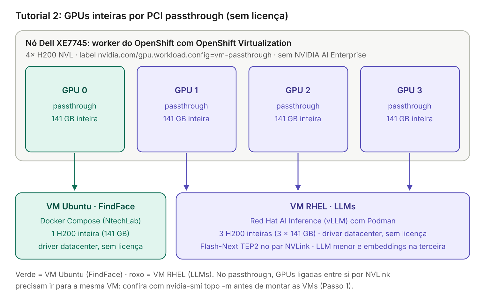
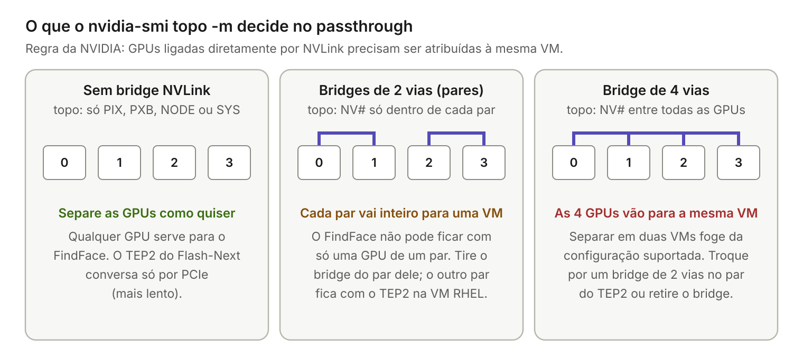

# Tutorial 2: H200 em duas VMs com GPUs inteiras (passthrough, sem licença)

Este tutorial prepara um servidor Dell PowerEdge XE7745 com 4× NVIDIA H200 NVL como **nó virtualizado** de um cluster OpenShift, com o **OpenShift Virtualization**, e entrega **GPUs inteiras** por PCI passthrough a duas VMs:

- **VM Ubuntu (FindFace):** 1 H200 inteira (141 GB).
- **VM RHEL (LLMs):** as outras 3 H200 inteiras.

O nó já nasce virtualizado: as GPUs nunca são usadas por pods, só pelas VMs. O tutorial mostra os dois jeitos de preparar o passthrough: pelo **NVIDIA GPU Operator** ou pelo **procedimento nativo do OpenShift Virtualization**, sem GPU Operator no nó.

O passthrough **não exige licença do NVIDIA AI Enterprise**: dentro das VMs roda o driver datacenter normal da NVIDIA. A contrapartida é que uma GPU não pode ser dividida entre VMs. Você ainda pode ligar o MIG **dentro** da VM Ubuntu e dividir a GPU dela em duas fatias, mas as duas ficam nessa mesma VM ([Passo 11.5](#115-opcional-dividir-a-gpu-da-vm-ubuntu-com-mig)). Para dar \~71 GB ao FindFace e o resto da mesma GPU à VM RHEL, é preciso vGPU: veja o [Tutorial 1](3.%20tutorial-vgpu-mig-vms.md).



## Índice

- [Visão geral](#visão-geral)
- [A regra do NVLink no passthrough](#a-regra-do-nvlink-no-passthrough)
- [Pré-requisitos](#pré-requisitos)
- [Drivers: o que baixar e quais versões combinar](#drivers-o-que-baixar-e-quais-versões-combinar)
- [Passo 1: BIOS do Dell](#passo-1-bios-do-dell)
- [Passo 2: pool de máquinas e IOMMU para o nó](#passo-2-pool-de-máquinas-e-iommu-para-o-nó)
- [Passo 3: escolher o caminho e instalar os operadores](#passo-3-escolher-o-caminho-e-instalar-os-operadores)
- [Passo 4: preparar as GPUs para passthrough](#passo-4-preparar-as-gpus-para-passthrough)
  - [4A. Caminho A: pelo GPU Operator](#4a-caminho-a-pelo-gpu-operator)
  - [4B. Caminho B: procedimento nativo do OpenShift Virtualization](#4b-caminho-b-procedimento-nativo-do-openshift-virtualization)
- [Passo 5: conferir as GPUs no nó](#passo-5-conferir-as-gpus-no-nó)
- [Passo 6: liberar as GPUs para as VMs](#passo-6-liberar-as-gpus-para-as-vms)
- [Passo 7: mapear o NVLink com `nvidia-smi topo -m` (VM de diagnóstico)](#passo-7-mapear-o-nvlink-com-nvidia-smi-topo--m-vm-de-diagnóstico)
- [Passo 8: criar as duas VMs](#passo-8-criar-as-duas-vms)
- [Passo 9: conferir qual GPU cada VM recebeu](#passo-9-conferir-qual-gpu-cada-vm-recebeu)
- [Passo 10: driver datacenter nas VMs](#passo-10-driver-datacenter-nas-vms)
- [Passo 11: VM Ubuntu (FindFace)](#passo-11-vm-ubuntu-findface)
- [Passo 12: VM RHEL (LLMs)](#passo-12-vm-rhel-llms)
- [Verificação final](#verificação-final)
- [Problemas comuns](#problemas-comuns)
- [Itens a validar](#itens-a-validar)
- [Referências](#referências)

## Visão geral

| Item | VM Ubuntu (FindFace) | VM RHEL (LLMs) |
| --- | --- | --- |
| Sistema | Ubuntu 24.04 | RHEL 9 |
| GPU entregue | 1 H200 inteira (141 GB) | 3 H200 inteiras (3 × 141 GB) |
| Workloads | FindFace Multi (Docker Compose, como a NtechLab suporta) | Exemplo: Qwen3.8-Flash-Next em TEP2 (tensor + expert parallel em 2 GPUs) no par NVLink; LLM menor e embeddings na terceira GPU |
| Driver na VM | Driver datacenter da NVIDIA, sem licença | Igual |
| Runtime de containers | Docker + NVIDIA Container Toolkit | Podman + NVIDIA Container Toolkit (CDI) |
| MIG | Opcional, **dentro** da VM: divide a GPU entre containers da própria VM | Não precisa |

## A regra do NVLink no passthrough

A NVIDIA exige que **todas as GPUs ligadas diretamente entre si por NVLink sejam atribuídas à mesma VM**. O tipo de bridge NVLink instalado no servidor decide se a divisão 1 + 3 é possível sem mexer no hardware:



| Bridge instalado | Situação | O que fazer |
| --- | --- | --- |
| Nenhum | Qualquer divisão é suportada | Siga o tutorial. O TEP2 se comunica só por PCIe, mais devagar |
| De 2 vias (pares, ex.: 0-1 e 2-3) | A VM Ubuntu não pode ficar com só uma GPU de um par | **Retire o bridge de um dos pares.** As duas GPUs desse par ficam soltas e uma delas vai para o FindFace; o outro par continua com NVLink e vai para o TEP2 na VM RHEL |
| De 4 vias (todas ligadas) | As 4 GPUs teriam de ir para a mesma VM | Troque por um bridge de 2 vias no par do TEP2, ou retire o bridge (o TEP2 fica só com PCIe) |

Para planejar antes de montar o servidor, confira o tipo de bridge na configuração de compra ou no inventário de hardware do iDRAC. A confirmação definitiva é o `nvidia-smi topo -m` do [Passo 7](#passo-7-mapear-o-nvlink-com-nvidia-smi-topo--m-vm-de-diagnóstico), rodado numa VM de diagnóstico. Como o nó nasce em passthrough, o host não tem driver NVIDIA para rodar esse comando.

## Pré-requisitos

| Item | Detalhe |
| --- | --- |
| OpenShift | Cluster 4.2x em funcionamento, com o Dell entrando como **worker bare metal** (RHCOS) |
| Acesso | `cluster-admin`, `oc`, `virtctl` e `jq` na estação de trabalho; `butane` no Caminho B |
| NVIDIA GPU Operator | Caminho A: versão atual, com suporte a `sandboxWorkloads` (VMs). Caminho B: não precisa |
| Licença NVIDIA | **Não precisa.** Driver datacenter nas VMs |
| RAM do servidor | Soma da RAM das duas VMs mais folga para o OpenShift. No exemplo, a VM RHEL usa 256 GiB, porque o vLLM deixa a tabela N-gram do Qwen3.8-Flash-Next (\~96 GiB) na RAM |

## Drivers: o que baixar e quais versões combinar

| Onde | Driver | De onde vem |
| --- | --- | --- |
| Host (nó Dell) | **Nenhum driver NVIDIA.** As GPUs ficam no `vfio-pci` | GPU Operator (Caminho A) ou `MachineConfig` (Caminho B), Passo 4 |
| VM Ubuntu | Driver datacenter de servidor (`ubuntu-drivers --gpgpu`) | Repositórios do Ubuntu, Passo 10.1 |
| VM RHEL | Driver datacenter com módulos abertos (`nvidia-open`), via DKMS | Repositório CUDA da NVIDIA, Passo 10.2 |
| VMs | NVIDIA Container Toolkit | Repositório da NVIDIA, Passos 11 e 12 |

Os drivers são públicos e não precisam de conta. Preencha a matriz antes de começar:

| Componente | Versão escolhida | Regra |
| --- | --- | --- |
| Driver datacenter nas VMs | | Branch que suporta a H200 NVL. Use o **mesmo branch** nas duas VMs, para simplificar a operação |
| CUDA das imagens (Red Hat AI Inference, FindFace) | | Não pode passar da *CUDA Version* que o `nvidia-smi` mostra dentro da VM |
| NVIDIA GPU Operator (Caminho A) | | Compatível com a versão do OpenShift |
| NVIDIA Container Toolkit | | Versão atual do repositório da NVIDIA |

## Passo 1: BIOS do Dell

No BIOS do XE7745 (AMD EPYC), ative:

- **IOMMU** (às vezes chamado AMD-Vi): sem ele não existe passthrough.
- **Above 4G Decoding:** a H200 expõe janelas de memória PCIe (BAR) muito grandes, e sem essa opção o passthrough costuma falhar.

## Passo 2: pool de máquinas e IOMMU para o nó

Crie um MachineConfigPool só para o Dell. Assim, as configurações dele não reiniciam os outros workers.

```yaml
apiVersion: machineconfiguration.openshift.io/v1
kind: MachineConfigPool
metadata:
  name: gpu-virt
spec:
  machineConfigSelector:
    matchExpressions:
      - key: machineconfiguration.openshift.io/role
        operator: In
        values: [worker, gpu-virt]
  nodeSelector:
    matchLabels:
      node-role.kubernetes.io/gpu-virt: ""
```

Argumentos de kernel do IOMMU (AMD):

```yaml
apiVersion: machineconfiguration.openshift.io/v1
kind: MachineConfig
metadata:
  name: 100-gpu-virt-iommu
  labels:
    machineconfiguration.openshift.io/role: gpu-virt
spec:
  config:
    ignition:
      version: 3.2.0
  kernelArguments:
    - amd_iommu=on
    - iommu=pt
```

```bash
oc apply -f mcp-gpu-virt.yaml -f mc-gpu-virt-iommu.yaml

# depois que o Dell entrar no cluster como worker
oc label node <no-dell> node-role.kubernetes.io/gpu-virt=
oc get mcp gpu-virt -w        # aguarde UPDATED=True (o nó reinicia)

# conferir
oc debug node/<no-dell> -- chroot /host sh -c 'cat /proc/cmdline; dmesg | grep -i -e AMD-Vi -e IOMMU | head'
```

## Passo 3: escolher o caminho e instalar os operadores

Há dois caminhos para ligar as GPUs ao `vfio-pci` e anunciá-las para as VMs. **Use um só no nó Dell**: misturar os dois gera conflito.

| | Caminho A: GPU Operator | Caminho B: nativo do OpenShift Virtualization |
| --- | --- | --- |
| Quem liga as GPUs ao `vfio-pci` | VFIO Manager do GPU Operator | `MachineConfig` gerado com Butane |
| Quem anuncia as GPUs para as VMs | Sandbox Device Plugin do GPU Operator | O próprio OpenShift Virtualization (`permittedHostDevices`) |
| GPU Operator | Obrigatório | Não precisa. Se já estiver instalado para outros nós, os operandos dele ficam **desligados** no Dell |
| Suporte | NVIDIA (GPU Operator) e Red Hat (OpenShift Virtualization) | Procedimento testado e suportado pela Red Hat |
| Quando escolher | O cluster já usa o GPU Operator e você quer gerenciar tudo por ele | Você quer menos componentes no nó, ou o cluster não tem GPU Operator |

Instale pelo catálogo de operadores do console do OpenShift e confira em *Installed Operators* se cada um fica `Succeeded`:

| Operador | Caminho A | Caminho B |
| --- | --- | --- |
| **OpenShift Virtualization**: crie o `HyperConverged` com os valores padrão | Sim | Sim |
| **Node Feature Discovery (NFD)**: crie uma `NodeFeatureDiscovery` com os valores padrão | Sim | Só se o GPU Operator for instalado por causa de outros nós |
| **NVIDIA GPU Operator**: **não crie a `ClusterPolicy` ainda**; ela vem no Passo 4A | Sim | Só se outros nós do cluster precisarem dele |

**Desligue o gerenciamento de *mediated devices* do OpenShift Virtualization** sempre que o GPU Operator estiver instalado no cluster: no Caminho A, ou no Caminho B quando o GPU Operator existir por causa de outros nós. A NVIDIA coloca esse passo nos pré-requisitos gerais do GPU Operator com OpenShift Virtualization (passthrough e vGPU), para evitar conflito entre os dois. Num cluster sem GPU Operator, pule este trecho. O `HyperConverged` é explicado no [Passo 6](#passo-6-liberar-as-gpus-para-as-vms). Descubra a versão do OpenShift Virtualization e use o comando correspondente:

```bash
oc get csv -n openshift-cnv | grep kubevirt-hyperconverged
```

**OpenShift Virtualization 4.23 ou superior:**

```bash
oc patch hyperconverged -n openshift-cnv kubevirt-hyperconverged --type='merge' \
  -p='{"spec":{"virtualization":{"mediatedDevicesConfiguration":{"enabled": false}}}}'

# conferir: deve mostrar false
oc get hyperconverged kubevirt-hyperconverged -n openshift-cnv \
  -o jsonpath='{.spec.virtualization.mediatedDevicesConfiguration.enabled}{"\n"}'
```

**OpenShift Virtualization 4.22.x** (com o nome completo e versionado do recurso, como pede a NVIDIA):

```bash
oc patch hyperconvergeds.v1beta1.hco.kubevirt.io -n openshift-cnv kubevirt-hyperconverged --type='json' \
  -p='[{"op": "add", "path": "/spec/featureGates/disableMDevConfiguration", "value": true}]'

# conferir: deve mostrar true
oc get hyperconvergeds.v1beta1.hco.kubevirt.io kubevirt-hyperconverged -n openshift-cnv \
  -o jsonpath='{.spec.featureGates.disableMDevConfiguration}{"\n"}'
```

**Versões anteriores à 4.22:**

```bash
oc patch hyperconverged -n openshift-cnv kubevirt-hyperconverged --type='json' \
  -p='[{"op": "add", "path": "/spec/featureGates/disableMDevConfiguration", "value": true}]'
```

## Passo 4: preparar as GPUs para passthrough

Siga **só** a subseção do caminho escolhido no Passo 3.

### 4A. Caminho A: pelo GPU Operator

Rotule o nó **antes** de criar a `ClusterPolicy`. Assim, o GPU Operator nunca instala no Dell o driver de containers:

```bash
oc label node <no-dell> --overwrite nvidia.com/gpu.workload.config=vm-passthrough
```

Crie a `ClusterPolicy` pelo console (*NVIDIA GPU Operator → ClusterPolicy → Create*), mantenha os valores padrão e, na visão YAML, ajuste estes campos:

```yaml
spec:
  sandboxWorkloads:
    enabled: true
    defaultWorkload: container        # outros nós de GPU, se houver, continuam com pods
  sandboxDevicePlugin:
    enabled: true
  vfioManager:
    enabled: true
```

No Dell, o GPU Operator liga as GPUs ao `vfio-pci` (VFIO Manager) e as anuncia para as VMs (Sandbox Device Plugin).

### 4B. Caminho B: procedimento nativo do OpenShift Virtualization

Neste caminho, um `MachineConfig` faz o kernel do nó entregar as GPUs ao `vfio-pci` já no boot, e o OpenShift Virtualization anuncia as GPUs sozinho (Passo 6). Precisa do `butane` na estação de trabalho, para gerar o `MachineConfig`.

**4B.1 Se o GPU Operator estiver instalado no cluster,** desligue os operandos dele no Dell **antes** de qualquer outra coisa. Assim o nó nunca recebe driver, device plugin nem VFIO Manager do GPU Operator:

```bash
oc label node <no-dell> --overwrite nvidia.com/gpu.deploy.operands=false

# conferir: nenhum pod do GPU Operator no nó (espere os Terminating sumirem)
oc get pods -n nvidia-gpu-operator -o wide | grep <no-dell>
```

Não use o label `nvidia.com/gpu.workload.config` no Caminho B.

**4B.2 Descobrir o ID da GPU** (fabricante:dispositivo):

```bash
oc debug node/<no-dell> -- chroot /host lspci -nnv | grep -i nvidia
# exemplo: ... NVIDIA Corporation GH100 [H200 NVL] [10de:XXXX]
#   10de = fabricante (NVIDIA), XXXX = dispositivo (H200 NVL)
```

**4B.3 Gerar o `MachineConfig` que liga as GPUs ao `vfio-pci`.** Crie o arquivo `100-gpu-virt-vfiopci.bu`. O campo `version` é a versão do seu OpenShift terminada em `0` (ex.: `4.22.0`), e o label de papel é o pool `gpu-virt` do Passo 2, para só o Dell receber a configuração:

```yaml
variant: openshift
version: 4.22.0
metadata:
  name: 100-gpu-virt-vfiopci
  labels:
    machineconfiguration.openshift.io/role: gpu-virt
storage:
  files:
    - path: /etc/modprobe.d/vfio.conf
      mode: 0644
      overwrite: true
      contents:
        inline: |
          options vfio-pci ids=10de:XXXX
    - path: /etc/modules-load.d/vfio-pci.conf
      mode: 0644
      overwrite: true
      contents:
        inline: vfio-pci
```

- `/etc/modprobe.d/vfio.conf` diz ao `vfio-pci` para assumir os dispositivos com esse ID: as 4 H200, porque são iguais.
- `/etc/modules-load.d/vfio-pci.conf` carrega o módulo `vfio-pci` no boot.

```bash
butane 100-gpu-virt-vfiopci.bu -o 100-gpu-virt-vfiopci.yaml
oc apply -f 100-gpu-virt-vfiopci.yaml
oc get mcp gpu-virt -w        # aguarde UPDATED=True (o nó reinicia)
```

**4B.4 Se outro driver pegar as GPUs antes do `vfio-pci`.** No Passo 5, se o `lspci` mostrar `Kernel driver in use: nouveau`, bloqueie o `nouveau` com outro `MachineConfig` e aguarde o nó reiniciar de novo. O bloqueio vale para todos os dispositivos daquele driver no host, o que aqui não é problema: o host não usa as GPUs.

```yaml
variant: openshift
version: 4.22.0
metadata:
  name: 100-gpu-virt-blacklist-nouveau
  labels:
    machineconfiguration.openshift.io/role: gpu-virt
openshift:
  kernel_arguments:
    - rd.driver.blacklist=nouveau
    - modprobe.blacklist=nouveau
storage:
  files:
    - path: /etc/modprobe.d/blacklist-nouveau.conf
      mode: 0644
      overwrite: true
      contents:
        inline: |
          blacklist nouveau
```

```bash
butane 100-gpu-virt-blacklist-nouveau.bu -o 100-gpu-virt-blacklist-nouveau.yaml
oc apply -f 100-gpu-virt-blacklist-nouveau.yaml
oc get mcp gpu-virt -w
```

## Passo 5: conferir as GPUs no nó

Nos dois caminhos, as 4 GPUs precisam estar com o driver `vfio-pci`:

```bash
oc debug node/<no-dell> -- chroot /host lspci -nnk -d 10de:
#   ... NVIDIA Corporation GH100 [H200 NVL] [10de:XXXX]
#   Kernel driver in use: vfio-pci
```

**Caminho A:** confira os pods do GPU Operator e o recurso que ele anuncia (anote o nome exato e o ID `10de:XXXX`):

```bash
oc get pods -n nvidia-gpu-operator -o wide | grep <no-dell>
# esperados: nvidia-vfio-manager, nvidia-sandbox-device-plugin-daemonset, nvidia-sandbox-validator

oc get node <no-dell> -o json | jq '.status.allocatable | with_entries(select(.key|startswith("nvidia.com/")))'
# esperado algo como: "nvidia.com/GH100_H200_NVL": "4"
```

**Caminho B:** nenhum pod do GPU Operator no nó. O recurso só aparece depois do Passo 6, com o nome que você escolher lá.

## Passo 6: liberar as GPUs para as VMs

O **HyperConverged** é o objeto de configuração principal do OpenShift Virtualization: um único recurso, `kubevirt-hyperconverged`, no namespace `openshift-cnv`. Edite pela CLI ou pelo console:

```bash
oc edit hyperconverged kubevirt-hyperconverged -n openshift-cnv
```

Console: *Operators → Installed Operators → OpenShift Virtualization → OpenShift Virtualization Deployment → kubevirt-hyperconverged → YAML*.

Em `spec.permittedHostDevices.pciHostDevices`, use o ID do Passo 4 ou 5 (`pciDeviceSelector` é o par fabricante:dispositivo):

**Caminho A** (quem anuncia é o GPU Operator; use o nome que o nó já mostra):

```yaml
spec:
  permittedHostDevices:
    pciHostDevices:
      - pciDeviceSelector: "10DE:XXXX"
        resourceName: "nvidia.com/GH100_H200_NVL"   # nome anunciado pelo nó no Passo 5
        externalResourceProvider: true             # quem anuncia é o GPU Operator
```

**Caminho B** (quem anuncia é o OpenShift Virtualization; o nome é escolhido por você):

```yaml
spec:
  permittedHostDevices:
    pciHostDevices:
      - pciDeviceSelector: "10DE:XXXX"
        resourceName: "nvidia.com/GH100_H200_NVL"   # mesmo nome usado nas VMs dos Passos 7 e 8
```

No Caminho B, **não** coloque `externalResourceProvider: true`: esse campo diz ao OpenShift Virtualization que outro componente anuncia os dispositivos.

Confira, nos dois caminhos:

```bash
oc describe node <no-dell> | grep -A1 -i "nvidia.com/GH100_H200_NVL"
# Capacity e Allocatable devem mostrar 4
```

O nome `nvidia.com/GH100_H200_NVL` é o que as VMs usam em `deviceName` nos Passos 7 e 8. Se trocar o nome aqui, troque nas VMs também.

## Passo 7: mapear o NVLink com `nvidia-smi topo -m` (VM de diagnóstico)

Como o host não tem driver NVIDIA, a topologia é lida de dentro de uma VM temporária que recebe **as 4 GPUs**. No passthrough, o guest enxerga o NVLink.

**7.1 Criar a VM de diagnóstico:**

```yaml
apiVersion: kubevirt.io/v1
kind: VirtualMachine
metadata:
  name: vm-diag-gpu
  namespace: gpu-diag
spec:
  runStrategy: Halted
  dataVolumeTemplates:
    - metadata:
        name: vm-diag-gpu-root
      spec:
        sourceRef:
          kind: DataSource
          name: rhel9
          namespace: openshift-virtualization-os-images
        storage:
          resources:
            requests:
              storage: 60Gi
  template:
    spec:
      nodeSelector:
        kubernetes.io/hostname: <no-dell>
      domain:
        cpu:
          cores: 4
        memory:
          guest: 16Gi
        firmware:
          bootloader:
            efi:
              secureBoot: false
        devices:
          hostDevices:
            - { name: gpu0, deviceName: nvidia.com/GH100_H200_NVL }
            - { name: gpu1, deviceName: nvidia.com/GH100_H200_NVL }
            - { name: gpu2, deviceName: nvidia.com/GH100_H200_NVL }
            - { name: gpu3, deviceName: nvidia.com/GH100_H200_NVL }
          disks:
            - name: rootdisk
              disk: { bus: virtio }
            - name: cloudinit
              disk: { bus: virtio }
          interfaces:
            - name: default
              masquerade: {}
      networks:
        - name: default
          pod: {}
      volumes:
        - name: rootdisk
          dataVolume:
            name: vm-diag-gpu-root
        - name: cloudinit
          cloudInitNoCloud:
            userData: |
              #cloud-config
              user: cloud-user
              ssh_authorized_keys:
                - <sua-chave-publica>
```

```bash
oc new-project gpu-diag
oc apply -f vm-diag-gpu.yaml
virtctl start vm-diag-gpu -n gpu-diag
virtctl ssh cloud-user@vm-diag-gpu -n gpu-diag
```

**7.2 Instalar o driver** seguindo o [Passo 10.2](#102-vm-rhel) e rodar:

```bash
nvidia-smi topo -m
nvidia-smi --query-gpu=index,pci.bus_id,uuid,serial --format=csv
```

Exemplo de saída com bridges de 2 vias (ilustrativo; a sua depende do bridge e dos slots):

```text
        GPU0    GPU1    GPU2    GPU3
GPU0     X      NV18    SYS     SYS
GPU1    NV18     X      SYS     SYS
GPU2    SYS     SYS      X      NV18
GPU3    SYS     SYS     NV18     X
```

| Valor na matriz | Significado |
| --- | --- |
| `NV#` (ex.: `NV18`) | As duas GPUs estão ligadas por NVLink; o número é a quantidade de links |
| `PIX`, `PXB` | Ligadas só por PCIe, passando por um ou mais switches PCIe |
| `PHB`, `NODE`, `SYS` | Ligadas só por PCIe, passando pela CPU (no mesmo socket ou entre sockets) |

Dentro da VM, a coluna `PCI Bus ID` mostra endereços virtuais. Para identificar as GPUs físicas, use o **UUID** e o **serial**, que são os mesmos no host e em qualquer VM.

**7.3 Decidir e anotar.** Use a tabela da seção [A regra do NVLink no passthrough](#a-regra-do-nvlink-no-passthrough). Se precisar mexer em bridges, desligue o servidor (drene o nó antes), faça a troca e repita o 7.2. No fim, anote:

- os **UUIDs** das GPUs que podem ir para a VM Ubuntu (as que ficaram sem `NV#`);
- os **UUIDs** do par com `NV#`, que precisa ficar inteiro na VM RHEL.

**7.4 Apagar a VM de diagnóstico,** para liberar as GPUs:

```bash
oc delete project gpu-diag
```

## Passo 8: criar as duas VMs

GPUs em passthrough entram em `spec.template.spec.domain.devices.hostDevices`. A VM precisa estar **parada** para receber ou trocar GPUs. Ajuste CPU, memória e disco ao seu dimensionamento.

**VM Ubuntu (FindFace)**, com 1 GPU:

```yaml
apiVersion: kubevirt.io/v1
kind: VirtualMachine
metadata:
  name: vm-findface
  namespace: findface-vm
spec:
  runStrategy: Halted
  dataVolumeTemplates:
    - metadata:
        name: vm-findface-root
      spec:
        source:
          registry:
            url: docker://quay.io/containerdisks/ubuntu:24.04
        storage:
          resources:
            requests:
              storage: 300Gi          # cache e dados do FindFace
  template:
    spec:
      nodeSelector:
        kubernetes.io/hostname: <no-dell>
      domain:
        cpu:
          cores: 16                   # conforme o dimensionamento da NtechLab
        memory:
          guest: 64Gi
        firmware:
          bootloader:
            efi:
              secureBoot: false       # o driver da NVIDIA é compilado na VM (módulo não assinado)
        devices:
          hostDevices:
            - name: gpu-findface
              deviceName: nvidia.com/GH100_H200_NVL
          disks:
            - name: rootdisk
              disk: { bus: virtio }
            - name: cloudinit
              disk: { bus: virtio }
          interfaces:
            - name: default
              masquerade: {}
      networks:
        - name: default
          pod: {}
      volumes:
        - name: rootdisk
          dataVolume:
            name: vm-findface-root
        - name: cloudinit
          cloudInitNoCloud:
            userData: |
              #cloud-config
              user: ubuntu
              ssh_authorized_keys:
                - <sua-chave-publica>
```

**VM RHEL (LLMs)**, com 3 GPUs:

```yaml
apiVersion: kubevirt.io/v1
kind: VirtualMachine
metadata:
  name: vm-llms
  namespace: llms-vm
spec:
  runStrategy: Halted
  dataVolumeTemplates:
    - metadata:
        name: vm-llms-root
      spec:
        sourceRef:
          kind: DataSource
          name: rhel9
          namespace: openshift-virtualization-os-images
        storage:
          resources:
            requests:
              storage: 1Ti            # pesos dos modelos (o Flash-Next FP8 tem ~173 GiB)
  template:
    spec:
      nodeSelector:
        kubernetes.io/hostname: <no-dell>
      domain:
        cpu:
          cores: 32
        memory:
          guest: 256Gi                # ~96 GiB só para a tabela N-gram do Flash-Next
        firmware:
          bootloader:
            efi:
              secureBoot: false
        devices:
          hostDevices:
            - name: gpu-a
              deviceName: nvidia.com/GH100_H200_NVL
            - name: gpu-b
              deviceName: nvidia.com/GH100_H200_NVL
            - name: gpu-c
              deviceName: nvidia.com/GH100_H200_NVL
          disks:
            - name: rootdisk
              disk: { bus: virtio }
            - name: cloudinit
              disk: { bus: virtio }
          interfaces:
            - name: default
              masquerade: {}
      networks:
        - name: default
          pod: {}
      volumes:
        - name: rootdisk
          dataVolume:
            name: vm-llms-root
        - name: cloudinit
          cloudInitNoCloud:
            userData: |
              #cloud-config
              user: cloud-user
              ssh_authorized_keys:
                - <sua-chave-publica>
```

```bash
oc new-project findface-vm; oc new-project llms-vm
oc apply -f vm-findface.yaml -f vm-llms.yaml
virtctl start vm-llms -n llms-vm
virtctl start vm-findface -n findface-vm
oc get vmi -A -o wide
```

## Passo 9: conferir qual GPU cada VM recebeu

As 4 GPUs são anunciadas com o **mesmo nome de recurso**, e o spec da VM não permite escolher a GPU física. Por isso, depois de instalar o driver (Passo 10), confira em cada VM:

```bash
nvidia-smi --query-gpu=index,uuid,serial --format=csv
nvidia-smi topo -m
```

Compare os UUIDs com os anotados no Passo 7:

- A VM Ubuntu precisa ter recebido uma GPU **sem** `NV#` com as outras.
- O par com `NV#` precisa estar **inteiro** na VM RHEL. Dentro dela, o `nvidia-smi topo -m` também mostra o `NV#` entre as duas.

**Quando a escolha muda:** se só uma VM reinicia, ela recebe de volta as GPUs que ficaram livres, que são as mesmas de antes. A escolha só é refeita quando as duas VMs sobem juntas, por exemplo depois de um reboot do nó. Se a distribuição vier errada, pare as duas VMs, suba de novo e confira. Inclua essa conferência no procedimento pós-manutenção do nó.

> Sem nenhum bridge NVLink, qualquer distribuição serve e este passo vira só uma conferência.

## Passo 10: driver datacenter nas VMs

### 10.1 VM Ubuntu

Acesse com `virtctl ssh ubuntu@vm-findface -n findface-vm` (ou `virtctl console`).

```bash
sudo apt-get update
sudo ubuntu-drivers list --gpgpu                  # drivers de servidor disponíveis
sudo ubuntu-drivers install --gpgpu nvidia:<branch>-server-open
sudo apt-get install -y nvidia-utils-<branch>-server
sudo reboot

nvidia-smi       # 1 GPU "NVIDIA H200 NVL" com ~141 GB; anote a "CUDA Version"
dkms status      # o módulo nvidia deve aparecer: ele é recompilado a cada kernel novo
```

### 10.2 VM RHEL

Acesse com `virtctl ssh cloud-user@vm-llms -n llms-vm` (ou a VM de diagnóstico do Passo 7). Siga o *NVIDIA Driver Installation Guide* para RHEL 9; os nomes dos pacotes mudam entre branches. Em linhas gerais:

```bash
sudo subscription-manager register        # ou chave de ativação
sudo subscription-manager repos --enable codeready-builder-for-rhel-9-x86_64-rpms
sudo dnf install -y https://dl.fedoraproject.org/pub/epel/epel-release-latest-9.noarch.rpm   # dkms
sudo dnf install -y kernel-devel-matched kernel-headers

sudo dnf config-manager --add-repo \
  https://developer.download.nvidia.com/compute/cuda/repos/rhel9/x86_64/cuda-rhel9.repo
sudo dnf install -y nvidia-open           # módulos abertos (recomendados para Hopper), via DKMS
sudo reboot

nvidia-smi --query-gpu=index,name,memory.total,uuid --format=csv
# GPUs "NVIDIA H200 NVL" com ~141 GB cada: 4 na VM de diagnóstico, 3 na VM RHEL
dkms status
```

O pacote do repositório CUDA bloqueia o `nouveau` e usa DKMS. Com isso, o driver é recompilado quando o kernel é atualizado.

## Passo 11: VM Ubuntu (FindFace)

**11.1 Driver:** [Passo 10.1](#101-vm-ubuntu).

**11.2 Docker e NVIDIA Container Toolkit:**

```bash
# Docker Engine (repositório oficial; use a versão exigida pela NtechLab, se houver)
sudo install -m 0755 -d /etc/apt/keyrings
sudo curl -fsSL https://download.docker.com/linux/ubuntu/gpg -o /etc/apt/keyrings/docker.asc
echo "deb [arch=$(dpkg --print-architecture) signed-by=/etc/apt/keyrings/docker.asc] https://download.docker.com/linux/ubuntu $(. /etc/os-release && echo $VERSION_CODENAME) stable" \
  | sudo tee /etc/apt/sources.list.d/docker.list
sudo apt-get update
sudo apt-get install -y docker-ce docker-ce-cli containerd.io docker-compose-plugin

# NVIDIA Container Toolkit
curl -fsSL https://nvidia.github.io/libnvidia-container/gpgkey \
  | sudo gpg --dearmor -o /usr/share/keyrings/nvidia-container-toolkit-keyring.gpg
curl -s -L https://nvidia.github.io/libnvidia-container/stable/deb/nvidia-container-toolkit.list \
  | sed 's#deb https://#deb [signed-by=/usr/share/keyrings/nvidia-container-toolkit-keyring.gpg] https://#g' \
  | sudo tee /etc/apt/sources.list.d/nvidia-container-toolkit.list
sudo apt-get update && sudo apt-get install -y nvidia-container-toolkit
sudo nvidia-ctk runtime configure --runtime=docker
sudo systemctl restart docker

sudo docker run --rm --gpus all ubuntu nvidia-smi
```

**11.3 Conferir a GPU recebida:** [Passo 9](#passo-9-conferir-qual-gpu-cada-vm-recebeu).

**11.4 FindFace.** Instale o FindFace Multi com o instalador e o Docker Compose da NtechLab. Nos serviços de GPU (`findface-extraction-api` e `findface-video-worker`), garanta o acesso à GPU, por exemplo:

```yaml
services:
  findface-extraction-api:
    deploy:
      resources:
        reservations:
          devices:
            - driver: nvidia
              count: all
              capabilities: [gpu]
```

Confirme com a NtechLab o suporte a H200 (Hopper) e se o CUDA das imagens do FindFace cabe na *CUDA Version* do driver.

### 11.5 (Opcional) Dividir a GPU da VM Ubuntu com MIG

A NVIDIA suporta MIG em GPU entregue por passthrough a um guest Linux, e isso não exige licença. As duas fatias ficam **nesta VM**: servem para limitar o FindFace a \~71 GB e usar a outra metade com outro serviço da própria VM Ubuntu. **Não** é possível passar uma fatia para a VM RHEL sem vGPU.

```bash
sudo nvidia-smi -i 0 -mig 1                       # pode exigir reboot da VM
sudo nvidia-smi mig -i 0 -cgi 3g.71gb,4g.71gb -C  # 3g.71gb (FindFace) + 4g.71gb (outro serviço)
nvidia-smi -L                                     # UUIDs das fatias (MIG-...)
```

No compose, aponte cada serviço para a sua fatia, com `device_ids: ["MIG-<uuid>"]` no lugar de `count: all`. As fatias não persistem após reboot: recrie-as com um serviço systemd que rode antes do Docker subir os containers.

## Passo 12: VM RHEL (LLMs)

**12.1 Driver:** [Passo 10.2](#102-vm-rhel). Instale também o Podman:

```bash
sudo dnf install -y podman
```

**12.2 Conferir a GPU recebida:** [Passo 9](#passo-9-conferir-qual-gpu-cada-vm-recebeu).

**12.3 `nvidia-smi topo -m` dentro da VM.** Os índices dentro da VM **não** são os do host: use esta matriz para escolher o par do TEP2.

```bash
nvidia-smi topo -m
```

- Par do TEP2: as duas GPUs com `NV#` entre elas.
- A terceira GPU fica para o LLM menor e os embeddings.
- Se nenhum par mostrar `NV#` e o servidor tem bridge, volte ao Passo 9: o par NVLink pode ter sido separado entre as VMs.

**12.4 NVIDIA Container Toolkit com CDI (Podman):**

```bash
curl -s -L https://nvidia.github.io/libnvidia-container/stable/rpm/nvidia-container-toolkit.repo \
  | sudo tee /etc/yum.repos.d/nvidia-container-toolkit.repo
sudo dnf install -y nvidia-container-toolkit
sudo nvidia-ctk cdi generate --output=/etc/cdi/nvidia.yaml
nvidia-ctk cdi list           # nvidia.com/gpu=0..2 e nvidia.com/gpu=all
```

Gere o CDI de novo sempre que o driver for atualizado.

**12.5 Red Hat AI Inference.** Exemplo com o par do TEP2 nas GPUs `0` e `1` da VM e a terceira na GPU `2`; troque pelos índices do 12.3. Antes, confirme duas coisas:

- A versão do vLLM da imagem suporta o modelo. A receita do vLLM para o Qwen3.8-Flash-Next pede 0.30.0 ou superior.
- O CUDA da imagem cabe na *CUDA Version* do driver (matriz de versões).

```bash
podman login registry.redhat.io

# Qwen3.8-Flash-Next em TEP2 no par NVLink
sudo podman run -d --name flashnext \
  --device nvidia.com/gpu=0 --device nvidia.com/gpu=1 \
  --security-opt=label=disable --shm-size=16g -p 8000:8000 \
  -v /var/lib/models:/models:Z \
  registry.redhat.io/rhaii/vllm-cuda-rhel9:<versao> \
  --model /models/Qwen3.8-Flash-Next-FP8 \
  --tensor-parallel-size 2 --enable-expert-parallel \
  --gpu-memory-utilization 0.90

# LLM menor ou embeddings na terceira GPU
sudo podman run -d --name llm-menor \
  --device nvidia.com/gpu=2 \
  --security-opt=label=disable --shm-size=8g -p 8001:8000 \
  -v /var/lib/models:/models:Z \
  registry.redhat.io/rhaii/vllm-cuda-rhel9:<versao> \
  --model /models/<modelo-menor> \
  --gpu-memory-utilization 0.90
```

**Para subir no boot,** transforme cada container num serviço Quadlet, por exemplo `/etc/containers/systemd/flashnext.container`:

```ini
[Container]
Image=registry.redhat.io/rhaii/vllm-cuda-rhel9:<versao>
AddDevice=nvidia.com/gpu=0
AddDevice=nvidia.com/gpu=1
SecurityLabelDisable=true
ShmSize=16g
PublishPort=8000:8000
Volume=/var/lib/models:/models:Z
Exec=--model /models/Qwen3.8-Flash-Next-FP8 --tensor-parallel-size 2 --enable-expert-parallel --gpu-memory-utilization 0.90

[Service]
Restart=always

[Install]
WantedBy=multi-user.target
```

```bash
sudo systemctl daemon-reload && sudo systemctl start flashnext
```

## Verificação final

- [ ] `nvidia-smi topo -m` da VM de diagnóstico (Passo 7) mostra a topologia esperada, depois de qualquer ajuste de bridge.
- [ ] Gerenciamento de *mediated devices* do OpenShift Virtualization desligado, se o GPU Operator estiver instalado (Passo 3).
- [ ] Só um caminho no nó Dell: Caminho A com `nvidia.com/gpu.workload.config=vm-passthrough`, ou Caminho B com o `MachineConfig` do `vfio-pci` (e `nvidia.com/gpu.deploy.operands=false` se houver GPU Operator).
- [ ] As 4 GPUs com `Kernel driver in use: vfio-pci` no nó (Passo 5).
- [ ] VM Ubuntu com uma GPU sem NVLink para as outras (UUID do Passo 7).
- [ ] VM RHEL com o par NVLink inteiro (`NV#` no `nvidia-smi topo -m` da VM).
- [ ] `dkms status` lista o módulo `nvidia` nas duas VMs.
- [ ] `curl http://<ip-vm-llms>:8000/v1/models` e `:8001/v1/models` respondem.
- [ ] FindFace processando com carga real.

## Problemas comuns

| Sintoma | Causa provável | O que fazer |
| --- | --- | --- |
| Pods do GPU Operator para containers (driver, device plugin) no nó Dell | Caminho A: nó rotulado depois da `ClusterPolicy`, ou label errado. Caminho B: faltou `nvidia.com/gpu.deploy.operands=false` | Confira o label do caminho escolhido (Passo 4) |
| Caminho B: `lspci` mostra `nouveau` em vez de `vfio-pci` | O `nouveau` pegou as GPUs antes | Passo 4B.4 |
| Caminho B: `Allocatable` sem o recurso ou com 0 | `pciDeviceSelector` errado, ou GPUs fora do `vfio-pci` | Compare o ID do `lspci` com o `HyperConverged`; confira o Passo 5 |
| VM `Pending` ou erro "insufficient nvidia.com/..." | `deviceName` da VM diferente do `resourceName`, ou `externalResourceProvider` no caminho errado (`true` só no Caminho A) | Compare o Passo 6 com as VMs |
| GPU aparece no `lspci` da VM, mas o driver falha (erros de BAR/MMIO no `dmesg`) | Janela de memória PCIe grande demais para a VM | Confirme Above 4G Decoding no BIOS e firmware UEFI na VM; se persistir, consulte a Red Hat sobre a janela MMIO de 64 bits para GPUs com BAR grande |
| Driver não carrega na VM | Secure Boot ligado ou `nouveau` carregado | `secureBoot: false`; confira `lsmod \| grep nouveau` |
| GPU some da VM depois de atualizar o kernel | Driver sem DKMS | Confira `dkms status`; reinstale pelo Passo 10 |
| Container falha com erro de versão CUDA | CUDA da imagem maior que a *CUDA Version* do driver | Use uma imagem compatível ou atualize o driver |
| Par NVLink separado entre as VMs | As duas VMs subiram juntas e a escolha das GPUs mudou | Passo 9: pare as duas, suba de novo e confira os UUIDs |
| `nvidia-smi` não roda no nó Dell | Esperado: as GPUs estão no `vfio-pci` | Use o `nvidia-smi` dentro das VMs |

## Itens a validar

| Item | Por quê |
| --- | --- |
| Tipo de bridge NVLink do XE7745 | Define se a divisão 1 + 3 é suportada sem mexer no hardware |
| Desempenho do TEP2 dentro da VM | Medir com e sem NVLink, se for preciso retirar bridges |
| FindFace em H200 dentro de VM | A NtechLab recomenda L4 (Ada); validar o suporte a Hopper |
| vLLM da imagem do Red Hat AI Inference com o modelo escolhido | Arquiteturas novas exigem vLLM recente |

## Referências

- [NVIDIA vGPU: Using GPU Pass-Through](https://docs.nvidia.com/vgpu/latest/grid-vgpu-user-guide/using-gpu-pass-through.html) (regra de NVLink na mesma VM)
- [NVIDIA GPU Operator com OpenShift Virtualization](https://docs.nvidia.com/datacenter/cloud-native/openshift/latest/openshift-virtualization.html) (pré-requisitos: IOMMU e *mediated devices*)
- [GPU Operator com KubeVirt](https://docs.nvidia.com/datacenter/cloud-native/gpu-operator/latest/gpu-operator-kubevirt.html)
- [OKD 4.21: Configuring PCI passthrough](https://docs.okd.io/4.21/virt/managing_vms/advanced_vm_management/virt-configuring-pci-passthrough.html) (Caminho B: bind no VFIO, `permittedHostDevices` e `nvidia.com/gpu.deploy.operands=false`)
- [OpenShift 4.22: Adding kernel arguments to enable the IOMMU driver](https://docs.redhat.com/ko/documentation/openshift_container_platform/4.22/html/virtualization/virt-adding-kernel-arguments-enable-iommu_virt-configuring-pci-passthrough)
- [OKD 4.22: Configuring virtual GPUs](https://docs.okd.io/4.22/virt/managing_vms/advanced_vm_management/virt-configuring-virtual-gpus.html)
- [MIG: configurações suportadas](https://docs.nvidia.com/datacenter/tesla/mig-user-guide/latest/supported-configurations.html)
- [Perfis MIG suportados](https://docs.nvidia.com/datacenter/tesla/mig-user-guide/latest/supported-mig-profiles.html)
- [NVIDIA Container Toolkit: instalação](https://docs.nvidia.com/datacenter/cloud-native/container-toolkit/latest/install-guide.html)
- [Red Hat AI Inference: ambientes suportados](https://docs.redhat.com/en/documentation/red_hat_ai/3/html/supported_product_and_hardware_configurations/rhaiis-supported-deployment-environments_supported-configurations)
- [Receita do vLLM para o Qwen3.8-Flash-Next](https://recipes.vllm.ai/Qwen/Qwen3.8-Flash-Next)
