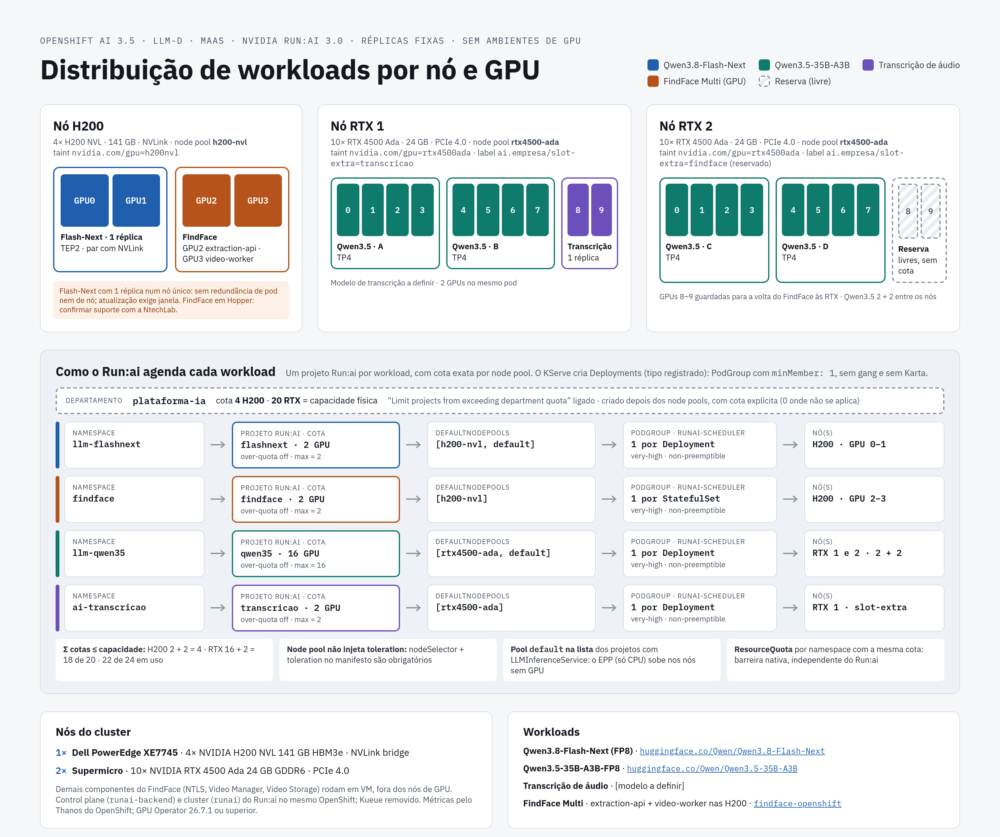
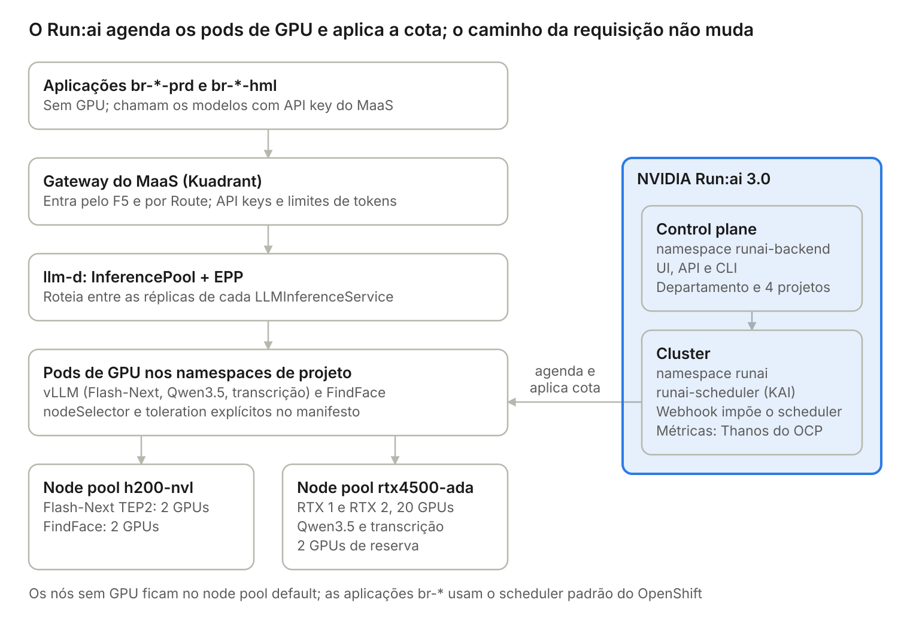

# Plataforma de IA no OpenShift AI 3.5, com NVIDIA Run:ai

## Índice

- [Como usar este documento](#como-usar-este-documento)
  - [Diagrama da arquitetura](#diagrama-da-arquitetura)
  - [O Run:ai self-hosted instala com Helm?](#o-runai-self-hosted-instala-com-helm)
  - [Run:ai e o Red Hat build of Kueue](#runai-e-o-red-hat-build-of-kueue)
- [Parte 1 – Arquitetura](#parte-1--arquitetura)
  - [1. Resumo das decisões](#1-resumo-das-decisões)
  - [2. Componentes](#2-componentes)
    - [2.1 Entrada de tráfego: F5 e Routes, sem MetalLB](#21-entrada-de-tráfego-f5-e-routes-sem-metallb)
  - [3. Dimensionamento](#3-dimensionamento)
  - [4. Distribuição das GPUs](#4-distribuição-das-gpus)
  - [5. Run:ai no desenho](#5-runai-no-desenho)
    - [5.1 Objetos](#51-objetos)
    - [5.2 Por que um projeto por workload](#52-por-que-um-projeto-por-workload)
    - [5.3 Restrições que moldam o desenho](#53-restrições-que-moldam-o-desenho)
    - [5.4 Taints, labels e manifestos explícitos](#54-taints-labels-e-manifestos-explícitos)
    - [5.5 Preparação para frações de GPU](#55-preparação-para-frações-de-gpu)
  - [6. Consumidores: projetos `br-*-prd` e `br-*-hml`](#6-consumidores-projetos-br--prd-e-br--hml)
  - [7. Decisões de operação](#7-decisões-de-operação)
  - [8. Riscos e itens a validar](#8-riscos-e-itens-a-validar)
  - [9. Fora da produção por enquanto](#9-fora-da-produção-por-enquanto)
- [Parte 2 – Implantação passo a passo](#parte-2--implantação-passo-a-passo)
  - [Bloco A – Plataforma](#bloco-a--plataforma)
    - [Etapa 1: verificações iniciais](#etapa-1-verificações-iniciais)
    - [Etapa 2: GPUs (NFD + NVIDIA GPU Operator)](#etapa-2-gpus-nfd--nvidia-gpu-operator)
    - [Etapa 3: User Workload Monitoring](#etapa-3-user-workload-monitoring)
    - [Etapa 4: cert-manager e LeaderWorkerSet](#etapa-4-cert-manager-e-leaderworkerset)
    - [Etapa 5: NVIDIA Run:ai](#etapa-5-nvidia-runai)
    - [Etapa 6: Red Hat Connectivity Link](#etapa-6-red-hat-connectivity-link)
    - [Etapa 7: OpenShift AI](#etapa-7-openshift-ai)
    - [Etapa 8: gateways e MaaS](#etapa-8-gateways-e-maas)
  - [Bloco B – Isolamento e cotas](#bloco-b--isolamento-e-cotas)
    - [Etapa 9: taints, labels, namespaces, cotas e Run:ai](#etapa-9-taints-labels-namespaces-cotas-e-runai)
  - [Bloco C – Workloads de GPU](#bloco-c--workloads-de-gpu)
    - [Etapa 10: validação do Run:ai e deploy inicial dos LLMs](#etapa-10-validação-do-runai-e-deploy-inicial-dos-llms)
    - [Etapa 11: teste de carga e número de réplicas](#etapa-11-teste-de-carga-e-número-de-réplicas)
    - [Etapa 12: FindFace e transcrição](#etapa-12-findface-e-transcrição)
    - [Etapa 13: LLMs no número final de réplicas](#etapa-13-llms-no-número-final-de-réplicas)
  - [Bloco D – Consumidores e operação](#bloco-d--consumidores-e-operação)
    - [Etapa 14: publicar no MaaS](#etapa-14-publicar-no-maas)
    - [Etapa 15: projetos de aplicação `br-*`](#etapa-15-projetos-de-aplicação-br-)
    - [Etapa 16: flow control (opcional)](#etapa-16-flow-control-opcional)
    - [Etapa 17: alertas e verificação final](#etapa-17-alertas-e-verificação-final)
- [Parte 3 – Operação](#parte-3--operação)
  - [1. Atualizar um workload sem janela (rolling update)](#1-atualizar-um-workload-sem-janela-rolling-update)
  - [2. Mudar o número de GPUs por pod (janela de manutenção)](#2-mudar-o-número-de-gpus-por-pod-janela-de-manutenção)
  - [3. Upgrade do Run:ai](#3-upgrade-do-runai)
  - [4. Remoção do Run:ai (transição para "sem Run:ai")](#4-remoção-do-runai-transição-para-sem-runai)
    - [4.1 Por que é simples neste desenho](#41-por-que-é-simples-neste-desenho)
    - [4.2 Pré-checagens](#42-pré-checagens)
    - [4.3 Passos](#43-passos)
    - [4.3.1 Limpeza (passo 7) em detalhe](#431-limpeza-passo-7-em-detalhe)
    - [4.4 Verificação](#44-verificação)
    - [4.5 O que muda depois da remoção](#45-o-que-muda-depois-da-remoção)
    - [4.6 Reinstalar o Run:ai depois da remoção](#46-reinstalar-o-runai-depois-da-remoção)
  - [5. Mover o FindFace para 2 RTX (e devolver as H200 ao Flash-Next)](#5-mover-o-findface-para-2-rtx-e-devolver-as-h200-ao-flash-next)
  - [6. Adotar frações de GPU](#6-adotar-frações-de-gpu)
- [Erros comuns](#erros-comuns)
- [Apêndices](#apêndices)
  - [A. TP, TEP e por que cada modelo usa um](#a-tp-tep-e-por-que-cada-modelo-usa-um)
  - [B. Tabela N-gram](#b-tabela-n-gram)
- [Referências](#referências)

## Como usar este documento

**Plataforma:** Red Hat OpenShift AI 3.5 · OpenShift 4.22 · Distributed Inference with llm-d · Models-as-a-Service (MaaS) · NVIDIA Run:ai self-hosted 3.0 (control plane e cluster no mesmo OpenShift)

**Workloads de GPU:** Qwen3.8-Flash-Next (FP8), Qwen3.5-35B-A3B-FP8, modelo de transcrição de áudio (a definir) e componentes de GPU do FindFace Multi

**Hardware:** 1 nó com 4× NVIDIA H200 NVL e 2 nós com 10× NVIDIA RTX 4500 Ada cada

- **Parte 1 – Arquitetura:** o que vai ser construído e por quê, sem comandos.
- **Parte 2 – Implantação passo a passo:** do cluster vazio até os workloads respondendo, na ordem de execução.
- **Parte 3 – Operação:** atualizações, mudanças de capacidade, upgrade do Run:ai e o procedimento para **remover o Run:ai**, se for necessário.


### Diagrama da arquitetura



### O Run:ai self-hosted instala com Helm?

Sim. Na versão 3.0, o Run:ai self-hosted são dois charts Helm, ambos no repositório `https://helm.ngc.nvidia.com/nvidia/runai-oss` ([control plane](https://docs.nvidia.com/run-ai/self-hosted/documentation/installation-and-configuration/install/manual-helm/install-the-control-plane), [cluster](https://docs.nvidia.com/run-ai/self-hosted/documentation/installation-and-configuration/install/manual-helm/install-the-cluster)):

| Chart | Release / namespace | Função |
| --- | --- | --- |
| `runai/control-plane` | `runai-backend` / `runai-backend` | UI, API, autenticação (Keycloak), banco (PostgreSQL); departamentos, projetos, node pools e papéis |
| `runai/runai-cluster` | `runai-cluster` / `runai` | Scheduler (`runai-scheduler`), controladores e webhooks de admissão; no OpenShift usa o Thanos da plataforma para métricas; conecta ao control plane |

- A 3.0 também traz o instalador guiado `runai-installer` (um `config.yaml` declarativo), que a NVIDIA recomenda para instalações novas. A instalação manual por Helm continua suportada e é a usada aqui, porque se encaixa melhor no GitOps e no `--dry-run`.
- Exige Helm 3.14 ou superior. Com Helm 4, acrescente `--server-side=false` aos `helm upgrade`.
- Há duas edições: **Open Source** (imagens públicas no `nvcr.io`, sem autenticação) e **Support-Entitled** (suporte da NVIDIA; exige chave NGC, secret `runai-reg-creds` e `supportEntitled=true` no control plane).
- O Run:ai 3.0 suporta OpenShift 4.20 a 4.22 e NVIDIA GPU Operator 25.10 a 26.7.1 ([Support Matrix](https://docs.nvidia.com/run-ai/self-hosted/v3.0/documentation/installation-and-configuration/support-matrix.md)). **Na prática, o cluster 3.0.20 exige GPU Operator 26.7.1 ou superior:** abaixo disso o cluster fica `MissingPrerequisites` (risco 23). Use a linha 26.7 (validado em laboratório com 26.7.2).

### Run:ai e o Red Hat build of Kueue

O OpenShift AI 3.5 traz o Red Hat build of Kueue como opção nativa de cota e enfileiramento de GPU. Este desenho usa o Run:ai para esse papel, e o Kueue não é instalado. A tabela mostra como as duas opções se comparam nos pontos que importam aqui.

| Tema | Red Hat build of Kueue | NVIDIA Run:ai (este desenho) |
| --- | --- | --- |
| Instalação | Operador pelo OperatorHub + Kueue CR | Dois charts Helm (control plane + cluster); o control plane traz Keycloak, NATS e Thanos próprios e usa o PostgreSQL externo |
| DataScienceCluster | `kueue: Unmanaged` | `kueue: Removed`; dashboard com `disableKueue: true` |
| Tipo de GPU | ResourceFlavor injeta `nodeSelector` e toleration | Node pool só agrupa nós por label; **não injeta toleration**. `nodeSelector` e tolerations no manifesto são obrigatórios (com Kueue seriam redundantes) |
| Cota | ClusterQueue por workload | Projeto Run:ai por workload, cota por node pool, dentro de um departamento |
| Ligação com o namespace | LocalQueue + labels `kueue.openshift.io/managed` e `kueue.x-k8s.io/queue-name` | Namespace existente associado ao projeto (o Run:ai aplica o label `runai/queue` sozinho); o `runai-scheduler` é imposto no namespace |
| Pod acima da cota | `SchedulingGated` | `Pending` (o `runai-scheduler` não agenda) ou recusado pela `ResourceQuota` |
| StatefulSet (FindFace) | Integração a validar | Tipo de workload já registrado no Run:ai (categoria Deploy, não preemptível) |
| LLMInferenceService | Suportado (um Workload por pod) | Não é tipo registrado, mas o KServe cria `Deployment`s (tipo registrado): um PodGroup por Deployment, `minMember: 1`, `very-high`, não preemptível, sem gang. Karta desnecessário **(validado em laboratório)** |
| Preempção | Não seria usada | Não usada; workloads de GPU marcados `non-preemptible` |
| Fatiar GPU | Só MIG | Frações de memória de GPU, opcionais; exigem driver r615, nós de GPU sem taint e SCC `privileged` para os agentes (seção 5.5) |
| Configuração como código | CRs no GitOps (flavors, filas) | Departamentos, projetos e node pools ficam no control plane: UI, CLI `runai` ou API REST |
| Hardware profiles do RHOAI | Tipo *local queue* | Tipo *node selectors and tolerations* |
| Visibilidade | `oc get workloads`, status das filas | UI do Run:ai com alocação e utilização por projeto e node pool |

## Parte 1 – Arquitetura

### 1. Resumo das decisões

| Decisão | Escolha |
| --- | --- |
| Ambientes dos workloads de GPU | **Sem separação por ambiente**: cada modelo/serviço existe uma vez e atende todos os consumidores |
| Consumidores | Aplicações em `br-<app>-prd` e `br-<app>-hml`, sem GPU, chamando os modelos pelo MaaS |
| Qwen3.8-Flash-Next | 2 H200: **1 réplica TEP2** |
| Qwen3.5-35B-A3B-FP8 | 16 RTX: **4 réplicas TP4** (2 por nó) |
| Transcrição de áudio | 2 RTX: **1 réplica** (modelo a definir) |
| FindFace Multi | **2 H200**: `findface-extraction-api` (1 GPU) + `findface-video-worker` (1 GPU), pela necessidade de processamento; o restante roda em VM. Pode voltar para 2 RTX depois (Parte 3, seção 5) |
| Reserva | 2 RTX livres no nó RTX 2, guardadas para a volta do FindFace às RTX |
| Réplicas | **Fixas**, definidas por teste de carga e alteradas só via GitOps |
| Agendador e cota de GPU | **NVIDIA Run:ai 3.0 self-hosted** (control plane e cluster no mesmo OpenShift): um departamento, **um projeto Run:ai por workload**, cota exata por node pool, sem over-quota |
| Tipo de GPU | Node pools `h200-nvl` e `rtx4500-ada` (label `nvidia.com/gpu.product`) + `nodeSelector` e tolerations explícitos no manifesto, **obrigatórios** |
| Prioridade dos pods de GPU | `very-high` e `non-preemptible`: só rodam dentro da cota e nunca são interrompidos pelo scheduler |
| Kueue | Não instalado; `kueue: Removed` no DataScienceCluster |
| Proteção da produção contra o hml | **Limites de tokens do MaaS** por ambiente (hml com no máximo \~10% da capacidade); GPUs protegidas pelos **taints** dos nós |
| Prioridade por requisição | Flow control do llm-d: **opcional e bloqueado** pelos riscos 15 e 18 (seção 8) |

**O que o Run:ai faz neste desenho:** com réplicas fixas e sem ambientes concorrentes, não há fila nem preempção no dia a dia. O Run:ai limita quantas GPUs cada workload usa (projeto com cota exata), agenda os pods de GPU com um scheduler ciente de GPU (`runai-scheduler`, baseado no KAI Scheduler) e mostra alocação e utilização por projeto e node pool. Ao contrário do Kueue, ele **não direciona** o pod ao tipo de GPU com toleration: isso fica com o manifesto. Também deixa a plataforma pronta para jobs futuros (fine-tuning, avaliação, batch), com fair-share, over-quota, gang scheduling e frações de GPU.

### 2. Componentes



A requisição passa pelo MaaS e pelo llm-d sem tocar no Run:ai; ele só decide em que nó cada pod de GPU sobe e se ele cabe na cota do projeto.

| Componente | Papel |
| --- | --- |
| NVIDIA GPU Operator + NFD | Expõe as GPUs e rotula os nós (`nvidia.com/gpu.product`). Linha 26.7 (26.7.1 ou superior) para o Run:ai 3.0.20 |
| User Workload Monitoring | Métricas do vLLM, do llm-d e do MaaS (obrigatório para o MaaS) |
| cert-manager | Certificados para KServe, llm-d e MaaS |
| NVIDIA Run:ai control plane (`runai-backend`) | UI, API REST, Keycloak, NATS, Thanos; banco no PostgreSQL externo; guarda departamentos, projetos, node pools e papéis |
| NVIDIA Run:ai cluster (`runai`) | `runai-scheduler`, controladores, webhooks que impõem o scheduler nos namespaces de projeto; métricas pelo Thanos do OpenShift (sem Prometheus próprio) |
| Red Hat Connectivity Link (Kuadrant, Authorino, Limitador) | Autenticação e rate limiting nos gateways |
| OpenShift AI (KServe + llm-d) | `LLMInferenceService`, pools de inferência e EPP |
| AI Gateway + MaaS | Publicação dos modelos, API keys, subscriptions e limites de tokens |
| PostgreSQL externo | Bancos do MaaS e do control plane do Run:ai, com banco e usuário separados para cada um; o Run:ai exige PostgreSQL 16 |
| F5 externo + Routes do OpenShift | Entrada de todo tráfego externo: o F5 balanceia \*.apps para os routers e cada serviço tem uma Route. Sem MetalLB e sem Services LoadBalancer (seção 2.1) |
| VM do FindFace | NTLS, Video Manager RPC, Video Storage e demais componentes sem GPU |

#### 2.1 Entrada de tráfego: F5 e Routes, sem MetalLB

O tráfego externo entra pelo F5, que já balanceia `*.apps.<cluster>` para os routers do OpenShift. Cada serviço ganha uma Route, e nenhum Service é do tipo `LoadBalancer`.

| Serviço | Host (exemplo) | Tipo de Route | Destino |
| --- | --- | --- | --- |
| MaaS | `maas.<dominio-apps>` | passthrough | Service do `maas-default-gateway` (ClusterIP), porta 443 |
| Inferência llm-d (opcional) | `inference.<dominio-apps>` | passthrough | Service do `openshift-ai-inference` (ClusterIP), porta 443 |
| UI e API do Run:ai | `runai.<dominio-apps>` | criada pelo próprio Run:ai | `runai-backend` |
| FindFace extraction-api | `ff-extraction.<dominio-apps>` | edge | Service ClusterIP, porta 18701 |
| FindFace video-worker (um por pod) | `ff-vw-0.<dominio-apps>` | edge | Service por pod, porta 19001 |

- **F5:** nada novo, desde que ele já entregue `*.apps` aos routers. Confira só o idle timeout: respostas de LLM em streaming e vídeo ficam abertas por muito tempo.
- **Gateways sem LoadBalancer:** a anotação `networking.istio.io/service-type: ClusterIP` no Gateway faz o OpenShift criar um Service ClusterIP, em vez de um LoadBalancer que ficaria pendente sem MetalLB. A documentação do RHOAI 3.5 usa essa anotação e descreve a Route para gateways em clusters sem LoadBalancer.
- **TLS:** Route passthrough nos gateways: F5 e router só encaminham pelo SNI, e o TLS termina no gateway com o mesmo certificado wildcard do router (Etapa 8.1). No FindFace, Route edge.
- **Timeouts do router:** o padrão de 30 s corta respostas longas em Routes edge ou reencrypt; ajuste `haproxy.router.openshift.io/timeout`. Em passthrough vale `haproxy.router.openshift.io/timeout-tunnel` (padrão de 1 h).
- **llm-d:** quando o gateway não tem IP externo, o controller descobre a Route e publica a URL em `status.addresses` do `LLMInferenceService`. Routes com caminho (path) não funcionam com essa descoberta. Quando o listener do gateway tem `hostname` (caso do `maas-default-gateway`), a URL externa vem desse hostname, com `origin.kind: Gateway` **(validado em laboratório)**.
- **EgressIP** não depende do MetalLB (é recurso do OVN-Kubernetes). Mantenha só se o NTLS ou o firewall da VM exigir IP de origem fixo para os pods do FindFace.
- **Validar:** Routes levam só HTTP, WebSocket e TLS com SNI. Confirme com a NtechLab que o tráfego de entrada da extraction-api e do streamer do video-worker é HTTP/WebSocket; se algum for TCP puro, a saída é um Service NodePort com um VIP no F5.

### 3. Dimensionamento

O agendador não entra na conta de memória: ela depende só do modelo, da precisão e do contexto.

|  | Qwen3.8-Flash-Next FP8 | Qwen3.5-35B-A3B-FP8 |
| --- | --- | --- |
| Arquitetura | MoE: 125B + 51B de tabela N-gram + 4B MTP; \~6B ativos | MoE: 35B, \~3B ativos |
| Experts | 512, dimensão interna 640 | 256, dimensão interna 512 |
| Checkpoint | 172,78 GiB | \~35 GiB (estimativa; confirmar) |
| Tabela N-gram | ≈ 47,7 GiB em FP8; pode ir para a RAM do host | não tem |
| Paralelismo | TP2 ou TP4 funcionam; **TP8 incompatível** com o FP8; **TEP recomendado** | TP puro funciona; EP opcional |
| vLLM | ≥ 0.30.0 (o RHOAI 3.5.2 traz o 0.24.0; ver risco 6) | já registrado na imagem do 3.5.2 |

|  | Flash-Next em 8× RTX (TEP8) | Flash-Next em 2× H200 (TEP2) |
| --- | --- | --- |
| VRAM utilizável por GPU | \~21,6 GiB | \~126 GiB |
| Pesos por GPU (N-gram na RAM) | \~16,5 GiB | \~63,5 GiB |
| Sobra para cache | **\~3 GiB** | **\~59 GiB** |

O Flash-Next fica nas H200; o Qwen3.5 nas RTX (TP4 deixa \~40 GiB de cache por réplica).

- **FindFace:** só `findface-extraction-api` e `findface-video-worker` no OpenShift, como StatefulSets, 1 GPU por pod. Neste desenho rodam em 2 H200 (1 por pod), pela necessidade de mais processamento. A NtechLab recomenda a NVIDIA L4 (Ada, 24 GB), da mesma classe da RTX 4500 Ada, e o FindFace pode voltar para 2 RTX depois (Parte 3, seção 5). O primeiro start leva \~2 horas de cache; a NtechLab não suporta rodar esses componentes no OpenShift.
- **Transcrição:** 2 RTX reservadas para 1 réplica; confirmar memória, runtime e compatibilidade com o MaaS quando o modelo for escolhido.

### 4. Distribuição das GPUs

| Workload | Namespace | Projeto Run:ai | Node pool | Réplicas × GPUs | Total | Nó |
| --- | --- | --- | --- | --- | --- | --- |
| Qwen3.8-Flash-Next | `llm-flashnext` | `flashnext` | `h200-nvl` | 1 × 2 H200 | 2 | H200 |
| FindFace (GPU) | `findface` | `findface` | `h200-nvl` | 2 pods × 1 H200 | 2 | H200 |
| Qwen3.5-35B-A3B | `llm-qwen35` | `qwen35` | `rtx4500-ada` | 4 × 4 RTX | 16 | RTX 1 e 2 (2 + 2) |
| Transcrição | `ai-transcricao` | `transcricao` | `rtx4500-ada` | 1 × 2 RTX | 2 | RTX 1 |
| Reserva | — | — | `rtx4500-ada` | — | 2 | RTX 2 |
| **Total** |  |  |  |  | **22 em uso de 24** |  |

| Nó | Ocupação |
| --- | --- |
| H200 (4× H200 NVL) | Flash-Next TEP2 (2 GPUs, de preferência um par com NVLink), FindFace extraction-api (1) e video-worker (1) |
| RTX 1 (10× RTX 4500 Ada) | Qwen3.5 A (4), Qwen3.5 B (4), transcrição (2) |
| RTX 2 (10× RTX 4500 Ada) | Qwen3.5 C (4), Qwen3.5 D (4), 2 GPUs de reserva |

**Posicionamento nos nós RTX.** O Run:ai controla a cota, mas a fragmentação continua sendo um risco: sem regras, a extraction-api e o video-worker podem cair em nós diferentes e deixar a transcrição (2 GPUs no mesmo pod) sem lugar. Por isso:

- **Transcrição:** fixada no RTX 1 pelo label `ai.empresa/slot-extra=transcricao`, além do `nodeSelector` do tipo de GPU.
- **Reserva no RTX 2:** o label `ai.empresa/slot-extra=findface` continua no RTX 2, para o FindFace voltar às RTX no mesmo lugar, sem fragmentar o nó (Parte 3, seção 5).
- **Qwen3.5:** um nó RTX tem 10 GPUs, então cabem no máximo 2 pods TP4 por nó; com 4 réplicas, a divisão 2 + 2 é obrigatória pela capacidade. O `topologySpreadConstraints` fica no manifesto, mas o desenho não depende dele (risco 4).
- **FindFace nas H200:** cada pod pede 1 GPU; no nó H200 só rodam o Flash-Next e o FindFace, sem disputa de slot.

**Pontos de atenção:**

- **Flash-Next com 1 réplica num nó H200 único:** sem redundância de pod nem de nó. Qualquer atualização do Flash-Next exige janela, porque não sobra GPU H200 para o pod novo (Parte 3, seção 1).
- **NVLink nas H200:** se a ponte liga as GPUs em pares, o Flash-Next deve ficar num par conectado; o FindFace não usa NVLink. Confira com `nvidia-smi topo -m` e veja quais GPUs cada pod recebeu, porque nem o device plugin nem o Run:ai escolhem o par.
- **FindFace em Hopper:** a NtechLab recomenda L4 (Ada). Confirme que as imagens do FindFace suportam H200 e meça o ganho em relação às RTX.
- **Folga:** 22 de 24 GPUs em uso. As 2 RTX livres não comportam uma réplica TP4 do Qwen3.5, então as atualizações dele exigem reduzir uma réplica antes.
- **Transcrição e FindFace sem HA:** 1 pod por componente.

**Se o FindFace precisar de mais video-workers**, em ordem de preferência:

1. **Usar as 2 RTX de reserva** para video-workers adicionais (1 GPU cada, com o `nodeSelector` das RTX e o slot `findface`).
2. **Frações de GPU do Run:ai nas H200:** cada H200 tem 141 GB e comporta vários video-workers. Exige driver r615, CUDA 13.4 ou superior no container e SCC para os agentes de frações; validar o runtime do FindFace com a NtechLab. O nó H200 teria de ficar **sem taint**, porque os agentes não toleram taints; o Flash-Next continua protegido pela cota e pelo `nodeSelector`, e as aplicações pelo node selector dos projetos `br-*` (seção 5.5).
3. **MIG nas H200:** fatiar uma H200 em instâncias para vários workers.

### 5. Run:ai no desenho

#### 5.1 Objetos

| Objeto | O que define | Neste desenho |
| --- | --- | --- |
| **Node pool** | Conjunto de nós definido por **um único** par label/valor; cada pool tem sua instância do scheduler | `h200-nvl` e `rtx4500-ada` (`nvidia.com/gpu.product`); o pool `default` fica com os nós sem GPU |
| **Departamento** | Cota agregada por node pool para um grupo de projetos | `plataforma-ia`: 4 H200 e 20 RTX |
| **Projeto** | Cota por node pool, over-quota, permissões, **lista ordenada de node pools padrão** (`defaultNodePools`); ligado a um namespace | Um por workload: `flashnext`, `qwen35`, `transcricao`, `findface`, associados aos namespaces existentes. Projetos com `LLMInferenceService` usam `[<pool de GPU>, default]` (seção 5.3) |
| **Fila** | Criada pelo Run:ai para cada par projeto/node pool | Automática (ex.: `qwen35-rtx4500-ada`) |
| **PodGroup** | Agrupa os pods de um workload para o scheduler | Um por `Deployment`/`StatefulSet`; no `LLMInferenceService`, um para o vLLM e outro para o EPP, `minMember: 1` **(validado em laboratório)** |
| **Prioridade e preemptibilidade** | Ordem na fila do projeto e se o pod pode ser interrompido | `very-high` + `non-preemptible` nos workloads de GPU (padrão da categoria Deploy) |
| **Tipo de workload (Karta)** | Como o Run:ai interpreta um recurso | `Deployment` e `StatefulSet` já registrados; o `LLMInferenceService` não, mas os pods dele pertencem a `Deployment`s, então o Karta não é necessário |
| **Hardware profile (RHOAI)** | Perfil do dashboard | Tipo *node selectors and tolerations* |

#### 5.2 Por que um projeto por workload

- **Isolamento entre workloads do mesmo tipo de GPU:** Qwen3.5 e transcrição dividem as RTX; Flash-Next e FindFace dividem as H200. Com projetos separados e cotas exatas, um não toma GPU do outro, mesmo com réplicas aumentadas por engano.
- **Workload não preemptível só roda dentro da cota:** no Run:ai, pods `non-preemptible` precisam caber na cota do projeto e do departamento no node pool, e não usam over-quota. A cota vira o teto.
- **Over-quota desligado e Max GPU allocation = cota** em cada projeto, como reforço caso algum pod seja tratado como preemptível. Na API, isso é `limit` igual a `deserved`; o peso de over-quota (`overQuotaWeight`) só pode ser informado se a configuração *Over quota weight* do tenant estiver ligada (padrão: desligada).
- **Departamento com cota = capacidade física** e a opção *Limit projects from exceeding department quota* ligada: a soma das cotas dos projetos não passa do que existe.

| Projeto | Namespace | Node pool | Cota de GPU | Over-quota | Max GPU allocation |
| --- | --- | --- | --- | --- | --- |
| `flashnext` | `llm-flashnext` | `h200-nvl` | 2 | desligado | 2 |
| `findface` | `findface` | `h200-nvl` | 2 | desligado | 2 |
| `qwen35` | `llm-qwen35` | `rtx4500-ada` | 16 | desligado | 16 |
| `transcricao` | `ai-transcricao` | `rtx4500-ada` | 2 | desligado | 2 |

**Soma das cotas ≤ capacidade física** (H200: 2 + 2 = 4; RTX: 16 + 2 = 18 de 20, com 2 RTX sem cota, reservadas para a volta do FindFace). No outro node pool, cada projeto fica com cota 0 e over-quota desligado.

#### 5.3 Restrições que moldam o desenho

- **Node pool novo entra em todos os departamentos e projetos existentes.** No laboratório, o departamento `default` recebeu os pools novos **sem limite** (`deserved: -1`). Crie o departamento e os projetos depois dos pools, com todos os pools listados e a cota explícita (0 onde não se aplica).
- **Um nó não pode casar com dois node pools.** Use só `nvidia.com/gpu.product` para os pools; os labels de slot (`ai.empresa/slot-extra`) não viram pool.
- **Sem preempção explícita, o Run:ai decide pela PriorityClass:** 100 ou mais é tratado como não preemptível, abaixo de 100 como preemptível. Na prática, `Deployment` e `StatefulSet` entram na categoria Deploy, que já é `very-high` e não preemptível.
- **O pod-grouper agrupa pods pelo dono de mais alto nível**, que no `LLMInferenceService` é o `Deployment` criado pelo KServe (tipo registrado): um PodGroup para o vLLM e outro para o EPP, ambos com `minMember: 1`. Com 2 réplicas, uma roda enquanto a outra espera; não há gang **(validado em laboratório; risco 1)**.
- **Scheduler imposto por namespace:** com `enforceRunaiScheduler: true` (campo do **projeto** no control plane, padrão `true`), **todo** pod do namespace passa a usar o `runai-scheduler`, inclusive o EPP do llm-d, que só usa CPU.
- **O Run:ai também prende os pods aos node pools padrão do projeto**, injetando `nodeAffinity` com o label do pool em **todos** os pods do namespace. Se o projeto listar só o pool de GPU, o EPP (sem toleration) fica `Pending` para sempre. Nos projetos com `LLMInferenceService`, use `defaultNodePools: [<pool de GPU>, default]`: o Run:ai passa a aceitar o pool de GPU **ou** os nós sem pool, o vLLM continua preso ao pool de GPU pelo `nodeSelector` e o EPP sobe nos nós sem GPU **(validado em laboratório; risco 22)**.
- **Rolling update com a cota cheia trava:** o `LLMInferenceService` usa `maxSurge` e não expõe a estratégia. O pod novo fica recusado pela `ResourceQuota` ou `Pending` no Run:ai. Procedimento na Parte 3, seção 1.
- **Apagar um projeto do Run:ai tenta apagar os workloads dele** (clusters 2.20 ou superiores). Nunca apague um projeto de produção para "desligar" o Run:ai (Parte 3, seção 4).
- **Configuração fora do cluster:** departamentos, projetos e node pools são objetos do control plane (UI, CLI ou API REST), não CRs aplicados por GitOps. Versione os scripts de API.

#### 5.4 Taints, labels e manifestos explícitos

- **Taints:** `nvidia.com/gpu=h200nvl:NoSchedule` e `nvidia.com/gpu=rtx4500ada:NoSchedule`. A chave `nvidia.com/gpu` já é tolerada pelos DaemonSets do GPU Operator.
- **Manifestos:** `nodeSelector` (`nvidia.com/gpu.product`) e a toleration do tipo de GPU são **obrigatórios**. O node pool não injeta nada; sem toleration o pod fica `Pending`, sem `nodeSelector` pode cair no pool errado.
- **Sem `schedulerName` nos manifestos:** o `runai-scheduler` é imposto por namespace. Assim, remover o Run:ai no futuro não exige mudar templates (Parte 3, seção 4).
- **Labels do Run:ai nos manifestos** (`runai/queue`, `priorityClassName`, `kai.scheduler/preemptibility`): sem o Run:ai, são ignorados. No `LLMInferenceService` eles **não chegam** aos pods nem aos PodGroups (nem em `metadata.labels`, nem em `spec.labels`, no RHOAI 3.5.2); prioridade e preemptibilidade vêm do tipo `Deployment`. Mantenha-os como documentação da intenção. No `Deployment` e no `StatefulSet` eles valem: o Run:ai lê os labels do dono de mais alto nível. Um label aplicado à mão no Deployment criado pelo KServe também é lido e sobrevive à reconciliação, mas some se o `LLMInferenceService` for recriado **(validado em laboratório)**.
- **`ResourceQuota` por namespace** com o mesmo número de GPUs do projeto: barreira nativa do Kubernetes, independente do scheduler, e substituta pronta se o Run:ai sair. Atenção: pods com frações de GPU do Run:ai não pedem `nvidia.com/gpu` e não contam nessa quota (seção 5.5).

#### 5.5 Preparação para frações de GPU

Frações de GPU (vários pods dividindo uma GPU, por memória) **não fazem parte do layout base**, mas o desenho foi ajustado para que possam ser adotadas depois sem refazer a plataforma. Casos prováveis: mais video-workers do FindFace numa H200 (seção 4), modelos pequenos, avaliação e jobs de desenvolvimento.

**O que o laboratório mostrou (Run:ai 3.0.20, OpenShift 4.22, GPU Operator 26.7.2):**

| Requisito | Situação | Consequência para o desenho |
| --- | --- | --- |
| GPU Operator 26.7.1 ou superior | Já é a versão do layout base (Etapa 2) | Nada a fazer |
| Driver r615 e CUDA 13.4 no container | O GPU Operator 26.7.2 instala, por padrão, o driver **r595** (CUDA 13.2) | Fixar `driver.version` (r615) na `ClusterPolicy`. Trocar o driver recarrega o driver nó a nó: só em janela. Validar antes as imagens do vLLM e do FindFace |
| Plugin NRI desligado | Já vem `cdi.nriPluginEnabled: false` na 26.7.2 | Não ligar |
| Agentes `gpu-fractioning-fractiond` e `gpu-fractioning-mpsd` (DaemonSets em `runai`, gerados pelo `GpuFractioningConfig/default` para os nós com `nvidia.com/gpu.present=true`) | **Não toleram taints** e não há onde configurar isso: o `GpuFractioningConfig` não tem o campo, `global.daemonsetsTolerations` e `global.additionalTolerations` do `RunaiConfig` não chegam a eles, e um patch direto na DaemonSet é revertido pelo controlador | **Nó com frações não pode ter taint `NoSchedule`.** O isolamento desse nó tem de vir de outro mecanismo (abaixo) |
| SCC dos agentes | Pedem `privileged`, `hostPID` e `hostPath`; o chart não concede SCC a eles no OpenShift, e os pods ficam em `FailedCreate` ("unable to validate against any security context constraint") | Conceder a SCC `privileged` às ServiceAccounts `default` (fractiond) e `runai-cluster-gpu-fractioning-daemon` (mpsd) em `runai`. **Não validado**: depende de aprovação de segurança e, de preferência, de confirmação da NVIDIA (a `default` de `runai` ficaria privilegiada) |
| Verificação de pré-requisitos do Run:ai | Mostra `gpu-fractioning` como **disponível** mesmo com os agentes sem nenhum pod | Conferir `oc get ds -n runai` (DESIRED = READY = nº de nós com frações), não só a UI |
| Cota | Pods com fração não pedem `nvidia.com/gpu` (pedem por anotação); o Run:ai cria um pod de reserva com a GPU inteira em `runai-reservation`, que não tem `ResourceQuota` | Para workloads com fração, a **cota do projeto Run:ai é a única barreira**. A `ResourceQuota` continua valendo para os workloads de GPU inteira |
| Onde a fração vale | Só nos namespaces de projeto do Run:ai (scheduler imposto). Num projeto `br-*`, a anotação é ignorada e o pod sobe sem GPU | Nenhuma aplicação ganha GPU por fração fora dos projetos do Run:ai |

**Regras do desenho que já preparam as frações:**

1. **Aplicações fora dos nós de GPU por node selector de projeto, não só por taint.** Os projetos `br-*` recebem `openshift.io/node-selector` apontando para os nós de aplicação (Etapa 15.4). Assim, tirar o taint de um nó de GPU para usar frações não abre esse nó para as aplicações.
2. **Frações num conjunto definido de nós.** Os nós escolhidos para frações perdem o taint e ganham um label próprio (ex.: `ai.empresa/gpu-fracao=true`); os workloads com fração usam esse label no `nodeSelector`. Os workloads de GPU inteira continuam com `nodeSelector` e toleration, e funcionam igual com ou sem taint.
3. **Projeto Run:ai próprio para workloads com fração**, separado dos projetos de GPU inteira, com cota em GPUs (frações somam: duas de 0,5 = 1). Assim a cota exata dos LLMs não é afetada.
4. **Namespaces do Run:ai na exceção da política de admissão:** `runai`, `runai-reservation` e `runai-scale-adjust` (Etapa 15.3).
5. **Remoção do Run:ai só sem frações em uso:** sem o Run:ai, um pod com fração não tem GPU nenhuma. Mova esses workloads para GPU inteira antes (Parte 3, seção 4.2).

O procedimento de adoção está na Parte 3, seção 6.

### 6. Consumidores: projetos `br-*-prd` e `br-*-hml`

Nada muda para as aplicações: os projetos `br-*` não são projetos do Run:ai e continuam com o scheduler padrão do OpenShift.

| A aplicação tem… | Resultado |
| --- | --- |
| Nem toleration nem request de GPU (caso normal) | Roda nos nós de aplicação |
| Request de GPU, sem toleration | Fica `Pending`; não toma GPU de ninguém |
| Toleration, sem request de GPU | Pode cair num nó de GPU e usar CPU/memória dele, mas não GPU |
| Toleration **e** request de GPU | Único caso que disputa GPU com os workloads |

- **Aplicações não usam a toleration `nvidia.com/gpu`**, garantido pela revisão de manifestos (GitOps/PR).
- **Charts de terceiros:** confira tolerations coringa (`operator: Exists` sem `key`); no nó H200 isso importa, porque cada réplica do Flash-Next usa \~96 Gi de RAM para o N-gram.
- **Workloads de GPU com requests de CPU e memória sempre definidos.**
- **Node selector nos projetos `br-*`:** `openshift.io/node-selector` apontando para os nós de aplicação (Etapa 15.4). É a proteção que continua valendo num nó de GPU sem taint, como os de frações (seção 5.5).
- **Reforço opcional:** `ValidatingAdmissionPolicy` que recusa `nvidia.com/gpu` fora dos namespaces de GPU (Etapa 15.3), com `runai`, `runai-reservation` e `runai-scale-adjust` na exceção.

**hml não pode deixar a produção sem capacidade.** A garantia vem de dimensionamento + limites do MaaS:

| Item | Regra |
| --- | --- |
| Grupos | `grp-apps-prd` e `grp-apps-hml` (ou um grupo por aplicação e ambiente) |
| Identidade das aplicações | Um usuário técnico por aplicação e ambiente (ex.: `svc-minhaapp-prd`) no grupo do ambiente, com API key do MaaS (`sk-oai-`). Alternativa validada: uma ServiceAccount por aplicação, com o grupo `system:serviceaccounts:<namespace>` na subscription e na policy (Etapa 15.1) |
| Limite por usuário | O `tokenRateLimits` é contado **por usuário técnico, por modelo e por subscription**, não pela subscription inteira; trocar de API key não zera o contador **(validado em laboratório; risco 19)** |
| Teto do hml | Por modelo, `limite da subscription hml × nº de usuários técnicos do hml` ≤ \~10% da capacidade medida |
| Produção | Por modelo, `limite da subscription prd × nº de usuários técnicos do prd` ≤ \~90% da capacidade medida |
| Garantia | soma(prd) + soma(hml) ≤ capacidade medida, sem depender do flow control. Cada usuário técnico novo aumenta a soma: recalcule o limite ao incluir uma aplicação |

Exemplo: Qwen3.5 com 4M tokens/min medidos e 4 aplicações no hml dá no máximo 100 mil tokens/min por usuário técnico do hml (4 × 100 mil = 400 mil = 10%).

**Flow control:** o gateway do MaaS não injeta nem bloqueia `x-gateway-inference-objective` (risco 15), e o istiod abaixo de 1.28.10 faz todos os modelos usarem o EPP de um só (risco 18). Fica como melhoria futura (Etapa 16).

| Workload | Pelo MaaS? |
| --- | --- |
| Qwen3.8-Flash-Next e Qwen3.5 | Sim (`LLMInferenceService` + `MaaSModelRef`) |
| Transcrição | Validar se o endpoint de áudio (ex.: `/v1/audio/transcriptions`) é roteado pelo MaaS |
| FindFace | Não: a VM do FindFace chega aos pods pelos Services (rede de pods) ou pelas Routes do FindFace via F5 (seção 2.1) |

### 7. Decisões de operação

- **Réplicas e GPUs por pod:** só via GitOps, seguindo a Parte 3.
- **Cotas do Run:ai:** alteradas pela API ou CLI a partir de scripts versionados, sempre junto com a `ResourceQuota` do namespace.
- **Pesos dos modelos:** modelcar (imagem OCI) ou PVC já populado.
- **Cache do FindFace:** nunca apague os PVCs de cache dos pods.
- **Backup do control plane do Run:ai** antes de cada upgrade, incluindo o banco no PostgreSQL externo (procedimento *Back Up Before Upgrading* da NVIDIA).

### 8. Riscos e itens a validar

| # | Item | Impacto | Mitigação / status |
| --- | --- | --- | --- |
| 1 | `LLMInferenceService` não é tipo registrado no Run:ai 3.0 | Pods agrupados de forma inesperada (vLLM e EPP num só PodGroup, gang entre réplicas) ou tratados como preemptíveis | **Resolvido (validado em laboratório):** os pods pertencem a `Deployment`s; PodGroups separados para vLLM e EPP, `minMember: 1`, `very-high`, não preemptíveis. Karta desnecessário. Revalidar a cada upgrade (Parte 3, seção 3) |
| 2 | Combinação Run:ai + KServe/llm-d não aparece na documentação do RHOAI 3.5 | Fronteira de suporte: Red Hat suporta OCP/RHOAI, NVIDIA suporta o Run:ai (edição Support-Entitled) | Abrir os casos com evidências dos dois lados; validar em homologação antes da produção |
| 3 | DaemonSets e agentes do Run:ai nos nós com taint | Métricas ou funções do Run:ai ausentes nos nós de GPU | Os únicos DaemonSets em `runai` são os agentes de frações (`gpu-fractioning-*`), com 0 pods: não toleram taint e não têm SCC no OpenShift. Sem frações, nada a fazer; métricas de GPU vêm do DCGM do GPU Operator. Com frações, ver seção 5.5 **(validado em laboratório)** |
| 4 | Suporte do `runai-scheduler` a `topologySpreadConstraints` não documentado | Nenhum para 4 réplicas (a capacidade força 2 + 2) | Não depender do campo; slot fixo para a transcrição e reserva para o FindFace no RTX 2 |
| 5 | GPU Operator no namespace `nvidia-gpu-operator` (o Run:ai espera `gpu-operator`) | Métricas de GPU ausentes no Run:ai | Flag `clusterConfig.global.nvidiaDcgmExporter.namespace` na instalação (Etapa 5.3); dependência `nvidia-metrics` disponível **(validado em laboratório)** |
| 6 | Imagem vLLM do RHOAI 3.5.2 (0.24.0) com o Qwen3.8-Flash-Next (receita pede ≥ 0.30.0) | Modelo não sobe com imagem suportada | Confirmar o registro da arquitetura (Bloco C); se ausente, imagem própria fora do suporte Red Hat |
| 7 | TEP2 do Flash-Next em H200 (fora das configs da receita) | Erro de inicialização ou memória | Testar; alternativa 1 × TEP4 |
| 8 | Toleration dos DaemonSets do GPU Operator | Driver/device plugin parados após o taint | Conferir antes e depois (Etapa 9.1) |
| 9 | Rolling update com a cota cheia | Atualização travada (o pod antigo continua atendendo) | Parte 3, seção 1 **(validado em laboratório)** |
| 10 | Apagar projeto do Run:ai apaga workloads | Queda do modelo | Nunca apagar projetos de produção com o Run:ai ativo; remoção pela Parte 3, seção 4, que desinstala o cluster **antes** de mexer em projetos e CRDs (validado em laboratório) |
| 11 | Métricas do Run:ai no OpenShift | Métricas do Run:ai ausentes | O Run:ai 3.0.20 não cria Prometheus próprio no OpenShift: usa o Thanos da plataforma. Conferir a dependência `prometheus` como disponível no status do cluster (Etapa 5.3) |
| 12 | RAM do nó H200 (offload do N-gram) | OOM no host | \~96 Gi do Flash-Next mais a RAM dos dois pods do FindFace (até 32 Gi cada) |
| 13 | Nó H200 único | Flash-Next (1 réplica) e FindFace indisponíveis em falha ou manutenção | Janela planejada e fallback na aplicação |
| 14 | P2P entre RTX via PCIe e pareamento NVLink das H200 | Latência maior; réplica TEP2 sem ponte | `nvidia-smi topo -m`; comparar TP4 × TEP4; conferir GPUs de cada pod |
| 15 | Gateway do MaaS não injeta nem bloqueia `x-gateway-inference-objective` | Flow control sem efeito ou burlável | Não usar flow control para prd/hml |
| 16 | Timeout de 200 ms do Authorino no plugin WASM do RHCL (RHOAIENG-71638) | HTTP 500/503 sob carga | `AUTH_SERVICE_TIMEOUT=2s` (Etapa 6.5) |
| 17 | Frações de GPU (se adotadas) | Agentes de frações não sobem em nó com taint nem sem SCC `privileged`; driver padrão r595 em vez de r615; FindFace/vLLM incompatíveis com CUDA 13.4; `ResourceQuota` não conta frações | Fora do layout base. Desenho preparado (seção 5.5); adoção pela Parte 3, seção 6, começando por um nó de homologação. SCC e driver r615 **não validados** |
| 18 | Vários `LLMInferenceService` no mesmo gateway usam o EPP de um só modelo (Istio 1.28.5) | Se o pool desse EPP ficar sem pods, todos os modelos retornam 503 | Corrigido no Istio 1.28.10 (OCPBUGS-132773). Reproduzido com o RHOAI 3.5.2 + OCP 4.22.14 (istiod 1.28.5). Até a correção, nunca zere o modelo dono do EPP; zerar os outros não afeta ninguém **(validado em laboratório)** |
| 19 | Limite de tokens por subscription ou por usuário | Teto do hml maior que o previsto | **Resolvido (validado em laboratório):** contado por usuário, por modelo e por subscription. Dimensionar `limite × nº de usuários` (seção 6) |
| 20 | Transcrição pelo MaaS | Endpoint de áudio não roteado | Validar quando o modelo for escolhido |
| 21 | FindFace no OpenShift | Sem suporte do fabricante; imagens precisam suportar Hopper (H200); chart sem `nodeSelector`/tolerations | Adaptar o chart (Etapa 12.1): nodeSelector, tolerations e Routes no lugar dos LoadBalancers |
| 22 | Run:ai prende todos os pods do namespace aos node pools padrão do projeto | EPP do llm-d `Pending` (sem toleration para os nós de GPU) e modelo indisponível | `defaultNodePools: [<pool de GPU>, default]` nos projetos com `LLMInferenceService` (Etapa 9.7) **(validado em laboratório)** |
| 23 | Pré-requisito de GPU Operator do Run:ai 3.0.20 | Abaixo de 26.7.1, ou sem o label de versão na `ClusterPolicy` (instalação via OLM), o cluster fica `MissingPrerequisites` | GPU Operator 26.7.x e label `app.kubernetes.io/version` na `ClusterPolicy` (Etapa 2) **(validado em laboratório)** |

### 9. Fora da produção por enquanto

- WVA e autoscaling KEDA, MaaS multi-tenancy (`AITenant`), dashboard de observabilidade do MaaS e runtime vLLM no MaaS (Technology Preview no RHOAI 3.5).
- Inferência nativa do Run:ai (Knative/OpenShift Serverless): os modelos rodam pelo KServe/llm-d do RHOAI.
- Frações de GPU do Run:ai: fora do layout base, com o desenho preparado para adotá-las (seção 5.5; risco 17).

## Parte 2 – Implantação passo a passo

**Pré-requisitos gerais:** OpenShift **4.20 a 4.22** (faixa suportada pelo Run:ai 3.0), acesso `cluster-admin`, `oc` e **Helm 3.14+**, storage class padrão com provisionamento dinâmico, **PostgreSQL 16** acessível (MaaS e control plane do Run:ai), o **F5 já balanceando `*.apps`** para os routers do OpenShift (sem MetalLB; seção 2.1 da Parte 1), a VM do FindFace pronta e **três nós sem GPU** para os serviços do Run:ai. EgressIP só se o FindFace exigir IP de origem fixo.

**Instalação de operadores:** pelo web console, em **Ecosystem → Software Catalog** (OpenShift 4.20+). Depois de cada um, confira em **Installed Operators** se o status é **Succeeded**. O Run:ai não é operador do catálogo: entra por Helm (Etapa 5).

> **OpenShift 4.21+:** o catálogo OLMv1 vem habilitado como Technology Preview e pode abrir uma página de *ClusterExtensions* em vez do formulário de instalação. Desabilite-o antes de instalar os operadores.

> **A ordem importa.** Autenticação quebrada e modelos inacessíveis costumam vir de pré-requisitos instalados fora de ordem.

| Etapa | O que faz |
| --- | --- |
| **Bloco A – Plataforma** |  |
| 1 | Verificações iniciais |
| 2 | GPUs: NFD + NVIDIA GPU Operator |
| 3 | User Workload Monitoring |
| 4 | cert-manager e LeaderWorkerSet |
| 5 | **NVIDIA Run:ai: preparações, control plane e cluster (Helm)** |
| 6 | Red Hat Connectivity Link |
| 7 | OpenShift AI (DataScienceCluster com **Kueue `Removed`**) |
| 8 | Gateways: inferência do llm-d e MaaS |
| **Bloco B – Isolamento e cotas** |  |
| 9 | Taints, labels, namespaces, ResourceQuotas, **node pools, departamento, projetos Run:ai** e hardware profiles |
| **Bloco C – Workloads de GPU** |  |
| 10 | **Validação do Run:ai** + deploy inicial dos LLMs (1 réplica cada) |
| 11 | Teste de carga e número de réplicas |
| 12 | FindFace e transcrição |
| 13 | LLMs no número final de réplicas |
| **Bloco D – Consumidores e operação** |  |
| 14 | Publicar no MaaS |
| 15 | Projetos `br-*`: usuários técnicos, API keys e política de admissão opcional |
| 16 | Flow control (opcional, bloqueado) |
| 17 | Alertas e verificação final |

### Bloco A – Plataforma

#### Etapa 1: verificações iniciais

```bash
oc login --token=<token> --server=<api_url>
oc get clusterversion          # 4.20 a 4.22 para o Run:ai 3.0
oc get storageclass            # deve existir uma (default)
oc get nodes -o wide           # escolha 3 nós sem GPU para os serviços do Run:ai
```

#### Etapa 2: GPUs (NFD + NVIDIA GPU Operator)

1. Instale o **Node Feature Discovery** e crie uma `NodeFeatureDiscovery` com os valores padrão.
2. Instale o **NVIDIA GPU Operator** no canal **`v26.7`** (26.7.1 ou superior) e crie uma `ClusterPolicy` com os valores padrão. O Support Matrix cita 25.10 a 26.7.1, mas o cluster Run:ai 3.0.20 marca qualquer versão abaixo de 26.7.1 como pré-requisito ausente (risco 23).
3. Aguarde driver, toolkit, device plugin e DCGM ficarem `Running`.
4. **Instalação pelo OperatorHub (OLM):** a `ClusterPolicy` criada pelo console não tem o label `app.kubernetes.io/version`, que o Run:ai lê para conferir a versão. Sem ele o cluster fica `MissingPrerequisites` mesmo na 26.7.x. Aplique o label com a versão instalada e repita a cada upgrade do GPU Operator:

```bash
oc get pods -n nvidia-gpu-operator
oc get nodes -L nvidia.com/gpu.product -L nvidia.com/gpu.count
oc exec -n nvidia-gpu-operator <pod-nvidia-driver-daemonset> -- nvidia-smi topo -m

GPUOP=$(oc get csv -n nvidia-gpu-operator -o jsonpath='{.items[?(@.spec.displayName=="NVIDIA GPU Operator")].spec.version}')
oc label clusterpolicy gpu-cluster-policy app.kubernetes.io/version=v${GPUOP} --overwrite
```

> Trocar o canal do GPU Operator com o cluster rodando recompila o driver nó a nó (os nós ficam cordonados). Por padrão vai um nó por vez (`driver.upgradePolicy.maxParallelUpgrades: 1`); com GPUs em uso, faça numa janela.

**Anote** o valor exato de `nvidia.com/gpu.product` dos nós H200 e RTX (ex.: `NVIDIA-H200-NVL` e `NVIDIA-RTX-4500-Ada-Generation`). Ele define os node pools e os manifestos.

> No OpenShift o GPU Operator fica em `nvidia-gpu-operator`, e o Run:ai espera `gpu-operator` por padrão. A instalação do cluster Run:ai (Etapa 5.3) informa o namespace certo.
>
> Frações de GPU do Run:ai exigiriam `driver.version` r615 explícito na `ClusterPolicy`: a 26.7.2 instala o r595 por padrão (CUDA 13.2). O `cdi.nriPluginEnabled: false` já é o padrão. Não fazem parte do layout base (seção 5.5).

#### Etapa 3: User Workload Monitoring

Obrigatório para o MaaS e para as métricas do vLLM. Se `cluster-monitoring-config` não existir em `openshift-monitoring`, crie; se existir, acrescente a chave sem apagar o resto:

```yaml
apiVersion: v1
kind: ConfigMap
metadata:
  name: cluster-monitoring-config
  namespace: openshift-monitoring
data:
  config.yaml: |
    enableUserWorkload: true
```

```bash
oc apply -f cluster-monitoring-config.yaml
oc get pods -n openshift-user-workload-monitoring   # prometheus-user-workload-* e thanos-ruler-*
```

> O Run:ai **não** pede Prometheus extra no OpenShift: usa o Cluster Monitoring e o Thanos da plataforma. Não há instância Prometheus própria no namespace `runai` **(validado em laboratório)**.

#### Etapa 4: cert-manager e LeaderWorkerSet

1. Instale **cert-manager Operator for Red Hat OpenShift** (namespace `cert-manager-operator`).
2. Instale **Red Hat build of Leader Worker Set**, namespace `openshift-lws-operator`.
3. Crie a instância do LWS. Só o operador **não** instala o CRD `LeaderWorkerSet`, e o Run:ai acusa "LeaderWorkerSet CRD is not installed":

```yaml
apiVersion: operator.openshift.io/v1
kind: LeaderWorkerSetOperator
metadata:
  name: cluster
spec:
  managementState: Managed
  logLevel: Normal
  operatorLogLevel: Normal
```

```bash
oc get pods -n cert-manager
oc get csv -n openshift-lws-operator | grep leader-worker-set     # Succeeded
oc get crd leaderworkersets.leaderworkerset.x-k8s.io              # deve existir
```

#### Etapa 5: NVIDIA Run:ai

O Run:ai é o agendador e o controle de cota das GPUs; o Red Hat build of Kueue não é instalado. Modelo **same-cluster**: control plane e cluster do Run:ai no mesmo OpenShift.

**5.1 Preparações**

1. **Edição: Support-Entitled** (suporte NVIDIA). Gere uma **NGC Personal Key** (começa com `nvapi-`) para baixar as imagens. Opcional: uma **NGC Service API Key** com os serviços *NVIDIA Run:ai Self-Hosted* e *NGC Catalog*, para associar a telemetria ao NCA ID da organização. Cluster de teste sem licença: use a edição Open Source e pule tudo o que é só da Support-Entitled (veja o quadro depois do comando da 5.2).
2. **Capacidade.** Mínimos documentados: control plane 10 cores, 12 GB e 110 GB de disco; serviços do cluster mais 10 cores, 20 GB e 50 GB. No mesmo OpenShift, os valores se somam. Só os *requests* do chart do control plane 3.0.20 somam \~9,3 vCPU e \~11 GiB (sem o PostgreSQL embutido); um único worker de 16 vCPU não comporta Run:ai + RHOAI + RHCL + MaaS. Rotule três nós sem GPU:

```bash
oc label node <no-sistema-1> <no-sistema-2> <no-sistema-3> node-role.kubernetes.io/runai-system=true
```

3. **Projetos do Run:ai:**

```bash
oc new-project runai-backend
oc new-project runai
oc label ns runai pod-security.kubernetes.io/audit=privileged \
  pod-security.kubernetes.io/enforce=privileged \
  pod-security.kubernetes.io/warn=privileged --overwrite
```

4. **Certificado.** O Run:ai publica a UI e a API pelo router padrão do OpenShift, cujo certificado precisa ser de uma CA confiável. Se for de CA interna, crie os secrets e acrescente `--set global.customCA.enabled=true` aos dois `helm upgrade`.

   **Atenção ao PostgreSQL:** com `customCA` ligado, o chart define `PGSSLROOTCERT` com esse bundle, e o libpq passa a tratar `sslmode=require` como **verify-ca**. O bundle precisa conter também a CA que assinou o certificado do PostgreSQL. Sem ela, os pods do control plane ficam presos nos init containers com `Waiting for <PG_HOST> service` (no `psql`: `SSL error: certificate verify failed`) **(validado em laboratório)**.

```bash
# <ca_bundle> = CA do router (*.apps) + CA do certificado do PostgreSQL, num único arquivo PEM
# Router com o certificado autoassinado padrão do OpenShift:
#   oc get secret router-ca -n openshift-ingress-operator -o jsonpath='{.data.tls\.crt}' | base64 -d
# PostgreSQL com certificado da service CA do OpenShift:
#   oc get cm openshift-service-ca.crt -n <ns_do_pg> -o jsonpath='{.data.service-ca\.crt}'
oc -n runai-backend create secret generic runai-ca-cert --from-file=runai-ca.pem=<ca_bundle>
oc -n runai create secret generic runai-ca-cert --from-file=runai-ca.pem=<ca_bundle>
oc -n openshift-monitoring create secret generic runai-ca-cert --from-file=runai-ca.pem=<ca_bundle>
oc label secret runai-ca-cert -n runai run.ai/cluster-wide=true run.ai/name=runai-ca-cert --overwrite
```

5. **Registry (obrigatório na Support-Entitled; pule no cluster de teste sem licença):**

```bash
oc create secret docker-registry runai-reg-creds -n runai-backend \
  --docker-server=https://nvcr.io \
  --docker-username='$oauthtoken' \
  --docker-password=<NGC_PERSONAL_KEY> \
  --docker-email=<EMAIL>
```

6. **O que não instalar:** kube-prometheus-stack (o OpenShift já tem), OpenShift Serverless/Knative (só serve à inferência nativa do Run:ai) e o Red Hat build of Kueue.

7) **PostgreSQL externo para o control plane.** O Run:ai 3.0 só suporta **PostgreSQL 16**; se usar o mesmo servidor do MaaS (que pede 14 ou superior), ele precisa estar na 16. Crie um banco e um usuário só para o Run:ai, separados dos do MaaS:

```sql
-- runai-db.sql
CREATE ROLE runai WITH LOGIN PASSWORD '<SENHA_RUNAI_DB>';
CREATE DATABASE runai OWNER runai;   -- dono do banco: no PostgreSQL 15+ isso dá CREATE no schema public
GRANT ALL PRIVILEGES ON DATABASE runai TO runai;
```

```bash
psql --host <PG_HOST> --port 5432 --user <ADMIN_PG> --dbname postgres -a -f runai-db.sql
```

O servidor precisa aceitar conexões dos pods de `runai-backend` (pg\_hba e firewall). Inclua esse banco na rotina de backup do PostgreSQL.

**5.2 Instalar o control plane**

```yaml
# runai-postgresql-externo.yaml (não versione com a senha; prefira existingSecret)
postgresql:
  enabled: false                   # não instala o PostgreSQL embutido
global:
  postgresql:
    auth:
      host: <PG_HOST>
      port: 5432
      database: runai
      username: runai
      password: <SENHA_RUNAI_DB>   # alternativa: existingSecret com as credenciais
      postgresPassword: <SENHA_RUNAI_DB>   # obrigatório com banco externo (ver abaixo)
      dbSslMode: require           # o modo prefer não é suportado
```

- **`postgresPassword` é obrigatório com banco externo.** Sem ele, o job `runai-backend-secret-generator` falha com `key "postgres-password" is marked as externalOnly but no explicit value was provided` e a instalação não avança. Os serviços não usam esse valor (só o `scram-md5-guard`, que roda apenas com o PostgreSQL embutido), então repita a senha do usuário `runai` em vez de entregar a senha de superusuário do servidor **(validado em laboratório)**.
- Se usar `existingSecret`, o secret precisa ter as duas chaves: `password` e `postgres-password`.

```bash
helm repo add runai https://helm.ngc.nvidia.com/nvidia/runai-oss --force-update
helm repo update
helm search repo runai/control-plane --versions | head    # fixe a última 3.0.x

DOMAIN=$(oc get ingresses.config cluster -o jsonpath='{.spec.domain}')   # ex.: apps.ocp.empresa.local

helm upgrade -i runai-backend -n runai-backend runai/control-plane \
  --version "<VERSAO_3.0.x>" \
  --set global.domain=runai.${DOMAIN} \
  --set global.config.kubernetesDistribution=openshift \
  --set tenantsManager.config.adminUsername=<EMAIL_ADMIN> \
  --set tenantsManager.config.adminPassword="<SENHA_ADMIN>" \
  --set supportEntitled=true \
  --set global.imagePullSecrets[0].name=runai-reg-creds \
  --set telemetryService.enabled=true \
  -f runai-postgresql-externo.yaml
# Telemetria associada à organização (opcional), uma das duas:
#   --set telemetryService.telemetryAuth.token=<SERVICE_API_KEY>
#   --set telemetryService.telemetryAuth.existingSecret=<SECRET> --set telemetryService.telemetryAuth.secretKey=<CHAVE>
# CA interna: --set global.customCA.enabled=true
# Helm 4: --server-side=false
```

**Cluster de teste sem licença (edição Open Source).** Mesma versão, mesmo repositório Helm e mesmas imagens, só que públicas no `nvcr.io`, sem autenticação. Não crie a NGC key nem o secret `runai-reg-creds` e rode o comando sem as linhas da Support-Entitled:

```bash
helm upgrade -i runai-backend -n runai-backend runai/control-plane \
  --version "<VERSAO_3.0.x>" \
  --set global.domain=runai.${DOMAIN} \
  --set global.config.kubernetesDistribution=openshift \
  --set tenantsManager.config.adminUsername=<EMAIL_ADMIN> \
  --set tenantsManager.config.adminPassword="<SENHA_ADMIN>" \
  -f runai-postgresql-externo.yaml
# CA interna: --set global.customCA.enabled=true
# Helm 4: --server-side=false
```

- Não inclua `telemetryService.enabled=true` na edição Open Source: o chart recusa com `telemetryService (call-home) is available only on a support-entitled release`.
- Esse comando foi o usado no laboratório (3.0.20), com as duas flags comentadas.

Todo o resto do tutorial (cluster na 5.3, node pools, projetos, workloads) é igual nas duas edições. No ambiente definitivo, quem tem a licença usa o comando Support-Entitled acima numa instalação nova: a documentação não descreve converter uma instalação Open Source em Support-Entitled.

Confira que nenhum pod de PostgreSQL subiu em `runai-backend` (`oc get pods -n runai-backend | grep -i postgres` deve vir vazio) e que os serviços conectaram ao banco externo. Pods presos em `Init` com `Waiting for <PG_HOST> service` indicam banco inacessível ou CA do PostgreSQL ausente no `runai-ca-cert` (5.1, item 4). No laboratório, os 29 pods ficaram prontos em \~5 minutos.

- A senha precisa de 8+ caracteres, com maiúscula, minúscula, número e um caractere especial. Se errar, o `helm upgrade` não corrige: apague o secret `runai-backend-gen-tenants-manager` em `runai-backend` e rode de novo.
- Use `--dry-run=client` antes, para revisar o que será criado.
- O administrador do Keycloak do control plane é o usuário `admin`, com senha aleatória gerada no secret `runai-backend-gen-keycloakx` (chave `KEYCLOAK_ADMIN_PASSWORD`). Guarde-a no cofre da plataforma; para definir uma senha própria, use `keycloakx.adminPassword` ou `keycloakx.existingSecret` no `helm upgrade` (*Advanced Control Plane Configuration*).

```bash
oc get pods -n runai-backend        # todos Running
oc get route -n runai-backend
```

Abra `https://runai.<dominio-apps>` (a UI pode levar até 15 minutos) e entre com o administrador. Troque a senha no primeiro acesso.

**5.3 Instalar o cluster**

1. No primeiro login, o assistente de cluster abre sozinho. Dê um nome (ex.: `ocp-ia`) e escolha **Same as the control plane**.
2. O assistente mostra um comando `helm upgrade` com `controlPlane.url`, `controlPlane.bootstrapToken`, `cluster.uid` e `cluster.url` (mais `clusterConfig.global.ingress.ingressClass=haproxy` e `global.fipsMode=off`). O token expira em **2 horas**. O comando pode citar o repositório `https://helm.ngc.nvidia.com/nvidia/runai`; mantenha o mesmo repositório e a mesma versão usados no control plane (5.2).
3. Rode o comando gerado, acrescentando o namespace do GPU Operator e o do LWS do OpenShift:

```bash
helm upgrade -i runai-cluster runai/runai-cluster -n runai \
  --set controlPlane.url=<do-assistente> \
  --set controlPlane.bootstrapToken=<do-assistente> \
  --set cluster.uid=<do-assistente> \
  --set cluster.url=<do-assistente> \
  --version="<VERSAO_3.0.x>" --create-namespace \
  --set clusterConfig.global.ingress.ingressClass=haproxy \
  --set global.fipsMode=off \
  --set clusterConfig.global.nvidiaDcgmExporter.namespace=nvidia-gpu-operator \
  --set clusterConfig.lws.namespace=openshift-lws-operator
# CA interna: --set global.customCA.enabled=true
# Helm 4: --server-side=false
```

> **Sem UI (ou para GitOps):** o assistente equivale a duas chamadas à API REST, autenticadas com o token de `POST /api/v1/token` (`{"grantType":"password","clientId":"cli","username":...,"password":...}`): `POST /api/v1/clusters` com `{"name":"ocp-ia","version":"<VERSAO_3.0.x>"}` devolve o `uuid`, e `GET /api/v1/clusters/<uuid>/cluster-install-info?version=<VERSAO_3.0.x>` devolve o `bootstrapToken` e o comando completo **(validado em laboratório)**.

4. Aguarde o assistente mudar para **Cluster connected**. Se aparecer **Missing prerequisites**, o motivo está nas dependências do cluster. O mais comum é o GPU Operator abaixo de 26.7.1 ou sem o label de versão na `ClusterPolicy` (Etapa 2, item 4).

```bash
oc get pods -n runai                  # ~28 pods Running
oc get runaiconfig runai -n runai     # AVAILABLE=True
oc get ds -n runai -o wide            # só os agentes gpu-fractioning, com 0 pods (risco 3; seção 5.5)
# Estado e dependências (gpu-stack, prometheus, lws...) pela API:
#   GET /api/v1/clusters  ->  status.state = Connected; status.dependencies.required.*.available = true
```

- A dependência `prometheus` deve aparecer como disponível, com "Running on OpenShift using built-in Thanos". Não há Prometheus próprio em `runai` (risco 11).
- A dependência opcional `lws` só fica disponível depois do `LeaderWorkerSetOperator` da Etapa 4. Knative, MPI e Kubeflow ficam indisponíveis, o que é esperado neste desenho.
- A dependência `gpu-fractioning` aparece **disponível** mesmo com os agentes de frações sem nenhum pod (seção 5.5). Para frações, o que vale é `oc get ds -n runai`.

**Namespaces do Run:ai** depois da instalação **(validado em laboratório)**:

| Namespace | Quem cria | Conteúdo | Na remoção (Parte 3, seção 4) |
| --- | --- | --- | --- |
| `runai-backend` | Você (5.1); o chart do control plane não cria namespace | Control plane: UI, API, Keycloak, NATS, Thanos | Apagar à mão |
| `runai` | Você (5.1), para aplicar os labels de PSA antes; o `--create-namespace` do cluster o criaria sem eles | Scheduler, controladores, webhooks, agentes de frações | Apagar à mão |
| `runai-reservation` | Chart do cluster, com `helm.sh/resource-policy: keep` | Vazio sem frações; com frações, os pods de reserva que seguram a GPU inteira | Fica após o `helm uninstall`: apagar à mão |
| `runai-scale-adjust` | Chart do cluster (com uma NetworkPolicy que bloqueia todo ingress) | Vazio; o *node-scale-adjuster* do KAI cria ali pods temporários que pedem GPU para o cluster autoscaler adicionar nós quando há workloads com fração | Removido pelo `helm uninstall` |

`runai`, `runai-reservation` e `runai-scale-adjust` podem ter pods pedindo GPU e entram na exceção da política de admissão da Etapa 15.3; o `runai-backend` não pede GPU.

Se a instalação falhar: `oc logs -n runai -l run.ai/hook` e `oc logs -n runai -l name=runai | grep ERROR`.

**5.4 Configurações gerais** (UI → **General settings**)

- Ligue **Limit projects from exceeding department quota** (vem **desligada**; chave `tenant.limit_quota_over_subscription`). Pela API: `PUT /v1/k8s/setting` com `{"key":"tenant.limit_quota_over_subscription","value":true}`.
- **Over quota weight** (`project.quota.manual_over_quota`) fica desligada: com ela desligada, a API recusa o campo `overQuotaWeight` nos departamentos e projetos.
- **CPU quota:** desligada neste desenho (`project.quota.cpu_resources`, padrão desligado). Se ligar, defina valores por projeto e node pool; o EPP (só CPU) também conta.
- O scheduler imposto nos namespaces de projeto é o campo `enforceRunaiScheduler` **de cada projeto** (padrão `true`, visível em `GET /api/v1/org-unit/projects/<id>`), não do `RunaiConfig`. A verificação prática é o `schedulerName: runai-scheduler` nos pods (Etapa 10.3).
- Opcional: **SSO com OpenShift** (*Set Up SSO with OpenShift*) e a CLI `runai` (baixada pela UI; `runai login`).

#### Etapa 6: Red Hat Connectivity Link

Exigido pela autenticação do llm-d e pelo MaaS (versão **1.4.x**, Kuadrant 1.4.2+).

**6.1 Instalar o operador:** **Red Hat Connectivity Link**, modo *All namespaces on the cluster* (`openshift-operators`), canal da 1.4.x. Authorino, Limitador e DNS Operator vêm como dependências.

**6.2 GatewayClass**

```bash
oc apply -f - <<EOF
apiVersion: gateway.networking.k8s.io/v1
kind: GatewayClass
metadata:
  name: openshift-default
spec:
  controllerName: openshift.io/gateway-controller/v1
EOF

oc get gatewayclass openshift-default     # ACCEPTED=True
```

> Se o operador foi instalado antes da GatewayClass: `oc delete pod -n openshift-operators -l app=kuadrant`.

**6.3 Kuadrant**

```bash
oc create namespace kuadrant-system

oc apply -f - <<EOF
apiVersion: kuadrant.io/v1beta1
kind: Kuadrant
metadata:
  name: kuadrant
  namespace: kuadrant-system
EOF

oc wait Kuadrant -n kuadrant-system kuadrant --for=condition=Ready --timeout=10m
```

**6.4 TLS no Authorino**

```bash
oc annotate svc/authorino-authorino-authorization \
  service.beta.openshift.io/serving-cert-secret-name=authorino-server-cert \
  -n kuadrant-system --overwrite

oc get secret authorino-server-cert -n kuadrant-system   # aguarde existir

oc apply -f - <<EOF
apiVersion: operator.authorino.kuadrant.io/v1beta1
kind: Authorino
metadata:
  name: authorino
  namespace: kuadrant-system
spec:
  replicas: 1
  clusterWide: true
  listener:
    tls:
      enabled: true
      certSecretRef:
        name: authorino-server-cert
  oidcServer:
    tls:
      enabled: false
EOF

oc -n kuadrant-system set env deployment/authorino \
  SSL_CERT_FILE=/etc/ssl/certs/openshift-service-ca/service-ca-bundle.crt \
  REQUESTS_CA_BUNDLE=/etc/ssl/certs/openshift-service-ca/service-ca-bundle.crt

oc wait --for=condition=ready pod -l authorino-resource=authorino -n kuadrant-system --timeout=150s
oc get authorino authorino -n kuadrant-system -o jsonpath='{.spec.listener.tls.enabled}{"\n"}'   # true
```

**6.5 Timeout de autenticação do Authorino (RHOAIENG-71638)**

Known issue do RHOAI 3.4 e 3.5: o plugin WASM do Kuadrant usa timeout de **200 ms** com `failureMode: deny`; sob carga, o MaaS devolve HTTP 500/503 com os modelos saudáveis. Workaround: `AUTH_SERVICE_TIMEOUT=2s` na Subscription do RHCL.

```bash
oc get subscription -n openshift-operators | grep rhcl
oc get subscription rhcl-operator -n openshift-operators -o jsonpath='{.spec.config}{"\n"}'

# Sem spec.config (instalação nova):
oc patch subscription rhcl-operator -n openshift-operators --type json \
  -p '[{"op":"add","path":"/spec/config","value":{"env":[{"name":"AUTH_SERVICE_TIMEOUT","value":"2s"}]}}]'

oc wait --for=jsonpath='{.status.state}'=AtLatestKnown subscription/rhcl-operator -n openshift-operators --timeout=300s
oc wait --for=condition=Available deployment/kuadrant-operator-controller-manager -n openshift-operators --timeout=120s
```

Se `spec.config` já existir, use `"path":"/spec/config/env"`; se `spec.config.env` existir, `"path":"/spec/config/env/-"` com um único objeto. Depois da Etapa 8, confira no gateway do MaaS:

```bash
oc get envoyfilter kuadrant-maas-default-gateway -n openshift-ingress -o json \
  | grep -o 'auth-service[^}]*' | grep -o 'timeout[^,]*'      # timeout ... 2s
```

#### Etapa 7: OpenShift AI

**7.1 Instalar o operador:** **Red Hat OpenShift AI**, canal da 3.5 (ex.: `stable-3.5`), namespace `redhat-ods-operator`. Não crie o DataScienceCluster pelo formulário.

```bash
oc get dscinitialization        # default-dsci criado automaticamente
```

**7.2 DataScienceCluster com Kueue `Removed`**

O componente `kueue` fica `Removed`, porque o Run:ai faz o papel de cota e agendamento. O MaaS fica desligado até a Etapa 8.

```yaml
apiVersion: datasciencecluster.opendatahub.io/v2
kind: DataScienceCluster
metadata:
  name: default-dsc
spec:
  components:
    dashboard:
      managementState: Managed
    kserve:
      managementState: Managed       # KServe + LLMInferenceService (llm-d)
    kueue:
      managementState: Removed       # cota e agendamento de GPU ficam com o Run:ai
    aigateway:
      managementState: Removed       # Managed na Etapa 8
      modelsAsAService:
        managementState: Removed
    ogx:
      managementState: Removed       # Managed na Etapa 8, se quiser a UI de MaaS
    aipipelines:
      managementState: Removed
    feastoperator:
      managementState: Removed
    mlflowoperator:
      managementState: Removed
    modelregistry:
      managementState: Removed
    ray:
      managementState: Removed
    trainer:
      managementState: Removed
    trainingoperator:
      managementState: Removed
    trustyai:
      managementState: Removed
    workbenches:
      managementState: Removed
```

```bash
oc apply -f default-dsc.yaml
oc get datasciencecluster default-dsc -w     # aguarde Phase: Ready
```

**7.3 Ajuste pós-instalação das GPUs**

```bash
oc delete configmap migration-gpu-status -n redhat-ods-applications --ignore-not-found
oc rollout restart deployment/rhods-dashboard -n redhat-ods-applications
```

**7.4 Kueue desligado no dashboard**

Com o Kueue desligado, o dashboard não rotula projetos novos nem cria LocalQueues, e os hardware profiles do tipo *node selectors and tolerations* ficam disponíveis.

```bash
oc patch odhdashboardconfig odh-dashboard-config -n redhat-ods-applications --type merge \
  -p '{"spec":{"dashboardConfig":{"disableKueue":true}}}'
```

Verificação:

```bash
oc get pods -n redhat-ods-applications | grep -E 'kserve-controller|llmisvc-controller|odh-model-controller'
oc get datasciencecluster default-dsc \
  -o jsonpath='{.status.conditions[?(@.type=="KueueReady")]}{"\n"}'     # status False, reason Removed
oc get deployments -n redhat-ods-applications | grep kueue              # vazio
```

> Se a condição `KserveLLMInferenceServiceWideEPDependencies` aparecer `False` com "LeaderWorkerSet not installed", falta o operador LWS (Etapa 4).

#### Etapa 8: gateways e MaaS

**8.1 Gateway de inferência do llm-d** (`openshift-ai-inference` em `openshift-ingress`). O Service Mesh v2 não pode estar instalado. No 3.5.2 o RHOAI não cria esse gateway:

```bash
DOMAIN=$(oc get ingresses.config cluster -o jsonpath='{.spec.domain}')

# Certificado wildcard do router (*.apps), o mesmo que o F5 e os clientes já usam.
# Vazio = certificado padrão gerado pelo OpenShift (router-certs-default).
CERT_SECRET=$(oc get ingresscontroller default -n openshift-ingress-operator \
  -o jsonpath='{.spec.defaultCertificate.name}')
CERT_SECRET=${CERT_SECRET:-router-certs-default}
oc get secret ${CERT_SECRET} -n openshift-ingress
```

```yaml
apiVersion: gateway.networking.k8s.io/v1
kind: Gateway
metadata:
  name: openshift-ai-inference
  namespace: openshift-ingress
  labels:
    istio.io/rev: openshift-gateway
  annotations:
    networking.istio.io/service-type: ClusterIP   # sem LoadBalancer: a entrada é uma Route (8.3.1)
spec:
  gatewayClassName: openshift-default
  listeners:
  - name: https
    port: 443
    protocol: HTTPS
    allowedRoutes:
      namespaces:
        from: Selector
        selector:
          matchLabels:
            inference-gateway-access: "true"
    tls:
      mode: Terminate
      certificateRefs:
      - name: <CERT_SECRET>          # wildcard do router (ex.: router-certs-default)
```

```bash
oc apply -f openshift-ai-inference.yaml
oc label ns openshift-ingress inference-gateway-access=true
oc get gateway openshift-ai-inference -n openshift-ingress -o wide   # PROGRAMMED=True
oc get svc -n openshift-ingress -l gateway.networking.k8s.io/gateway-name=openshift-ai-inference   # TYPE ClusterIP
```

> Não anexe outras HTTPRoutes a este gateway (INFERENG-6962). **Opcional:** se todo acesso for pelo MaaS, dispense este gateway; todo `LLMInferenceService` precisa então de `router.gateway.refs` para o `maas-default-gateway` (já é o caso nos YAMLs deste documento), e o label `inference-gateway-access` deixa de ser necessário.

**8.2 Secret do PostgreSQL do MaaS**

```bash
oc create namespace redhat-ai-gateway-infra --dry-run=client -o yaml | oc apply -f -
oc create secret generic maas-db-config -n redhat-ai-gateway-infra \
  --from-literal=DB_CONNECTION_URL='postgresql://<usuario>:<senha>@<host>:5432/<banco>?sslmode=require'
```

**8.3 Gateway do MaaS**

O listener do MaaS usa o mesmo certificado wildcard do router (`CERT_SECRET` da 8.1); não é preciso gerar outro. O hostname `maas.<dominio-apps-do-cluster>` já está coberto por `*.apps` no certificado e no F5.

```yaml
apiVersion: gateway.networking.k8s.io/v1
kind: Gateway
metadata:
  name: maas-default-gateway
  namespace: openshift-ingress
  annotations:
    opendatahub.io/managed: "false"
    security.opendatahub.io/authorino-tls-bootstrap: "true"
    networking.istio.io/service-type: ClusterIP   # sem LoadBalancer: a entrada é uma Route (8.3.1)
spec:
  gatewayClassName: openshift-default
  listeners:
  - name: https
    hostname: "maas.<dominio-apps-do-cluster>"
    port: 443
    protocol: HTTPS
    allowedRoutes:
      namespaces:
        from: Selector                 # nunca All (RHOAIENG-80360)
        selector:
          matchLabels:
            maas-gateway-access: "true"
    tls:
      mode: Terminate
      certificateRefs:
      - name: <CERT_SECRET>          # wildcard do router (ex.: router-certs-default)
```

```bash
oc apply -f maas-default-gateway.yaml
oc label ns redhat-ai-gateway-infra maas-gateway-access=true --overwrite
oc get gateway maas-default-gateway -n openshift-ingress        # PROGRAMMED=True
```

**8.3.1 Publicar os gateways por Route (F5 → router → gateway)**

O caminho fica: cliente → VIP do F5 para `*.apps` → router do OpenShift → Route passthrough → Service ClusterIP do gateway. O controller do Gateway pode já ter criado uma Route; confira antes:

```bash
for GW in maas-default-gateway openshift-ai-inference; do
  oc get route -n openshift-ingress -l gateway.networking.k8s.io/gateway-name=$GW
  oc get svc -n openshift-ingress -l gateway.networking.k8s.io/gateway-name=$GW \
    -o custom-columns=NOME:.metadata.name,TIPO:.spec.type,PORTAS:.spec.ports[*].name
done
```

Se não houver Route, crie uma passthrough por gateway, com o nome do Service e o nome da porta 443 mostrados acima:

```yaml
apiVersion: route.openshift.io/v1
kind: Route
metadata:
  name: maas-default-gateway
  namespace: openshift-ingress
  annotations:
    haproxy.router.openshift.io/timeout-tunnel: 1h   # respostas longas em streaming
spec:
  host: maas.<dominio-apps-do-cluster>              # igual ao hostname do listener
  to:
    kind: Service
    name: <service-do-maas-default-gateway>
    weight: 100
  port:
    targetPort: <porta-443-do-service>              # ex.: https
  tls:
    termination: passthrough
  wildcardPolicy: None
---
apiVersion: route.openshift.io/v1
kind: Route
metadata:
  name: openshift-ai-inference
  namespace: openshift-ingress
  annotations:
    haproxy.router.openshift.io/timeout-tunnel: 1h
spec:
  host: inference.<dominio-apps-do-cluster>
  to:
    kind: Service
    name: <service-do-openshift-ai-inference>
    weight: 100
  port:
    targetPort: <porta-443-do-service>
  tls:
    termination: passthrough
  wildcardPolicy: None
```

```bash
oc apply -f routes-gateways.yaml
oc get route -n openshift-ingress

# Pelo F5: qualquer resposta do Envoy significa que a requisição chegou ao gateway do MaaS.
# Antes da 8.4 vem 404 (sem rotas); depois do MaaS ativo, 401 sem API key. 503 "Application is not available" é do router (Route errada)
curl -sk -o /dev/null -w '%{http_code}\n' https://maas.<dominio-apps-do-cluster>/v1/models
```

- Depois da Etapa 10, confira a descoberta da Route pelo KServe: `oc get llmisvc -n llm-qwen35 -o jsonpath='{.items[*].status.addresses}'` deve trazer a URL `https://maas.<dominio-apps-do-cluster>/llm-qwen35/qwen35`. Com `hostname` no listener (caso do `maas-default-gateway`), as entradas vêm com `origin.kind: Gateway`; `origin.kind: Route` só aparece em gateway sem hostname **(validado em laboratório)**.
- Se dispensar o `openshift-ai-inference` (8.1), não crie a segunda Route.
- **Alternativa reencrypt:** a documentação do MaaS mostra uma Route `reencrypt` com `targetPort: https` e `insecureEdgeTerminationPolicy: Redirect`. Nesse modo o router precisa confiar no certificado do gateway (campo `destinationCACertificate` quando ele não vem da CA de serviço do OpenShift). Com passthrough isso não é necessário.

**8.4 Ativar o MaaS**

```bash
oc patch datasciencecluster default-dsc --type merge -p '{
  "spec": {"components": {
    "aigateway": {"managementState": "Managed",
                  "modelsAsAService": {"managementState": "Managed"}},
    "ogx": {"managementState": "Managed"}
  }}}'

oc patch odhdashboardconfig odh-dashboard-config -n redhat-ods-applications --type merge -p '{
  "spec": {"dashboardConfig": {
    "modelAsService": true,
    "genAiStudio": true
  }}}'
```

- Não inclua `maasAuthPolicies` (depreciada; o patch inteiro é rejeitado).
- `ogx` e `genAiStudio` só são necessários para as telas de MaaS para usuários.
- Não habilite `vLLMDeploymentOnMaaS` (Technology Preview).

**8.5 Verificação**

```bash
oc get pods -n redhat-ai-gateway-infra                                          # maas-api Running
oc get pods -n redhat-ods-applications | grep maas
oc get maastenantconfigs.maas.opendatahub.io default-tenant -n models-as-a-service   # READY=True
oc get aitenants.maas.opendatahub.io -A
oc get authpolicy maas-gateway-auth -n openshift-ingress
oc get tokenratelimitpolicy gateway-default-deny -n openshift-ingress
```

Tenant `Degraded`: confira User Workload Monitoring, secret `maas-db-config`, Kuadrant/Authorino, anotações do gateway e `oc logs -n redhat-ods-applications deploy/maas-controller --tail=50`.

### Bloco B – Isolamento e cotas

#### Etapa 9: taints, labels, namespaces, cotas e Run:ai

**9.1 Taints nos nós de GPU**

```bash
oc get clusterpolicy -o jsonpath='{.items[0].spec.daemonsets.tolerations}{"\n"}'   # vazio = padrão, tolera nvidia.com/gpu

# --overwrite troca um taint nvidia.com/gpu:NoSchedule sem valor que já venha no nó (ex.: aplicado pela MachineSet)
oc adm taint nodes <no-rtx-1> <no-rtx-2> nvidia.com/gpu=rtx4500ada:NoSchedule --overwrite
oc adm taint nodes <no-h200> nvidia.com/gpu=h200nvl:NoSchedule --overwrite

oc get pods -n nvidia-gpu-operator -o wide    # driver, device plugin e DCGM continuam Running
oc get ds -n runai -o wide                    # agentes gpu-fractioning com 0 pods: não toleram taint (seção 5.5)
```

> Se algum DaemonSet do Run:ai deixar de cobrir os nós de GPU, ajuste as tolerations dele pela configuração avançada do cluster (*Advanced Cluster Configuration*). Não use chave própria no domínio `nvidia.com/` para o taint.

**9.2 Labels de slot nos nós RTX**

```bash
oc label node <no-rtx-1> ai.empresa/slot-extra=transcricao
oc label node <no-rtx-2> ai.empresa/slot-extra=findface
oc get nodes -L nvidia.com/gpu.product -L ai.empresa/slot-extra
```

**9.3 Namespaces dos workloads de GPU**

Sem labels do Kueue. A associação com o Run:ai vem na 9.7.

```yaml
apiVersion: v1
kind: Namespace
metadata:
  name: llm-flashnext
  labels: { tipo: gpu-workload, inference-gateway-access: "true", maas-gateway-access: "true" }
---
apiVersion: v1
kind: Namespace
metadata:
  name: llm-qwen35
  labels: { tipo: gpu-workload, inference-gateway-access: "true", maas-gateway-access: "true" }
---
apiVersion: v1
kind: Namespace
metadata:
  name: ai-transcricao
  labels: { tipo: gpu-workload, inference-gateway-access: "true", maas-gateway-access: "true" }
---
apiVersion: v1
kind: Namespace
metadata:
  name: findface
  labels: { tipo: gpu-workload }
```

```bash
oc apply -f namespaces-gpu.yaml
```

**9.4 ResourceQuota por namespace**

Mesmo número de GPUs do projeto Run:ai. É a barreira nativa do Kubernetes, que vale com ou sem Run:ai.

```yaml
apiVersion: v1
kind: ResourceQuota
metadata: { name: gpu-quota, namespace: llm-flashnext }
spec: { hard: { requests.nvidia.com/gpu: "2" } }
---
apiVersion: v1
kind: ResourceQuota
metadata: { name: gpu-quota, namespace: findface }
spec: { hard: { requests.nvidia.com/gpu: "2" } }
---
apiVersion: v1
kind: ResourceQuota
metadata: { name: gpu-quota, namespace: llm-qwen35 }
spec: { hard: { requests.nvidia.com/gpu: "16" } }
---
apiVersion: v1
kind: ResourceQuota
metadata: { name: gpu-quota, namespace: ai-transcricao }
spec: { hard: { requests.nvidia.com/gpu: "2" } }
```

```bash
oc apply -f resourcequotas.yaml
oc get resourcequota -A | grep gpu-quota
```

**9.5 Node pools** (UI → **Resources → Node pools → + NEW NODE POOL**)

| Node pool | Label key | Label value | GPU node placement | GPU device placement |
| --- | --- | --- | --- | --- |
| `h200-nvl` | `nvidia.com/gpu.product` | `NVIDIA-H200-NVL` | Bin-pack | Bin-pack |
| `rtx4500-ada` | `nvidia.com/gpu.product` | `NVIDIA-RTX-4500-Ada-Generation` | Bin-pack | Bin-pack |

- Use os valores anotados na Etapa 2. Minimum guaranteed runtime 0 e time-based fairshare desligado.
- Os nós sem GPU ficam no pool `default`, que não pode ser apagado.
- **NUMA-aware scheduling** é opcional e exige dados de NodeResourceTopology nos nós; fica fora do layout base.
- Confira: status **Ready**, 1 nó e 4 GPUs no `h200-nvl`, 2 nós e 20 GPUs no `rtx4500-ada` (`runai nodepool list` ou a tabela da UI).

> Ao criar um node pool, o Run:ai o adiciona a todos os departamentos e projetos existentes. No laboratório, o departamento `default` recebeu os pools novos **sem limite** (`deserved: -1`). Crie os pools **antes** do departamento e dos projetos (9.6 e 9.7), que então já nascem com todos os pools e cotas explícitas.

Pela API (o `clusterId` é o `uuid` da 5.3):

```bash
# POST /api/v1/node-pools
{"name":"rtx4500-ada","labelKey":"nvidia.com/gpu.product","labelValue":"NVIDIA-RTX-4500-Ada-Generation",
 "clusterId":"<uuid>","schedulingConfiguration":{"gpuPodsPlacementStrategy":{"node":"binpack","device":"binpack"}}}
# GET /api/v1/node-pools  ->  anote o "id" de cada pool, inclusive do "default"
```

**9.6 Departamento** (UI → **Organization → Departments**)

Crie `plataforma-ia` (ou use o `default`) com:

| Node pool | Cota de GPU | Over-quota | Max GPU allocation |
| --- | --- | --- | --- |
| `h200-nvl` | 4 | desligado | 4 |
| `rtx4500-ada` | 20 | desligado | 20 |
| `default` | 0 | desligado | 0 |

```bash
# POST /api/v1/org-unit/departments   (sem overQuotaWeight: ver 5.4)
{"name":"plataforma-ia","clusterId":"<uuid>","resources":[
  {"nodePool":{"id":"<id-h200-nvl>"},"gpu":{"deserved":4,"limit":4}},
  {"nodePool":{"id":"<id-rtx4500-ada>"},"gpu":{"deserved":20,"limit":20}},
  {"nodePool":{"id":"<id-default>"},"gpu":{"deserved":0,"limit":0}}]}
```

**9.7 Projetos** (UI → **Organization → Projects → + NEW PROJECT**)

Para cada linha da tabela abaixo:

1. **Scope:** departamento `plataforma-ia`. **Nome:** o do projeto.
2. **Namespace:** escolha usar um namespace existente. O Run:ai aplica o label `runai/queue=<projeto>` no namespace sozinho, sem precisar de `oc label` **(validado em laboratório)**.
3. **Node pools (ordem de preferência):** o pool do projeto primeiro. Nos projetos com `LLMInferenceService` (`flashnext`, `qwen35` e `transcricao`, se for servida por llm-d), acrescente o pool **`default` em segundo**. Sem isso, o EPP do llm-d fica `Pending` (seção 5.3 da Parte 1; risco 22). No `findface` (só StatefulSets de GPU), o pool de GPU sozinho basta. Defina a **GPU quota**.
4. **Over quota:** desligue **Allow workloads to exceed the project's quota** e defina **Max GPU allocation** igual à cota.
5. Nos outros node pools (inclusive o `default`): cota 0.
6. **Access rules:** só administradores da plataforma e a service account do pipeline.

| Projeto | Namespace | Node pools (ordem) | GPU quota | Max GPU allocation |
| --- | --- | --- | --- | --- |
| `flashnext` | `llm-flashnext` | `h200-nvl`, `default` | 2 | 2 |
| `findface` | `findface` | `h200-nvl` | 2 | 2 |
| `qwen35` | `llm-qwen35` | `rtx4500-ada`, `default` | 16 | 16 |
| `transcricao` | `ai-transcricao` | `rtx4500-ada`, `default` | 2 | 2 |

```bash
# POST /api/v1/org-unit/projects   (parentId = id do departamento)
{"name":"qwen35","clusterId":"<uuid>","parentId":"<id-plataforma-ia>","requestedNamespace":"llm-qwen35",
 "defaultNodePools":["rtx4500-ada","default"],
 "resources":[{"nodePool":{"id":"<id-rtx4500-ada>"},"gpu":{"deserved":16,"limit":16}},
              {"nodePool":{"id":"<id-h200-nvl>"},"gpu":{"deserved":0,"limit":0}},
              {"nodePool":{"id":"<id-default>"},"gpu":{"deserved":0,"limit":0}}]}
# Alterar depois: PUT /api/v1/org-unit/projects/<id> com defaultNodePools e resources (sem "name"; PATCH não é aceito)

oc get ns llm-flashnext llm-qwen35 ai-transcricao findface -L runai/queue   # cada um com seu projeto
runai project list
```

- Com *Limit projects from exceeding department quota* ligada, uma cota que estoure o departamento é recusada ("exceeds the department's available quota"), e uma cota abaixo do uso não preemptível também ("below the usage of non-preemptive workloads") **(validado em laboratório)**.
- Se mudar `defaultNodePools` com pods `Pending` já criados, apague o PodGroup e o pod (`oc delete podgroup -n <ns> <pg>`): o PodGroup antigo guarda o pool anterior.

> Para manter a configuração como código, replique projetos e node pools com a API REST do Run:ai a partir de um script versionado, autenticado por uma service account do Run:ai. Os corpos acima foram os usados no laboratório.

**9.8 Hardware profiles** (para deploy pelo dashboard)

Em **Settings → Environment setup → Hardware profiles**, um perfil por projeto, com **Workload allocation strategy = Add node selectors and tolerations** e `nvidia.com/gpu` **mínimo = padrão = máximo**:

| Profile | GPUs | Node selector | Toleration |
| --- | --- | --- | --- |
| `flashnext-tep2` | 2 | `nvidia.com/gpu.product=NVIDIA-H200-NVL` | `nvidia.com/gpu` Equal `h200nvl` NoSchedule |
| `qwen35-tp4` | 4 | `nvidia.com/gpu.product=NVIDIA-RTX-4500-Ada-Generation` | `nvidia.com/gpu` Equal `rtx4500ada` NoSchedule |
| `transcricao` | 2 | o de RTX + `ai.empresa/slot-extra=transcricao` | `nvidia.com/gpu` Equal `rtx4500ada` NoSchedule |

> O known issue RHOAIENG-67403 (perfis com node selectors indisponíveis para workbenches) só ocorre com Kueue `Unmanaged`; com `Removed` não se aplica. O FindFace é instalado pelo chart, sem profile.

**9.9 RBAC**

- **OpenShift:** namespaces de workload, `ResourceQuota` e labels de nó alterados só por administradores ou pelo pipeline GitOps.
- **Run:ai:** papel *System administrator* só para a equipe de plataforma; edição de projetos, node pools e departamentos restrita por access rules.

### Bloco C – Workloads de GPU

> **Antes de começar:** o RHOAI 3.5.2 traz o vLLM **0.24.0**, e a receita do Qwen3.8-Flash-Next pede ≥ 0.30.0. Confirme se a arquitetura está registrada na imagem suportada:
>
> ```bash
> oc exec -n <ns> <pod> -c main -- python3 -c "import vllm.model_executor.models.registry as r; print([m for m in r._VLLM_MODELS if 'qwen4' in m.lower()])"
> # deve listar Qwen4ExpForConditionalGeneration
> ```
>
> Se vier vazio, use imagem vLLM própria no container `main` (fora do suporte Red Hat). Prefira pesos em **modelcar** ou **PVC** já populado.

**Padrão de todos os manifestos de GPU com Run:ai:**

- `nodeSelector` (`nvidia.com/gpu.product`) e a toleration do tipo de GPU: **obrigatórios**.
- Labels `runai/queue: <projeto>`, `priorityClassName: very-high` e `kai.scheduler/preemptibility: non-preemptible` no objeto de mais alto nível (o `LLMInferenceService`, o `StatefulSet` ou o `Deployment`). No `LLMInferenceService` eles não chegam aos pods; a prioridade efetiva vem do tipo `Deployment` (seção 5.4 da Parte 1).
- **Sem** `schedulerName` e sem labels do Kueue.
- Nos projetos com `LLMInferenceService`, o pool `default` precisa estar na lista de node pools do projeto, para o EPP (Etapa 9.7).

#### Etapa 10: validação do Run:ai e deploy inicial dos LLMs

Suba cada LLM com **1 réplica** primeiro: valida o Run:ai e deixa GPUs livres para o teste de carga.

**10.1 Qwen3.5 (TP4)**

```yaml
apiVersion: serving.kserve.io/v1alpha2
kind: LLMInferenceService
metadata:
  name: qwen35
  namespace: llm-qwen35
  labels:
    runai/queue: qwen35                             # projeto Run:ai
    priorityClassName: very-high                    # prioridade no Run:ai
    kai.scheduler/preemptibility: non-preemptible   # só dentro da cota; nunca interrompido
spec:
  replicas: 1                      # valor final definido na Etapa 11 (aplicado na Etapa 13)
  model:
    uri: oci://<registry>/qwen3.5-35b-a3b-fp8-modelcar:<tag>   # ou pvc://...
    name: Qwen/Qwen3.5-35B-A3B-FP8
  router:
    scheduler: {}
    route: {}
    gateway:
      refs:                                         # obrigatório para publicar no MaaS
      - name: maas-default-gateway
        namespace: openshift-ingress
  template:                                         # sem schedulerName: o Run:ai impõe pelo namespace
    nodeSelector:                                   # obrigatório: o node pool não direciona o pod
      nvidia.com/gpu.product: NVIDIA-RTX-4500-Ada-Generation
    tolerations:                                    # obrigatório: o Run:ai não injeta toleration
    - { key: nvidia.com/gpu, operator: Equal, value: rtx4500ada, effect: NoSchedule }
    topologySpreadConstraints:                      # redundante: a capacidade já força 2 + 2
    - maxSkew: 1
      topologyKey: kubernetes.io/hostname
      whenUnsatisfiable: DoNotSchedule
      labelSelector:
        matchLabels:
          app.kubernetes.io/name: qwen35
          kserve.io/component: workload
    containers:
    - name: main
      env:
      - name: VLLM_ADDITIONAL_ARGS
        value: "--tensor-parallel-size 4 --gpu-memory-utilization 0.90 --enable-prefix-caching --kv-cache-dtype fp8"
      resources:
        requests: { nvidia.com/gpu: "4", cpu: "16", memory: 96Gi }
        limits:   { nvidia.com/gpu: "4", cpu: "32", memory: 128Gi }
```

**10.2 Qwen3.8-Flash-Next (TEP2)**

```yaml
apiVersion: serving.kserve.io/v1alpha2
kind: LLMInferenceService
metadata:
  name: flashnext
  namespace: llm-flashnext
  labels:
    runai/queue: flashnext
    priorityClassName: very-high
    kai.scheduler/preemptibility: non-preemptible
spec:
  replicas: 1                      # valor final: 1 (as outras 2 H200 são do FindFace)
  model:
    uri: oci://<registry>/qwen3.8-flash-next-fp8-modelcar:<tag>   # ou pvc://...
    name: Qwen/Qwen3.8-Flash-Next-FP8
  router:
    scheduler: {}
    route: {}
    gateway:
      refs:
      - name: maas-default-gateway
        namespace: openshift-ingress
  template:
    nodeSelector:
      nvidia.com/gpu.product: NVIDIA-H200-NVL
    tolerations:
    - { key: nvidia.com/gpu, operator: Equal, value: h200nvl, effect: NoSchedule }
    containers:
    - name: main
      env:
      - name: VLLM_ADDITIONAL_ARGS
        value: >-
          --tensor-parallel-size 2 --enable-expert-parallel --moe-backend triton
          --gpu-memory-utilization 0.85 --max-num-seqs 256 --enable-prefix-caching
          --kv-cache-dtype fp8 --attention-config.indexer_kv_dtype fp8
          --enable-auto-tool-choice --tool-call-parser qwen3_coder --reasoning-parser qwen3
      resources:
        requests: { nvidia.com/gpu: "2", cpu: "16", memory: 96Gi }
        limits:   { nvidia.com/gpu: "2", cpu: "32", memory: 128Gi }
```

- O offload do N-gram para a RAM do host é o padrão do vLLM: \~96 Gi por pod.
- Mantenha `--max-num-seqs 256`. MTP pode entrar depois.
- Nunca use `security.opendatahub.io/enable-auth: 'false'`.

**10.3 Aplicar e validar o Run:ai**

Este é o ponto mais importante do tutorial (risco 1): o `LLMInferenceService` não é um tipo de workload registrado no Run:ai 3.0, então é preciso ver como o scheduler agrupa e classifica os pods. O resultado esperado abaixo é o observado no laboratório (RHOAI 3.5.2 + Run:ai 3.0.20).

```bash
oc apply -f qwen35.yaml -f flashnext.yaml

# 1. Scheduler, prioridade e nó de cada pod (inclui o EPP do llm-d)
oc get pods -n llm-qwen35 -o custom-columns=POD:.metadata.name,SCHED:.spec.schedulerName,PRIO:.spec.priorityClassName,NODE:.spec.nodeName

# 2. Como o Run:ai agrupou os pods
oc get podgroups -n llm-qwen35 -o custom-columns=NAME:.metadata.name,MIN:.spec.minMember,QUEUE:.spec.queue,PREEMPT:.spec.preemptibility,PRIO:.spec.priorityClassName

# 3. Afinidade injetada no EPP (deve aceitar nós sem pool: "runai/node-pool DoesNotExist")
oc get pods -n llm-qwen35 -l app.kubernetes.io/component=llminferenceservice-router-scheduler -o jsonpath='{.items[0].spec.affinity}{"\n"}'

# 4. Logs do vLLM
oc logs -n llm-flashnext <pod> -c main | grep -iE 'error|memory|kv cache'
```

Resultado esperado (laboratório):

```
POD                               SCHED             PRIO     NODE
qwen35-kserve-<hash>              runai-scheduler   <none>   <nó RTX>
qwen35-kserve-router-scheduler-…  runai-scheduler   <none>   <nó sem GPU>

NAME                                      MIN  QUEUE                PREEMPT          PRIO
pg-qwen35-kserve-<uid>                    1    qwen35-rtx4500-ada   non-preemptible  very-high
pg-qwen35-kserve-router-scheduler-<uid>   1    qwen35               non-preemptible  very-high
```

- `PRIO <none>` no pod é normal: a prioridade do Run:ai fica no PodGroup.
- Com mais de uma réplica, todos os pods vLLM entram no mesmo PodGroup, mas com `minMember: 1`: cada réplica é agendada sozinha, sem gang.
- O `LLMInferenceService` fica `Ready` e publica a URL do MaaS em `status.addresses`.

Na UI do Run:ai, confira **Workloads**: dois workloads do tipo `Deployment` por modelo (`<nome>-kserve` e `<nome>-kserve-router-scheduler`), categoria Deploy, `very-high`, no projeto certo. Confira também **Projects**: `qwen35` com 4 de 16 GPUs alocadas; `flashnext` com 2 de 2.

| Observado | Significado | Ação |
| --- | --- | --- |
| `SCHED = runai-scheduler` em todos os pods | Namespace associado e scheduler imposto | Seguir |
| `SCHED = default-scheduler` | Namespace sem `runai/queue` ou `enforceRunaiScheduler` do projeto desligado | Refazer a associação (9.7) e recriar o pod |
| PodGroups separados para vLLM e EPP, `minMember: 1`, `very-high`, não preemptíveis | Comportamento validado | Seguir |
| **EPP (`router-scheduler`) `Pending`** com "node(s) had untolerated taint(s)" e `nodeAffinity` só com o pool de GPU | Projeto sem o pool `default` em `defaultNodePools` | Acrescentar `default` em segundo (9.7) e apagar o PodGroup e o pod do EPP |
| PodGroup preemptível, prioridade baixa ou `minMember` > 1 | Comportamento diferente do validado (versão nova do Run:ai ou do RHOAI?) | Registrar o tipo via Karta (10.4) |
| Pod `Pending` com `OverLimit: <fila> quota has reached the allowable limit` | Projeto sem cota no pool, pool errado na lista ou réplica acima da cota | Revisar 9.7 |
| Pod `Pending` sem decisão de cota | Toleration ou `nodeSelector` errados | Revisar o manifesto |

**10.4 (Condicional) Registrar o `LLMInferenceService` como tipo de workload**

**Não foi necessário no laboratório** (RHOAI 3.5.2 + Run:ai 3.0.20). Use só se a 10.3, refeita depois de um upgrade, mostrar agrupamento ou prioridade errados. O Run:ai permite registrar CRDs novos com uma definição **Karta** pela API `POST /api/v1/workload-types` (*Extending Workload Support with Karta*). O esqueleto abaixo é um **ponto de partida não validado**: ajuste caminhos, condições e agrupamento ao que a 10.3 mostrou, e teste em homologação.

1. Crie uma service account no Run:ai com papel de administrador e obtenha um token (*How to Authenticate to the API*).
2. Obtenha os IDs da categoria **Deploy** (API *List workload categories*) e da prioridade **very-high** (`GET /api/v1/workload-priorities`).
3. Envie:

```json
{
  "categoryId": "<id-categoria-deploy>",
  "priorityId": "<id-prioridade-very-high>",
  "preemptibility": "non-preemptible",
  "name": "LLMInferenceService",
  "group": "serving.kserve.io",
  "kartas": [
    {
      "spec": {
        "structureDefinition": {
          "rootComponent": {
            "name": "llminferenceservice",
            "kind": { "group": "serving.kserve.io", "version": "v1alpha2", "kind": "LLMInferenceService" },
            "specDefinition": { "podSpecPath": ".spec.template" },
            "statusDefinition": {
              "conditionsDefinition": {
                "path": ".status.conditions",
                "typeFieldName": "type",
                "statusFieldName": "status",
                "messageFieldName": "message"
              },
              "statusMappings": {
                "running": [ { "byConditions": [ { "type": "Ready", "status": "True" } ] } ]
              }
            }
          },
          "additionalChildKinds": [
            { "group": "apps", "version": "v1", "kind": "Deployment" }
          ]
        },
        "optimizationInstructions": {}
      }
    }
  ]
}
```

- Se os pods de vLLM e do EPP precisarem de grupos separados, acrescente `childComponents` com `podSelector` pelo label `kserve.io/component` (confira os valores com `oc get pods -n llm-qwen35 --show-labels`).
- Se usar também a versão `v1alpha1` do CRD, inclua uma segunda entrada em `kartas`.
- Repita a 10.3 depois do registro.

**10.5 NVLink (H200)**

Com o Flash-Next rodando, confira quais GPUs o pod recebeu (`nvidia-smi` no pod) e compare com `nvidia-smi topo -m` no nó.

#### Etapa 11: teste de carga e número de réplicas

Antes, aplique o timeout do Authorino (Etapa 6.5).

1. **SLO** por modelo: TTFT e tempo entre tokens (p95).
2. **Qwen3.5:** meça TP4; repita com `--enable-expert-parallel` (TEP4) e fique com o mais rápido.
3. **Flash-Next:** meça TEP2, a única configuração possível com 2 H200. Se não sustentar o SLO, a saída é devolver as H200 ao Flash-Next (Parte 3, seção 5).
4. Registre os **tokens/min sustentados dentro do SLO** por réplica.
5. **Capacidade do modelo = capacidade por réplica × réplicas finais**; esse número define os limites do MaaS (Etapa 14).
6. Se o número de GPUs por pod mudar, ajuste a cota do projeto Run:ai **e** a `ResourceQuota`.

> A UI do Run:ai mostra a utilização de GPU por workload durante o teste; use-a junto com as métricas do vLLM.

#### Etapa 12: FindFace e transcrição

**12.1 FindFace (chart `findface-openshift`)**

O chart não define `nodeSelector` nem tolerations. Adapte `templates/extraction-api/statefulset.yaml` e `templates/video-worker/statefulset.yaml` (ou exponha os campos em `values.yaml`):

```yaml
# metadata do StatefulSet
metadata:
  labels:
    runai/queue: findface
    priorityClassName: very-high
    kai.scheduler/preemptibility: non-preemptible
# spec.template.spec do StatefulSet
spec:
  template:
    spec:
      nodeSelector:                       # FindFace nas H200
        nvidia.com/gpu.product: NVIDIA-H200-NVL
      tolerations:
      - { key: nvidia.com/gpu, operator: Equal, value: h200nvl, effect: NoSchedule }
```

`StatefulSet` é tipo registrado no Run:ai (categoria Deploy: `very-high`, não preemptível); os labels só deixam isso explícito.

Valores do chart para o layout base: `extractionApi.replicaCount: 1`, `videoWorker.replicaCount: 1`, `gpu.enabled: true`, `gpu.count: 1` e `externalDependencies` apontando para NTLS, Video Manager RPC e Video Storage na VM. **Sem MetalLB**, desligue os Services `LoadBalancer` por pod do chart; `addressPool` e `loadBalancerIPs` deixam de ser usados. `videoWorker.cudaVisibleDevices` não deve fixar índice físico de GPU.

```yaml
# values-prd.yaml (trecho)
extractionApi:
  service:
    loadBalancer:
      enabled: false            # sem MetalLB: acesso por Service ClusterIP e Route
  egressIP:
    enabled: false              # true só se NTLS/firewall exigir IP de origem fixo
videoWorker:
  streamer:
    url: "<URL da Route do video-worker>"   # endereço que os clientes recebem para o vídeo
  service:
    loadBalancer:
      enabled: false
  egressIP:
    enabled: false
```

```bash
helm upgrade --install findface charts/findface -n findface -f values-prd.yaml
oc get pods -n findface -o wide              # ambos no nó H200, schedulerName runai-scheduler
oc get podgroups -n findface
```

Na UI do Run:ai, o projeto `findface` deve mostrar 2 de 2 GPUs. Os modelos de rede neural vão para o PVC compartilhado (`models.loader` + `oc rsync`, conforme o README do chart). O primeiro start leva **\~2 horas**; não apague os PVCs de cache.

**Acesso ao FindFace sem MetalLB**

- **VM na rede de pods** (OpenShift Virtualization com a interface padrão): a VM resolve os Services do cluster e chama, por exemplo, `ff-extraction-api.findface.svc:18701` direto, sem Route.
- **VM ou clientes fora da rede de pods** (ex.: VLAN 70 ou navegadores vendo o vídeo): use Routes sob `*.apps`, entregues pelo F5. Um Service por pod mantém o endereço estável de cada componente, como faziam os IPs do MetalLB:

```yaml
apiVersion: v1
kind: Service
metadata: { name: ff-extraction-api, namespace: findface }
spec:
  type: ClusterIP
  selector: { statefulset.kubernetes.io/pod-name: findface-extraction-api-0 }
  ports: [ { name: http, port: 18701, targetPort: 18701 } ]
---
apiVersion: route.openshift.io/v1
kind: Route
metadata:
  name: ff-extraction-api
  namespace: findface
  annotations:
    haproxy.router.openshift.io/timeout: 300s
spec:
  host: ff-extraction.<dominio-apps-do-cluster>
  to: { kind: Service, name: ff-extraction-api }
  port: { targetPort: http }
  tls: { termination: edge, insecureEdgeTerminationPolicy: Redirect }
---
apiVersion: v1
kind: Service
metadata: { name: ff-video-worker-0, namespace: findface }
spec:
  type: ClusterIP
  selector: { statefulset.kubernetes.io/pod-name: findface-video-worker-0 }
  ports: [ { name: streamer, port: 19001, targetPort: 19001 } ]
---
apiVersion: route.openshift.io/v1
kind: Route
metadata:
  name: ff-video-worker-0
  namespace: findface
  annotations:
    haproxy.router.openshift.io/timeout: 1h        # streaming de vídeo
spec:
  host: ff-vw-0.<dominio-apps-do-cluster>
  to: { kind: Service, name: ff-video-worker-0 }
  port: { targetPort: streamer }
  tls: { termination: edge, insecureEdgeTerminationPolicy: Allow }   # aceita ws:// e wss://
```

```bash
oc apply -f findface-routes.yaml
oc get route -n findface
curl -sk -o /dev/null -w '%{http_code}\n' https://ff-extraction.<dominio-apps-do-cluster>/
```

- Para cada video-worker novo, repita o par Service + Route com o ordinal seguinte (`-1`, `-2`…) e aponte o `streamer.url` de cada um para a sua Route.
- **EgressIP**, se precisar: IPs livres da sub-rede dos nós e nós rotulados com `k8s.ovn.org/egress-assignable=""`. Confira com `helm template` se o chart ainda gera os `EgressIP` com `loadBalancer.enabled: false`; se não gerar, crie o `EgressIP` à parte.
- Routes levam só HTTP e WebSocket: valide os protocolos com a NtechLab (seção 2.1 da Parte 1).

**12.2 Transcrição (2 RTX, 1 réplica)**

Se for servida por vLLM via `LLMInferenceService`, siga o padrão do Qwen3.5:

```yaml
metadata:
  name: transcricao
  namespace: ai-transcricao
  labels:
    runai/queue: transcricao
    priorityClassName: very-high
    kai.scheduler/preemptibility: non-preemptible
spec:
  replicas: 1
  template:
    nodeSelector:
      nvidia.com/gpu.product: NVIDIA-RTX-4500-Ada-Generation
      ai.empresa/slot-extra: transcricao
    tolerations:
    - { key: nvidia.com/gpu, operator: Equal, value: rtx4500ada, effect: NoSchedule }
    containers:
    - name: main
      resources:
        requests: { nvidia.com/gpu: "2" }
        limits:   { nvidia.com/gpu: "2" }
```

Se usar outro runtime num `Deployment` comum (tipo registrado no Run:ai), use os mesmos labels, `nodeSelector` e toleration, e `strategy.type: Recreate`.

#### Etapa 13: LLMs no número final de réplicas

```bash
oc patch llminferenceservice qwen35 -n llm-qwen35 --type merge -p '{"spec":{"replicas":4}}'
# Flash-Next fica com 1 réplica (2 H200); as outras 2 H200 são do FindFace

oc get pods -A -o wide | grep -E 'qwen35|flashnext|transcricao|findface'
oc describe resourcequota gpu-quota -n llm-qwen35      # Used 16 = Hard 16
```

Na UI do Run:ai: `qwen35` com 16 de 16, `transcricao` com 2 de 2, `flashnext` com 2 de 2 e `findface` com 2 de 2; node pool `h200-nvl` com 100% de alocação e `rtx4500-ada` com 18 de 20. Resultado esperado: H200 com o Flash-Next (2 GPUs) e o FindFace (2 GPUs); RTX 1 com Qwen3.5 A, B e transcrição; RTX 2 com Qwen3.5 C, D e 2 GPUs livres.

### Bloco D – Consumidores e operação

As etapas 14 a 16 não dependem do Run:ai: o MaaS não enxerga o agendador.

#### Etapa 14: publicar no MaaS

**14.1 Modelos.** O nome do `MaaSModelRef` precisa ser **igual** ao do `LLMInferenceService`; com nomes diferentes, toda chamada recebe HTTP 403.

```yaml
apiVersion: maas.opendatahub.io/v1alpha1
kind: MaaSModelRef
metadata: { name: qwen35, namespace: llm-qwen35 }
spec: { modelRef: { kind: LLMInferenceService, name: qwen35 } }
---
apiVersion: maas.opendatahub.io/v1alpha1
kind: MaaSModelRef
metadata: { name: flashnext, namespace: llm-flashnext }
spec: { modelRef: { kind: LLMInferenceService, name: flashnext } }
```

```bash
oc get maasmodelrefs -A      # PHASE=Pending até a 14.3; depois Ready, GATEWAY=maas-default-gateway
```

O `MaaSModelRef` fica `Pending`, com a condição `GovernanceAttached=False` ("No active subscription and auth policy pairing found"), até existirem a subscription e a authorization policy da 14.3. Isso é esperado: ele passa a `Ready` sozinho logo depois **(validado em laboratório)**.

| Modelo | Endpoint |
| --- | --- |
| Qwen3.5 | `https://maas.<dominio>/llm-qwen35/qwen35/v1/...` |
| Flash-Next | `https://maas.<dominio>/llm-flashnext/flashnext/v1/...` |

Transcrição: publicar só depois de validar o endpoint (risco 20).

**14.2 Grupos.** `grp-apps-prd` e `grp-apps-hml` (OpenShift ou OIDC externo); opcionalmente um grupo por aplicação e ambiente.

**14.3 Subscriptions e authorization policies** (exemplo com Qwen3.5 = 4M e Flash-Next = 2M tokens/min medidos na Etapa 11, com **um** usuário técnico por ambiente). O `limit` vale **por usuário técnico**: com N usuários no ambiente, divida o valor por N (seção 6 da Parte 1).

```yaml
apiVersion: maas.opendatahub.io/v1alpha1
kind: MaaSSubscription
metadata: { name: apps-prd, namespace: models-as-a-service }
spec:
  priority: 20
  owner:
    groups: [ { name: grp-apps-prd } ]
    users: []
  modelRefs:
  - name: qwen35
    namespace: llm-qwen35
    tokenRateLimits: [ { limit: 3600000, window: 1m } ]     # ~90% da capacidade
  - name: flashnext
    namespace: llm-flashnext
    tokenRateLimits: [ { limit: 1800000, window: 1m } ]
---
apiVersion: maas.opendatahub.io/v1alpha1
kind: MaaSSubscription
metadata: { name: apps-hml, namespace: models-as-a-service }
spec:
  priority: 10
  owner:
    groups: [ { name: grp-apps-hml } ]
    users: []
  modelRefs:
  - name: qwen35
    namespace: llm-qwen35
    tokenRateLimits: [ { limit: 400000, window: 1m } ]      # ~10% da capacidade
  - name: flashnext
    namespace: llm-flashnext
    tokenRateLimits: [ { limit: 200000, window: 1m } ]
---
apiVersion: maas.opendatahub.io/v1alpha1
kind: MaaSAuthPolicy
metadata: { name: apps-prd, namespace: models-as-a-service }
spec:
  subjects:
    groups: [ { name: grp-apps-prd } ]
  modelRefs:
  - { name: qwen35,    namespace: llm-qwen35 }
  - { name: flashnext, namespace: llm-flashnext }
---
apiVersion: maas.opendatahub.io/v1alpha1
kind: MaaSAuthPolicy
metadata: { name: apps-hml, namespace: models-as-a-service }
spec:
  subjects:
    groups: [ { name: grp-apps-hml } ]
  modelRefs:
  - { name: qwen35,    namespace: llm-qwen35 }
  - { name: flashnext, namespace: llm-flashnext }
```

- `priority` diferente por subscription (iguais geram `SpecPriorityDuplicate`).
- Subscription e authorization policy andam juntas: só a policy gera HTTP 429; só a subscription gera HTTP 403.
- **Risco 19 (validado em laboratório):** o `TokenRateLimitPolicy` gerado conta por `auth.identity.selected_subscription_key` + `auth.identity.userid`. Com dois usuários do hml, o primeiro recebeu 429 e o segundo continuou com 200; uma segunda API key do mesmo usuário também recebeu 429. Confira no seu cluster com `oc get tokenratelimitpolicy -A -o yaml | grep -A2 counters`.

#### Etapa 15: projetos de aplicação `br-*`

Os projetos `br-<app>-prd` e `br-<app>-hml` **não** são projetos do Run:ai e não precisam de labels, anotações nem cotas especiais.

**15.1 Usuários técnicos e API keys**

1. Um usuário técnico por aplicação e ambiente (ex.: `svc-minhaapp-prd`), no grupo do ambiente.
2. Gere a API key **autenticado como o usuário técnico**, com expiração e a subscription do ambiente. No RHOAI 3.5.2, o `maas-api` cria a key para quem chama e resolve a subscription pelos grupos de quem chama (um admin chamando recebe `invalid_subscription`). Não encontramos na API uma forma de o administrador gerar a key em nome de outro usuário.
3. Guarde a key num secret do projeto da aplicação.
4. Expiração máxima no tenant:

```bash
oc patch maastenantconfigs.maas.opendatahub.io default-tenant -n models-as-a-service --type merge \
  -p '{"spec":{"apiKeys":{"maxExpirationDays":90}}}'
```

**Alternativa validada em laboratório: ServiceAccount como usuário técnico.** Dispensa usuário no IdP e mantém a identidade no próprio projeto da aplicação:

```bash
oc create sa svc-app -n br-minhaapp-prd
# Na MaaSSubscription (owner.groups) e na MaaSAuthPolicy (subjects.groups) do prd, acrescente:
#   - name: system:serviceaccounts:br-minhaapp-prd
TOKEN=$(oc create token svc-app -n br-minhaapp-prd --duration=10m)
curl -sk -X POST -H "Authorization: Bearer $TOKEN" -H 'Content-Type: application/json' \
  https://maas.<dominio-apps-do-cluster>/maas-api/v1/api-keys \
  -d '{"name":"br-minhaapp-prd","subscription":"apps-prd","expiresIn":"720h"}'
# resposta: {"key":"sk-oai-...","subscription":"apps-prd","expiresAt":...}
oc create secret generic maas-api-key -n br-minhaapp-prd --from-literal=API_KEY=<sk-oai-...>
```

Com essa alternativa, cada namespace `br-*` conta como um usuário no limite de tokens.

> A API key guarda os grupos do momento da criação. Se o usuário mudar de grupo, as keys antigas mantêm o acesso anterior até serem revogadas.

**15.2 Teste**

```bash
H=maas.<dominio-apps-do-cluster>
curl -sk -H "Authorization: Bearer <api-key-hml>" -H 'Content-Type: application/json' \
  https://$H/llm-qwen35/qwen35/v1/chat/completions \
  -d '{"model":"Qwen/Qwen3.5-35B-A3B-FP8","messages":[{"role":"user","content":"oi"}],"max_tokens":20}'
```

Esperado: HTTP 401 sem key; HTTP 200 dentro do limite; 429 ao passar do limite do hml; a key de prd e as keys de **outros** usuários do hml continuam respondendo (o limite é por usuário) **(validado em laboratório)**.

**15.3 (Opcional) Política de admissão: GPU só nos namespaces de GPU**

```yaml
apiVersion: admissionregistration.k8s.io/v1
kind: ValidatingAdmissionPolicy
metadata:
  name: gpu-somente-em-namespaces-de-gpu
spec:
  failurePolicy: Fail
  matchConstraints:
    resourceRules:
    - apiGroups: [""]
      apiVersions: ["v1"]
      operations: ["CREATE", "UPDATE"]
      resources: ["pods"]
  validations:
  - expression: >-
      !object.spec.containers.exists(c,
        has(c.resources.requests) && 'nvidia.com/gpu' in c.resources.requests ||
        has(c.resources.limits) && 'nvidia.com/gpu' in c.resources.limits)
    message: "GPU só pode ser usada em namespaces de workload de GPU."
---
apiVersion: admissionregistration.k8s.io/v1
kind: ValidatingAdmissionPolicyBinding
metadata:
  name: gpu-somente-em-namespaces-de-gpu
spec:
  policyName: gpu-somente-em-namespaces-de-gpu
  validationActions: ["Deny"]
  matchResources:
    namespaceSelector:
      matchExpressions:
      - key: tipo
        operator: NotIn
        values: ["gpu-workload"]
      - key: kubernetes.io/metadata.name
        operator: NotIn
        values: ["nvidia-gpu-operator", "runai", "runai-reservation", "runai-scale-adjust"]   # GPU Operator e Run:ai
```

- Com frações de GPU, o Run:ai cria pods de reserva com GPU inteira em `runai-reservation`, e o *node-scale-adjuster* cria pods que pedem GPU em `runai-scale-adjust`; por isso os dois estão na exceção, junto com `runai` (seção 5.5).
- Pods com fração não pedem `nvidia.com/gpu` (a fração vem por anotação), então esta política não os afeta: o que limita frações é a cota do projeto Run:ai.
- Antes de aplicar, confirme que nenhum outro componente pede `nvidia.com/gpu` fora dos namespaces de GPU.
- Teste: um pod com `nvidia.com/gpu: 1` num projeto `br-*` deve ser recusado; os workloads de GPU continuam subindo.

**15.4 (Recomendado) Node selector nos projetos `br-*`**

O taint dos nós de GPU mantém as aplicações longe deles, mas um nó usado para frações de GPU não pode ter taint (seção 5.5). Para o isolamento não depender do taint, cada projeto `br-*` recebe um node selector que o OpenShift soma ao `nodeSelector` de todos os pods do namespace. Um pod que tente ir para um nó de GPU (mesmo com toleration e `nodeSelector` de GPU) fica `Pending`, porque nenhum nó satisfaz os dois seletores **(validado em laboratório)**.

```bash
# Nós de aplicação (sem GPU), uma vez:
oc label node <no-app-1> <no-app-2> ... ai.empresa/tipo-no=app

# Em cada projeto br-* (ou no template de projeto, para os novos):
oc annotate namespace br-minhaapp-prd openshift.io/node-selector=ai.empresa/tipo-no=app --overwrite
```

- Para projetos novos, ponha a anotação no *project request template* (`oc adm create-bootstrap-project-template`) ou no pipeline que cria os namespaces `br-*`.
- Não use o node selector padrão do cluster (`Scheduler.spec.defaultNodeSelector`): ele afetaria os namespaces de GPU e de plataforma.
- Pré-requisito para adotar frações (Parte 3, seção 6).
- Se o pod usar a **mesma chave** do node selector do projeto com outro valor, o OpenShift o recusa na criação ("pod node label selector conflicts with its project node label selector").

#### Etapa 16: flow control (opcional)

Não use para separar prd e hml enquanto os riscos 15 e 18 estiverem abertos. Quando o istiod for ≥ 1.28.10 e o cabeçalho `x-gateway-inference-objective` for fixado pelo gateway do MaaS:

```bash
oc exec -n openshift-ingress deploy/istiod-openshift-gateway -- pilot-discovery version --short
```

```yaml
apiVersion: llm-d.ai/v1alpha2
kind: InferenceObjective
metadata: { name: apps-prd, namespace: llm-qwen35 }
spec:
  priority: 100
  poolRef: { group: inference.networking.k8s.io, name: qwen35-inference-pool }
---
apiVersion: llm-d.ai/v1alpha2
kind: InferenceObjective
metadata: { name: apps-hml, namespace: llm-qwen35 }
spec:
  priority: -1
  poolRef: { group: inference.networking.k8s.io, name: qwen35-inference-pool }
```

> `poolRef.group` precisa ser `inference.networking.k8s.io`; com `llm-d.ai`, o EPP ignora o objective sem erro. Confira com `oc logs -n llm-qwen35 deploy/qwen35-kserve-router-scheduler | grep 'Added/Updated InferenceObjective'`.

#### Etapa 17: alertas e verificação final

| Alerta | Sinal | Ação |
| --- | --- | --- |
| KV cache alto | `vllm:kv_cache_usage_perc` > 0,8 por 10 min | Revisar limites do MaaS ou capacidade |
| Fila no vLLM | `vllm:num_requests_waiting` crescente | Idem |
| Pods de GPU `Pending` | `kube_pod_status_phase{phase="Pending"}` nos namespaces de workload | Ver cota do projeto, taints, labels de slot |
| Cluster Run:ai desconectado | Status do cluster na UI do Run:ai; pods em `runai` e `runai-backend` | Sem o scheduler, pods novos de GPU não sobem |
| `runai-scheduler` indisponível | Pods do scheduler em `runai` | Idem |
| Webhooks de admissão do Run:ai indisponíveis | Deployments `admission` e `runai-admission-controller` em `runai` (1 réplica cada, `failurePolicy: Fail`) | Nos namespaces de GPU, nem os pods nem os Deployments/StatefulSets são criados ou atualizados (o GitOps falha); os pods em execução não são afetados |
| 429 frequentes no prd | Métricas do Limitador / MaaS | Limite de prd abaixo da demanda |
| EPP indisponível | Pods do scheduler do llm-d | Gateway pode retornar 503 (risco 18) |

**Checklist final**

- [ ] Operadores `Succeeded`; `default-dsc` `Ready` com `KueueReady` `False`/`Removed`.
- [ ] GPU Operator 26.7.x com o label `app.kubernetes.io/version` na `ClusterPolicy`; CRD `LeaderWorkerSet` presente.
- [ ] Run:ai: control plane e cluster `Running`, cluster **Connected** (sem *Missing prerequisites*), dependências `gpu-stack` e `prometheus` disponíveis.
- [ ] Node pools `h200-nvl` (1 nó, 4 GPUs) e `rtx4500-ada` (2 nós, 20 GPUs) **Ready**.
- [ ] Departamento com 4 + 20 GPUs; 4 projetos com cota exata, over-quota desligado, Max GPU allocation = cota; *Limit projects from exceeding department quota* ligada.
- [ ] Projetos com `LLMInferenceService` com `defaultNodePools: [<pool de GPU>, default]`; EPP de cada modelo `Running` num nó sem GPU.
- [ ] Namespaces de GPU associados (`runai/queue`); pods de GPU com `schedulerName: runai-scheduler`.
- [ ] PodGroups dos `LLMInferenceService` com `minMember: 1`, prioridade `very-high` e não preemptíveis.
- [ ] Pods do GPU Operator `Running` nos nós de GPU após os taints.
- [ ] `ResourceQuota` iguais às cotas; manifestos com `nodeSelector` e tolerations, sem `schedulerName`.
- [ ] H200: Flash-Next 1 × TEP2 (num par NVLink, se aplicável) + FindFace extraction-api e video-worker. RTX 1: Qwen3.5 A, B + transcrição. RTX 2: Qwen3.5 C, D + 2 GPUs de reserva.
- [ ] Routes do MaaS e do FindFace respondendo pelo F5, sem nenhum Service LoadBalancer; tenant do MaaS `Ready`; API keys de prd e hml funcionando; hml limitado sem afetar o prd.
- [ ] Nenhuma aplicação `br-*` com toleration `nvidia.com/gpu`.
- [ ] Runbooks da Parte 3 publicados; backup do control plane do Run:ai agendado.

## Parte 3 – Operação

### 1. Atualizar um workload sem janela (rolling update)

Toda a capacidade está alocada, e o `LLMInferenceService` usa `maxSurge` sem permitir mudar a estratégia. O pod novo precisa de GPU **antes** de o antigo sair; sem folga, ele é recusado pela `ResourceQuota` ou fica `Pending` no `runai-scheduler` (não preemptível só roda dentro da cota). A saída é **liberar uma réplica antes**:

| Workload | Procedimento | Impacto |
| --- | --- | --- |
| Qwen3.5 (4 réplicas) | `replicas: 3` → aplicar a mudança → aguardar o rollout → `replicas: 4` | Capacidade em 75% durante a troca |
| Flash-Next (1 réplica) | Só com janela (seção 2): não sobra GPU H200 para o pod novo | Fora do ar durante a recarga; com istiod abaixo de 1.28.10, veja o risco 18 antes de zerar |
| Transcrição (`LLMInferenceService`, 1 réplica) | Só com janela (seção 2), ou usar as 2 RTX de reserva como folga para o pod novo | Fora do ar durante a recarga, se não usar a reserva |
| Transcrição (`Deployment` com `Recreate`) | Aplicar a mudança | Fora do ar durante a recarga |
| FindFace (StatefulSets) | Aplicar: o StatefulSet apaga o pod antes de criar o novo | Cada componente fora do ar durante a troca; cache do PVC reaproveitado |

```bash
# Exemplo: Qwen3.5
oc patch llminferenceservice qwen35 -n llm-qwen35 --type merge -p '{"spec":{"replicas":3}}'
# aplicar a mudança (imagem, argumentos) via GitOps, mantendo replicas: 3
oc get pods -n llm-qwen35 -w
oc patch llminferenceservice qwen35 -n llm-qwen35 --type merge -p '{"spec":{"replicas":4}}'
```

> **Validado em laboratório:** com 1 réplica e a cota cheia, mudar um argumento do vLLM criou um ReplicaSet novo, preso em `FailedCreate` ("exceeded quota: gpu-quota"), e o pod antigo continuou atendendo (HTTP 200). O Deployment do KServe usa `maxSurge: 25%` / `maxUnavailable: 25%`, o que com 1 réplica vira surge 1 / indisponível 0. O caminho `replicas: 0` → `replicas: 1` aplicou a mudança. Com a `ResourceQuota` folgada, o Run:ai também segura o pod extra (`OverLimit: ... quota has reached the allowable limit of GPUs`), mesmo havendo GPU livre no pool.

### 2. Mudar o número de GPUs por pod (janela de manutenção)

Exemplos: Qwen3.5 de TP4 para outro tamanho; Flash-Next de TEP2 para TEP4, se o FindFace sair das H200 (seção 5). Só funciona com o workload **parado**.

1. **Antes:** confira o istiod (risco 18). Abaixo de 1.28.10, deixar um `LLMInferenceService` com `replicas: 0` no gateway do MaaS pode derrubar todos os modelos. Confirme qual EPP atende e não zere o modelo dono dele. No laboratório (istiod 1.28.5), as requisições do `qwen35` iam para o EPP do `flashnext`. Zerar o `qwen35` não afetou o `flashnext`; zerar o `flashnext` derrubaria os dois.

```bash
oc exec -n openshift-ingress deploy/istiod-openshift-gateway -- pilot-discovery version --short
T0=$(date -u +%Y-%m-%dT%H:%M:%SZ)
# mande algumas requisições a um modelo pelo MaaS e conte em qual EPP elas chegaram:
for ns in llm-qwen35 llm-flashnext; do
  echo "$ns: $(oc logs -n $ns deploy/${ns#llm-}-kserve-router-scheduler --since-time=$T0 | grep -c 'EPP received request')"
done
```
2. `replicas: 0`.
3. Altere juntos `--tensor-parallel-size` e `nvidia.com/gpu` em `requests` e `limits`.
4. Se o total do workload mudar, ajuste a **cota do projeto Run:ai** (UI, CLI ou API) e a **`ResourceQuota`**. Para **reduzir** a cota, reduza as réplicas antes: o Run:ai não deixa baixar a cota abaixo do que os workloads não preemptíveis estão usando.
5. Volte às réplicas desejadas.

```bash
oc patch llminferenceservice flashnext -n llm-flashnext --type merge -p '{"spec":{"replicas":0}}'
# alterar --tensor-parallel-size e nvidia.com/gpu no YAML e aplicar (GitOps)
oc patch llminferenceservice flashnext -n llm-flashnext --type merge -p '{"spec":{"replicas":1}}'
```

### 3. Upgrade do Run:ai

1. Confira a **Support Matrix** da versão alvo: OpenShift, GPU Operator, LWS. Atualize o OpenShift ou o GPU Operator só dentro da faixa suportada pelas duas pontas (Run:ai e RHOAI). Depois de cada upgrade do GPU Operator, atualize o label `app.kubernetes.io/version` da `ClusterPolicy` (Etapa 2) e confira o cluster como **Connected**.
2. Faça o **backup** do control plane (*Back Up Before Upgrading*) e leia *Plan the Upgrade*.
3. Atualize o **control plane** e depois o **cluster** com `helm upgrade` na versão nova, repetindo as mesmas flags da instalação (Support-Entitled: `supportEntitled=true` e `global.imagePullSecrets[0].name`). O `runai-installer` ainda não faz upgrade.
4. Refaça a Etapa 10.3 num workload de homologação: o comportamento com `LLMInferenceService` (PodGroups, `minMember`, prioridade e afinidade do EPP) foi validado só com Run:ai 3.0.20 + RHOAI 3.5.2 e precisa ser revalidado a cada upgrade do Run:ai **ou** do RHOAI.

### 4. Remoção do Run:ai (transição para "sem Run:ai")

#### 4.1 Por que é simples neste desenho

Os manifestos já têm `nodeSelector` e tolerations, **não** têm `schedulerName` (o `runai-scheduler` é injetado pod a pod pelo namespace) e cada namespace já tem `ResourceQuota`. Ao remover o Run:ai, os pods que estão rodando continuam; os pods novos passam para o scheduler padrão sem mudar nenhum template.

> **Validado em laboratório:** com uma chamada a cada 5 s aos dois modelos pelo MaaS, o `helm uninstall` do cluster e do control plane, a remoção dos namespaces, dos CRDs e dos finalizers e a limpeza de escopo de cluster **não geraram nenhuma falha** (269 checagens seguidas com HTTP 200). Os pods mantiveram o mesmo UID. As únicas indisponibilidades vieram dos restarts deliberados do passo 5.

| Função | Com Run:ai | Depois da remoção |
| --- | --- | --- |
| Tipo de GPU | `nodeSelector` + toleration do manifesto | Igual |
| Cota de GPU | Projeto Run:ai (e `ResourceQuota`) | `ResourceQuota` |
| Fixação de slot | Label de nó no manifesto | Igual |
| Scheduler | `runai-scheduler` imposto por namespace | `default-scheduler` |
| Hardware profiles | *node selectors and tolerations* | Igual: nada muda no RHOAI |
| Prioridade entre pods | Labels do Run:ai | Opcional: `PriorityClass` nativa |

#### 4.2 Pré-checagens

```bash
# 1. Templates sem schedulerName fixo (deve vir "default-scheduler", o padrão do API server, ou vazio;
#    o runai-scheduler é injetado só no pod; validado em laboratório)
oc get deploy,sts -n llm-qwen35 -o jsonpath='{range .items[*]}{.metadata.name}{"  "}{.spec.template.spec.schedulerName}{"\n"}{end}'
# repita para llm-flashnext, ai-transcricao, findface

# 2. nodeSelector e tolerations nos pods de GPU
oc get pods -n llm-qwen35 -o jsonpath='{range .items[*]}{.metadata.name}{"  "}{.spec.nodeSelector}{"  "}{.spec.tolerations}{"\n"}{end}'

# 3. ResourceQuota igual à cota de cada projeto
oc get resourcequota -A | grep gpu-quota

# 4. Nenhum pod Pending nos namespaces de GPU
oc get pods -A --field-selector=status.phase=Pending | grep -E 'llm-|ai-transcricao|findface'

# 5. Retrato dos webhooks do Run:ai (pelo namespace do Service, não pelo nome: três deles
#    não têm "runai" no nome: mutating-engine-admission, validating-engine-admission, application-validation)
for k in mutatingwebhookconfigurations validatingwebhookconfigurations; do
  oc get $k -o jsonpath='{range .items[*]}{.metadata.name}{" "}{.webhooks[*].clientConfig.service.namespace}{"\n"}{end}' \
    | awk '/ runai( |$)/{print "'$k'/"$1}'
done | sort -u | tee webhooks-runai.txt      # no laboratório: 10 configurações, quase todas failurePolicy=Fail

# 6. Qual modelo é dono do EPP compartilhado (risco 18): será o último a ser reiniciado no passo 5

# 7. Nenhum workload com fração de GPU (sem o Run:ai, o pod com fração fica sem GPU nenhuma).
#    Deve vir vazio; se não vier, mova esses workloads para GPU inteira antes (seção 6)
oc get pods -A -o jsonpath='{range .items[*]}{.metadata.namespace}/{.metadata.name} {.metadata.annotations.gpu-fraction}{.metadata.annotations.gpu-memory}{"\n"}{end}' \
  | awk 'NF>1'
oc get pods -n runai-reservation --no-headers 2>/dev/null
```

> O Run:ai **não** guarda nada nos workloads que precise ser migrado. Os labels `runai/queue` dos namespaces, os PodGroups e os RoleBindings/ServiceMonitors que ele criou são removidos nos passos 7 e 8.

Se algum template tiver `schedulerName: runai-scheduler` fixo, remova **antes** (com o Run:ai ainda ativo e o procedimento da seção 1, porque gera rollout). Sem o Run:ai, um pod com esse campo fica `Pending` para sempre.

#### 4.3 Passos

| # | Passo | Comando / ação | Afeta pods em execução? |
| --- | --- | --- | --- |
| 1 | **Não apague** os projetos do Run:ai | Apagar projeto tenta apagar os workloads dele | — |
| 2 | (Opcional) criar `PriorityClass` nativa para uso futuro | `oc apply -f priorityclasses.yaml` | Não |
| 3 | Desinstalar o cluster do Run:ai | `helm uninstall runai-cluster -n runai` (\~1 min). Remove todos os pods de `runai`, o `RunaiConfig` e os webhooks; mantém o namespace `runai-reservation` (resource policy) | Não: a desinstalação não apaga projetos nem workloads **(validado em laboratório)** |
| 4 | Conferir webhooks remanescentes | Repita o comando 5 da 4.2: deve vir vazio. Se sobrar algum, apague-o: webhook com `failurePolicy: Fail` apontando para um serviço que não existe mais **bloqueia a criação de pods, Deployments e StatefulSets** nos namespaces com o label `runai/queue` (os de GPU) até o passo 8 | Não |
| 5 | Teste controlado | Reinicie **um** pod de cada workload e confira `schedulerName: default-scheduler`, nó, ausência de `nodeAffinity` injetada e cota. Com 1 réplica, cada restart tira aquele modelo do ar durante a recarga (\~2,5 min no laboratório). **Reinicie por último, e numa janela, o modelo dono do EPP compartilhado** (risco 18): no laboratório, reiniciar o `flashnext` derrubou **os dois** modelos (503) até o pod novo ficar pronto | Só o pod de teste (e todos os modelos, no caso do dono do EPP) |
| 6 | Remover o cluster do control plane e desinstalar o control plane | UI → Clusters → remover (ou `DELETE /api/v1/clusters/<uuid>`, HTTP 202); `helm uninstall runai-backend -n runai-backend` | Não **(validado em laboratório)** |
| 7 | Limpeza | Ver 4.3.1 abaixo: namespaces, CRDs (com finalizers), objetos de escopo de cluster e o banco no PostgreSQL | Não **(validado em laboratório)** |
| 8 | Labels | `oc label ns <namespaces de GPU> runai/queue-`; os labels `runai/queue`, `priorityClassName` e `kai.scheduler/preemptibility` dos manifestos saem na próxima mudança planejada | Só na próxima mudança |

#### 4.3.1 Limpeza (passo 7) em detalhe

**Namespaces.** O `helm uninstall runai-backend` deixa em `runai-backend` os PVCs do NATS e do Thanos e os secrets gerados (`runai-backend-gen-*`). Eles saem com o namespace. O `runai-scale-adjust` já sai com o `helm uninstall runai-cluster`; o `runai-reservation` fica (`resource-policy: keep`):

```bash
oc delete project runai runai-backend runai-reservation
```

**CRDs.** Sobram 26 CRDs (`run.ai`, `kai.*`), ainda com CRs: PodGroups, Queues, Projects, Departments, NodePools, Kartas etc. Antes de apagar, saiba o que vai junto:

- Os CRs `Project` são donos (ownerReference) de \~20 RoleBindings e 4 ServiceMonitors `runai-*` **em cada namespace de workload**. Ao apagar os CRDs, o garbage collector remove esses objetos, que são só do Run:ai: os RoleBindings e ServiceMonitors do KServe/llm-d não têm dono Run:ai e ficam. No laboratório, nenhum Namespace, Deployment, StatefulSet ou ResourceQuota tinha dono Run:ai.
- Cinco tipos têm finalizers que ninguém mais vai processar (`departments`, `nodepools`, `projects`, `kartas`, `gpufractioningconfigs`); os CRDs deles ficam presos em `Terminating`. Retirar o finalizer do `Project` agora **não** apaga workloads: quem fazia isso era o controlador, que já foi removido.

```bash
# Conferir que nenhum objeto relevante depende dos CRs do Run:ai: nos namespaces de workload deve listar
# só RoleBinding e ServiceMonitor (linhas do namespace runai, se ele ainda existir, são esperadas)
for r in namespaces deployments statefulsets resourcequotas rolebindings servicemonitors; do
  oc get $r -A -o jsonpath='{range .items[*]}{.kind}{" "}{.metadata.namespace}{" "}{.metadata.name}{" "}{.metadata.ownerReferences[*].apiVersion}{"\n"}{end}' \
    | grep -E 'run\.ai|kai\.'
done | awk '{print $1, $2}' | sort | uniq -c

oc delete $(oc get crd -o name | grep -E 'run\.ai|kai') --wait=false
for c in departments.kai.resources nodepools.kai.resources projects.kai.resources kartas.run.ai \
         gpufractioningconfigs.gpu-fractioning.kai.scheduler; do
  for o in $(oc get $c -o name 2>/dev/null); do oc patch $o --type merge -p '{"metadata":{"finalizers":null}}'; done
done
oc get crd -o name | grep -cE 'run\.ai|kai'       # 0
```

**Escopo de cluster.** O `helm uninstall` não remove:

```bash
oc delete clusterrole kai-resource-management-scc kai-system-scc \
  runai-additional-workload-gvks-crud runai-additional-workload-gvks-read
oc delete clusterrolebinding kai-resource-management-scc kai-system-scc
oc delete scc kai-system kai-resource-management
# PriorityClasses do Run:ai (very-high, high, medium-high, medium, medium-low, low, very-low);
# confira antes que nenhum pod usa e apague pelo label, para não levar PriorityClasses de outra origem:
oc get pods -A -o jsonpath='{range .items[*]}{.spec.priorityClassName}{"\n"}{end}' | sort | uniq -c
oc delete priorityclass -l run.ai/priority-class-source=Run.ai
oc label nodes -l runai/node-pool runai/node-pool-
# node-role.kubernetes.io/runai-system (Etapa 5.1) é da equipe de plataforma: remova se os nós não forem mais reservados
```

**Banco do control plane.** O banco `runai` no PostgreSQL externo **continua com os dados** (tenant, realm do Keycloak, projetos). Faça o backup antes, como num upgrade. Ele só serve para voltar à mesma instalação junto com os secrets `runai-backend-gen-*` do mesmo momento. Para uma reinstalação nova (4.6), apague e recrie o banco: com o banco antigo e secrets gerados de novo, as senhas internas (Keycloak) não batem.

#### 4.4 Verificação

```bash
oc get pods -A -o custom-columns=NS:.metadata.namespace,POD:.metadata.name,SCHED:.spec.schedulerName,NODE:.spec.nodeName \
  | grep -E 'qwen35|flashnext|transcricao|findface'
oc describe resourcequota gpu-quota -n llm-qwen35     # Used = Hard
```

Teste de cota: tente subir 1 réplica a mais do Qwen3.5. O pod deve ser **recusado pela `ResourceQuota`** ("exceeded quota: gpu-quota") **(validado em laboratório)**.

Confira também que não sobrou nada: `oc get crd,scc,mutatingwebhookconfigurations,validatingwebhookconfigurations -o name | grep -E 'run\.ai|kai|engine-admission|application-validation'` e `oc get priorityclass -l run.ai/priority-class-source=Run.ai` devem vir vazios, e os pods novos não devem ter `spec.affinity` injetada pelo Run:ai.

#### 4.5 O que muda depois da remoção

- **Atualizações:** o procedimento da seção 1 continua igual.
- **Novos workloads de GPU:** precisam de `ResourceQuota` no namespace e de `nodeSelector` + toleration no manifesto.
- **Jobs futuros** (fine-tuning, avaliação, batch): sem Run:ai, não há fair-share, gang scheduling nem frações.

#### 4.6 Reinstalar o Run:ai depois da remoção

Validado em laboratório: o control plane, o cluster e a configuração levaram \~18 min, sem nenhuma falha no tráfego.

1. **Banco:** recrie o banco `runai` vazio (4.3.1). Não toque no banco do MaaS.
2. **Etapa 5.1:** namespaces `runai-backend` e `runai`, labels de PSA e os secrets `runai-ca-cert` (o de `openshift-monitoring` sobrevive à remoção; os outros dois vão com os namespaces).
3. **Etapas 5.2 a 5.4:** o mesmo comando de instalação; o cluster é recriado com um `uuid` novo (o assistente gera outro `bootstrapToken`). O label de versão na `ClusterPolicy` (Etapa 2) continua lá.
4. **Etapas 9.5 a 9.7:** node pools, departamento e projetos, nessa ordem, com `defaultNodePools` corretos. Ao criar os projetos com `requestedNamespace`, o Run:ai reaplica `runai/queue` nos namespaces.
5. **Recrie os pods de GPU.** O Run:ai **não enxerga** os pods que já rodavam com o `default-scheduler`: no laboratório, os projetos mostraram 0 GPUs alocadas, sem workloads nem PodGroups, até os pods serem recriados. Enquanto isso, a contabilidade de cota do Run:ai fica errada. Reinicie os workloads pelo procedimento da seção 1 ou 2, com o dono do EPP por último e numa janela (risco 18). Depois confira a Etapa 10.3 e a alocação por projeto.

### 5. Mover o FindFace para 2 RTX (e devolver as H200 ao Flash-Next)

O layout deixa 2 RTX livres no nó RTX 2, com o label `ai.empresa/slot-extra=findface`, justamente para isso. Faça numa janela: o FindFace fica fora do ar durante a troca.

1. **Run:ai:** no projeto `findface`, cota 2 no `rtx4500-ada` e 0 no `h200-nvl`, com o `rtx4500-ada` na lista de node pools do projeto. A `ResourceQuota` do namespace continua 2.
2. **Chart do FindFace:** troque o `nodeSelector` e a toleration dos dois StatefulSets:

```yaml
nodeSelector:
  nvidia.com/gpu.product: NVIDIA-RTX-4500-Ada-Generation
  ai.empresa/slot-extra: findface
tolerations:
- { key: nvidia.com/gpu, operator: Equal, value: rtx4500ada, effect: NoSchedule }
```

3. **Aplicar:** `helm upgrade --install findface charts/findface -n findface -f values-prd.yaml`. O StatefulSet recria os pods no RTX 2. Conte com um novo primeiro start de \~2 horas, porque o cache é gerado para o modelo de GPU; confirme com a NtechLab se ele pode ser reaproveitado.
4. **Devolver as H200 ao Flash-Next (opcional):** projeto `flashnext` com cota 4 no `h200-nvl`, `ResourceQuota` de `llm-flashnext` com 4 e `replicas: 2` (2 × TEP2). O Flash-Next volta a ter redundância de pod e passa a aceitar rolling update reduzindo uma réplica.
5. **MaaS:** refaça o teste de carga (Etapa 11) e recalcule os limites de tokens (Etapa 14), porque a capacidade do Flash-Next e do FindFace muda.

```bash
oc get pods -n findface -o wide              # ambos no nó RTX 2
oc get pods -n llm-flashnext -o wide         # 2 réplicas, se fez o passo 4
oc describe resourcequota gpu-quota -n llm-flashnext
```

### 6. Adotar frações de GPU

Roteiro para quando houver um caso de uso (seção 5.5). Faça primeiro num nó de homologação; os itens marcados **não validado** não foram testados em laboratório.

**Antes**

- Etapa 15.4 aplicada em todos os projetos `br-*`: é ela que mantém as aplicações fora do nó que vai perder o taint.
- Runtime do workload validado com driver r615 e CUDA 13.4 (vLLM, FindFace).
- Aprovação de segurança para a SCC `privileged` dos agentes de frações (passo 3) e, se possível, confirmação da NVIDIA sobre a ServiceAccount do `fractiond`.

**Passos**

1. **Driver r615 (janela):** fixe `spec.driver.version` na `ClusterPolicy` com a versão r615 suportada pelo GPU Operator instalado. O driver é recarregado nó a nó, e os pods de GPU de cada nó caem durante a troca. Confira o label `nvidia.com/cuda.driver.major` nos nós. **Não validado.**
2. **Escolher os nós de frações e tirar o taint:** rotule (`ai.empresa/gpu-fracao=true`) e remova o taint `nvidia.com/gpu` desses nós. Se os nós vêm de MachineSet, tire o taint também do template da MachineSet e dos objetos `Machine`, senão o controlador de máquinas o reaplica **(validado em laboratório)**.
3. **SCC dos agentes:** **não validado.**
   ```bash
   oc adm policy add-scc-to-user privileged -z runai-cluster-gpu-fractioning-daemon -n runai
   oc adm policy add-scc-to-user privileged -z default -n runai      # fractiond usa a SA default
   oc get ds -n runai      # gpu-fractioning-fractiond e -mpsd: DESIRED = READY = nº de nós sem taint
   oc get events -n runai --field-selector involvedObject.kind=DaemonSet | grep FailedCreate   # vazio
   ```
4. **Projeto Run:ai para frações:** um projeto próprio (ex.: `fracoes-findface`), com cota em GPUs no pool dos nós de frações, associado a um namespace de GPU (`tipo: gpu-workload`). Sem `ResourceQuota` de GPU, que não contaria as frações.
5. **Workload de teste:** pod no namespace do projeto, sem `nvidia.com/gpu` em `resources`, com a anotação de fração (`gpu-fraction: "0.5"` ou `gpu-memory`; confira os nomes na documentação *GPU Memory Fractions* da versão), `nodeSelector` `ai.empresa/gpu-fracao: "true"` e o pool do projeto. Confira: pod `Running`, um pod de reserva em `runai-reservation` no mesmo nó, a UI do Run:ai mostrando 0,5 GPU alocada e `nvidia-smi` no pod mostrando o limite de memória. **Não validado.**
6. **Somente depois:** mover o workload real (ex.: video-workers adicionais do FindFace) e acompanhar a utilização na UI do Run:ai.

**Para voltar atrás:** apague os workloads com fração, recoloque o taint no nó (e na MachineSet), retire a SCC dos agentes e o label `ai.empresa/gpu-fracao`. O driver r615 pode ficar.

## Erros comuns

| Sintoma | Causa provável | Correção |
| --- | --- | --- |
| Pod de GPU com `schedulerName: default-scheduler` | Namespace sem associação ao projeto (`runai/queue`) ou `enforceRunaiScheduler` do projeto desligado | Associar o namespace (9.7) e recriar o pod |
| EPP (`<modelo>-kserve-router-scheduler`) `Pending`: "node(s) had untolerated taint(s)" | Projeto com só o pool de GPU em `defaultNodePools`; o Run:ai prende o EPP aos nós de GPU | `defaultNodePools: [<pool de GPU>, default]` (9.7); apagar o PodGroup e o pod do EPP |
| `runai-backend-secret-generator` em erro: `key "postgres-password" is marked as externalOnly` | `postgresPassword` ausente com PostgreSQL externo | Acrescentar `global.postgresql.auth.postgresPassword` (5.2); `helm uninstall` da release pendente e instalar de novo |
| Pods de `runai-backend` presos em `Init` com `Waiting for <PG_HOST> service` | Banco inacessível ou, com `customCA`, CA do PostgreSQL fora do `runai-ca-cert` (verify-ca) | Incluir a CA do PostgreSQL no bundle (5.1, item 4) e recriar os pods |
| Cluster Run:ai **Missing prerequisites** (`gpu-stack`) | GPU Operator abaixo de 26.7.1 ou `ClusterPolicy` sem o label `app.kubernetes.io/version` (instalação via OLM) | Canal `v26.7` e label de versão (Etapa 2) |
| Run:ai: "LeaderWorkerSet CRD is not installed" | Operador LWS sem a instância `LeaderWorkerSetOperator` | Criar `LeaderWorkerSetOperator/cluster` (Etapa 4) |
| API do Run:ai recusa departamento/projeto: "over quota feature is off. OverQuotaWeight should be deserved or empty" | Campo `overQuotaWeight` enviado com *Over quota weight* desligada | Omitir `overQuotaWeight` (9.6) |
| Chart do control plane recusa `telemetryService` | Telemetria só existe na Support-Entitled | Remover `telemetryService.enabled` na edição Open Source (5.2) |
| `MaaSModelRef` `Pending` com "No active subscription and auth policy pairing found" | Falta a subscription ou a authorization policy do modelo | Criar as duas (14.3) |
| Criar API key como admin retorna `invalid_subscription` | O `maas-api` resolve a subscription pelos grupos de quem chama | Gerar a key autenticado como o usuário técnico (15.1) |
| Pod de GPU `Pending` com evento de cota do Run:ai | Projeto sem cota no node pool certo, ou rolling update com cota cheia | Revisar 9.7; Parte 3, seção 1 |
| Pod de GPU `Pending`, nó com GPU livre | Toleration ausente: o node pool do Run:ai não injeta toleration | Toleration explícita no manifesto (5.4 da Parte 1) |
| Pod caiu no tipo de GPU errado | `nodeSelector` ausente no manifesto | Acrescentar `nvidia.com/gpu.product` |
| `LLMInferenceService` aparece como workload preemptível ou com gang entre réplicas | Mudança de comportamento após upgrade (no 3.0.20 + RHOAI 3.5.2 isso não ocorre) | Karta (10.4) |
| Não consigo reduzir a cota do projeto | Workloads não preemptíveis usando a cota | Reduzir réplicas antes (Parte 3, seção 2) |
| Workloads sumiram ao apagar um projeto do Run:ai | Apagar projeto tenta apagar os workloads | Nunca apagar projetos de produção (Parte 3, seção 4) |
| CRDs do Run:ai presos em `Terminating` depois da remoção | Finalizers (`run.ai.finalizers.*`, `karta.run.ai/finalize`, `nodepool.run.ai/finalize`...) sem controlador | Retirar os finalizers dos CRs restantes (Parte 3, 4.3.1) |
| Pods, Deployments ou StatefulSets recusados nos namespaces de GPU ("failed calling webhook") | Webhook de admissão do Run:ai sem serviço: pod `admission`/`runai-admission-controller` fora do ar (1 réplica) ou webhook remanescente depois da remoção | Run:ai ativo: recuperar os pods em `runai`. Depois da remoção: apagar os webhooks listados na pré-checagem 5 (Parte 3, 4.2) ou tirar o `runai/queue` dos namespaces |
| Run:ai reinstalado mostra 0 GPUs alocadas com os modelos rodando | Pods criados pelo `default-scheduler` antes da reassociação | Recriar os pods (Parte 3, 4.6) |
| Assistente do cluster não conecta | `bootstrapToken` expirado (2 horas) | Gerar um novo comando no assistente |
| UI do Run:ai inacessível logo após instalar | A UI pode levar até 15 minutos | Aguardar; conferir pods em `runai-backend` |
| Senha do administrador do Run:ai inválida | `helm upgrade` não corrige a senha | Apagar o secret `runai-backend-gen-tenants-manager` e rodar de novo |
| Conflito ao instalar com Helm 4 | Server-side apply | `--server-side=false` |
| Sem métricas de GPU no Run:ai | GPU Operator em `nvidia-gpu-operator` | `clusterConfig.global.nvidiaDcgmExporter.namespace=nvidia-gpu-operator` (5.3) |
| Frações de GPU não agendam | Pré-requisitos ausentes (GPU Operator 26.7.1, driver r615, NRI desligado) ou agentes de frações sem pods | Status *Missing prerequisites* na UI; `oc get ds -n runai` (Parte 3, seção 6) |
| `gpu-fractioning-fractiond`/`-mpsd` com 0 pods, sem evento | Todos os nós de GPU têm taint; os agentes não toleram taint | Tirar o taint dos nós de frações (Parte 3, seção 6, passo 2) |
| `gpu-fractioning-*` com `FailedCreate`: "unable to validate against any security context constraint" | ServiceAccounts dos agentes sem SCC `privileged` (`privileged`, `hostPID`, `hostPath`) | Parte 3, seção 6, passo 3 |
| Taint de GPU volta sozinho ao nó, sem valor | Taint no template da MachineSet / no objeto `Machine` | Ajustar a MachineSet e os `Machine` (Parte 3, seção 6, passo 2) |
| Pods de GPU `Pending` com evento `Scheduled` do `runai-scheduler`, mas sem nó (`spec.nodeName` vazio) | Binder do Run:ai travado (no laboratório, depois de o cluster ser desligado e religado: "hasn't received required bookmark event" nos logs) | `oc rollout restart deploy/binder -n runai` **(validado em laboratório)** |
| Pods de GPU antigos `Failed` com `UnexpectedAdmissionError` ("no healthy devices" / "unregistered device") | Nó reiniciado: o kubelet tentou admitir os pods antes de o device plugin registrar a GPU | O Deployment/StatefulSet cria pods novos; apague os `Failed` (`oc delete pod -n <ns> --field-selector=status.phase=Failed`) |
| Autenticação do llm-d não funciona | Pré-requisitos fora de ordem | Recriar Gateway, Kuadrant e Authorino na ordem; reiniciar `odh-model-controller` e `kserve-controller-manager` |
| Modelos inacessíveis após instalar o Connectivity Link | OpenShift AI instalado antes do Kuadrant | `oc delete pod -n redhat-ods-applications -l app=odh-model-controller` e `-l control-plane=kserve-controller-manager` |
| Tenant do MaaS `Degraded` | UWM, secret do banco ou Kuadrant | Ver 8.5 |
| `oc patch tenants.maas.opendatahub.io default-tenant` retorna NotFound | O tenant do RHOAI 3.5.2 é `maastenantconfigs` | Usar `maastenantconfigs.maas.opendatahub.io` (15.1) |
| HTTP 429 sem consumo | Authorization policy sem subscription | Criar a subscription |
| HTTP 403 | Subscription sem authorization policy, ou nome do `MaaSModelRef` diferente do `LLMInferenceService` | Criar a policy; usar o mesmo nome (14.1) |
| `MaaSModelRef` `Failed`: "does not reference gateway" | `LLMInferenceService` sem `router.gateway.refs` | Apontar para `maas-default-gateway` (10.1) |
| Gateway não roteia para o modelo | Namespace sem o label do `allowedRoutes` | Aplicar o label (9.3) |
| Transcrição ou FindFace `Pending` | Label de slot ausente ou slot ocupado | Conferir `ai.empresa/slot-extra` (9.2) |
| Pod de aplicação num nó de GPU | Toleration `nvidia.com/gpu` ou coringa | Remover a toleration; política opcional (15.3) |
| Pod de GPU recusado com "GPU só pode ser usada..." | Namespace sem `tipo=gpu-workload` com a política ativa | Aplicar o label (9.3) |
| Todos os modelos do MaaS com 503 | Pool do EPP compartilhado sem pods (risco 18) | Restaurar réplicas; atualizar o istiod |
| Pods do GPU Operator param após o taint | Toleration customizada na `ClusterPolicy` | Ajustar `daemonsets.tolerations` |
| Operador abre "ClusterExtensions" | Catálogo OLMv1 (OCP 4.21+) | Desabilitar o OLMv1 antes de instalar |
| Kuadrant `MissingDependency: Gateway API provider` | GatewayClass `openshift-default` ausente | Etapa 6.2 e reiniciar o operador do Kuadrant |
| Gateway `PROGRAMMED=Unknown` | GatewayClass inexistente ou secret TLS ausente | Usar `openshift-default` e criar o secret (8.1/8.3) |
| Patch do `OdhDashboardConfig` rejeitado | Chave `maasAuthPolicies` depreciada | Remover a chave (8.4) |

**Entrada por F5 e Routes**

| Sintoma | Causa provável | Correção |
| --- | --- | --- |
| Service do gateway com `EXTERNAL-IP <pending>` | Gateway sem a anotação `networking.istio.io/service-type: ClusterIP` | Anotar o Gateway (8.1 e 8.3) e conferir o Service |
| Route responde "Application is not available" (503 do router) | Nome do Service ou da porta errado na Route | Conferir com `oc get svc -l gateway.networking.k8s.io/gateway-name=<gateway>` (8.3.1) |
| Erro de certificado ou de SNI no cliente | Host da Route diferente do `hostname` do listener, ou certificado sem o host | Igualar host e hostname; usar o certificado wildcard do router (`CERT_SECRET`) |
| Streaming corta depois de \~30 s | Timeout padrão do router em Route edge/reencrypt, ou idle timeout do F5 | `haproxy.router.openshift.io/timeout` (ou `timeout-tunnel` em passthrough) e idle timeout do F5 |
| `LLMInferenceService` sem URL externa em `status.addresses` | Route ausente ou com path | Route sem path para o gateway (8.3.1) |
| VM do FindFace não alcança os pods | VM fora da rede de pods e sem Route, ou protocolo não HTTP | Routes do FindFace (12.1); para TCP puro, NodePort com VIP no F5 |

## Apêndices

### A. TP, TEP e por que cada modelo usa um

**TEP = Tensor Parallelism + Expert Parallelism** (`--tensor-parallel-size N --enable-expert-parallel`): atenção e camadas densas fatiadas em N; experts distribuídos inteiros entre as N GPUs. Com **TP puro**, cada expert é fatiado; o FP8 usa blocos de 128, e a fatia por GPU não pode ser menor que um bloco.

| Modelo | Dimensão do expert | Fatia por GPU em TP2 / TP4 / TP8 | TP puro | Recomendação |
| --- | --- | --- | --- | --- |
| Qwen3.8-Flash-Next | 640 | 320 / 160 / **80** | TP2 e TP4 funcionam; **TP8 incompatível** | **TEP**, por desempenho |
| Qwen3.5-35B-A3B | 512 | 256 / 128 / 64 | TP2 e TP4 funcionam | **TP**; EP decidido no teste de carga |

Sem NVLink (RTX), mantenha N pequeno (2 ou 4).

### B. Tabela N-gram

```
20.000.000 entradas × 2.560 = 51,2 × 10⁹ parâmetros
FP8 (1 byte)               = 51,2 GB ≈ 47,7 GiB
Por GPU (só via TP)        = 47,7 GiB ÷ nº de GPUs
Resto do checkpoint        = 172,78 − 47,7 ≈ 125 GiB
```

## Referências

**NVIDIA Run:ai self-hosted 3.0**

- [Support Matrix](https://docs.nvidia.com/run-ai/self-hosted/v3.0/documentation/installation-and-configuration/support-matrix.md)
- [What's New in Version 3.0](https://docs.nvidia.com/run-ai/self-hosted/v3.0/documentation/getting-started/whats-new/whats-new-3-0.md)
- [Preparations](https://docs.nvidia.com/run-ai/self-hosted/v3.0/documentation/installation-and-configuration/install/manual-helm/preparations.md)
- [Prerequisites and Features](https://docs.nvidia.com/run-ai/self-hosted/v3.0/documentation/installation-and-configuration/install/manual-helm/prerequisites-and-features.md)
- [Install the Control Plane](https://docs.nvidia.com/run-ai/self-hosted/documentation/installation-and-configuration/install/manual-helm/install-the-control-plane)
- [Install the Cluster](https://docs.nvidia.com/run-ai/self-hosted/v3.0/documentation/installation-and-configuration/install/manual-helm/install-the-cluster.md)
- [Uninstall](https://docs.nvidia.com/run-ai/self-hosted/v3.0/documentation/installation-and-configuration/install/manual-helm/uninstall.md)
- [Infrastructure Requirements](https://docs.nvidia.com/run-ai/self-hosted/v3.0/documentation/installation-and-configuration/system-requirements/infrastructure-requirements.md)
- [Node Roles](https://docs.nvidia.com/run-ai/self-hosted/v3.0/documentation/installation-and-configuration/config/node-roles.md)
- [Node Pools](https://docs.nvidia.com/run-ai/self-hosted/v3.0/documentation/platform-management/manage-ai-initiatives/resources/node-pools.md)
- [Projects](https://docs.nvidia.com/run-ai/self-hosted/v3.0/documentation/platform-management/manage-ai-initiatives/organization/projects.md)
- [The NVIDIA Run:ai Scheduler: Concepts and Principles](https://docs.nvidia.com/run-ai/self-hosted/v3.0/documentation/platform-management/runai-scheduler/scheduling/concepts-and-principles.md)
- [Setting the Default Scheduler](https://docs.nvidia.com/run-ai/self-hosted/v3.0/documentation/platform-management/runai-scheduler/scheduling/default-scheduler.md)
- [Workload Priority and Preemption](https://docs.nvidia.com/run-ai/self-hosted/v3.0/documentation/platform-management/runai-scheduler/scheduling/workload-priority-control.md)
- [Supported Workload Types](https://docs.nvidia.com/run-ai/self-hosted/v3.0/documentation/workloads-in-nvidia-run-ai/workload-types/supported-workload-types.md)
- [Supported Features](https://docs.nvidia.com/run-ai/self-hosted/v3.0/documentation/workloads-in-nvidia-run-ai/workload-types/supported-features.md)
- [Submit Supported Workload Types via YAML](https://docs.nvidia.com/run-ai/self-hosted/v3.0/documentation/workloads-in-nvidia-run-ai/submit-via-yaml.md)
- [Extending Workload Support with Karta](https://docs.nvidia.com/run-ai/self-hosted/v3.0/documentation/workloads-in-nvidia-run-ai/workload-types/extending-workload-support.md)
- [Defining a Karta](https://docs.nvidia.com/run-ai/self-hosted/v3.0/documentation/workloads-in-nvidia-run-ai/workload-types/extending-workload-support/defining-a-karta.md)
- [GPU Memory Fractions](https://docs.nvidia.com/run-ai/self-hosted/v3.0/documentation/platform-management/runai-scheduler/resource-optimization/gpu-fractions/memory-fractions.md)

**Documentação Red Hat (OpenShift AI 3.5 / OCP 4.22, anexada ao projeto)**

- *Installing and uninstalling OpenShift AI Self-Managed*: DataScienceCluster e `kueue: Removed`
- *Managing OpenShift AI*, cap. 8: Kueue (alternativa nativa, não usada neste desenho)
- *Working with accelerators*, cap. 7: hardware profiles com node selectors e tolerations
- *Deploy models using Distributed Inference with llm-d*: `LLMInferenceService`, EPP, flow control
- *Govern LLM access with Models-as-a-Service*: subscriptions, API keys, autenticação
- *Release notes 3.5*: RHOAIENG-71638, RHOAIENG-80360, RHOAIENG-67403, INFERENG-6962

**Workloads e hardware**

- [vLLM Recipes – Qwen3.8-Flash-Next](https://recipes.vllm.ai/Qwen/Qwen3.8-Flash-Next)
- [vLLM Recipes – Qwen3.5-35B-A3B](https://recipes.vllm.ai/Qwen/Qwen3.5-35B-A3B)
- [FindFace Multi 2.4.1 – Requirements](https://docs.ntechlab.com/projects/ffmulti/en/2.4.1/requirements.html)
- [FindFace Multi 2.4.1 – Deployment](https://docs.ntechlab.com/projects/ffmulti/en/2.4.1/deployment.html)
- [Chart findface-openshift](https://github.com/dsferreira54/findface-openshift)
- [NVIDIA RTX 4500 Ada (datasheet)](https://www.nvidia.com/content/dam/en-zz/Solutions/products/workstations/nvidia-rtx-4500-datasheet.pdf)