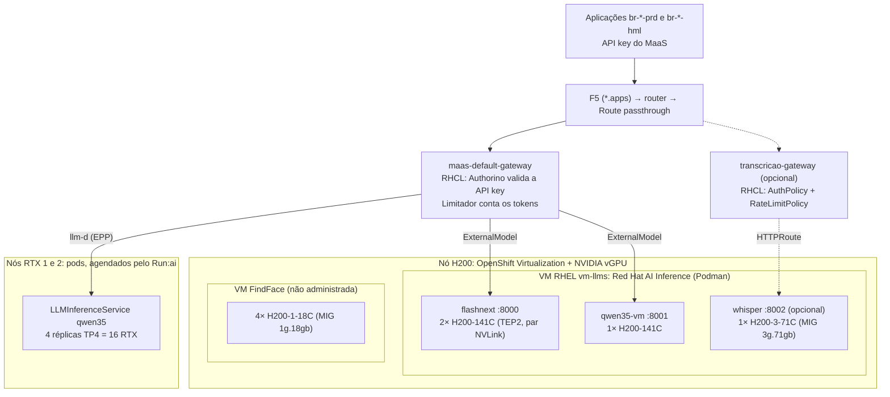
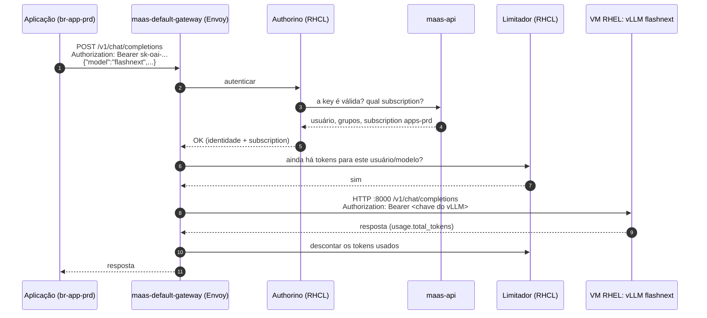
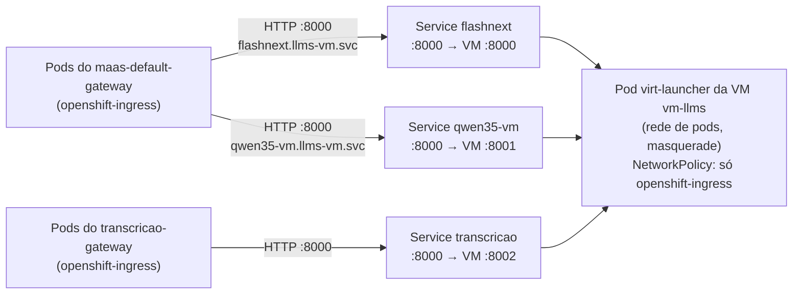

# Plataforma de IA no OpenShift AI 3.5: nó H200 virtualizado + RTX com Run:ai

## Índice

- [Como usar este documento](#como-usar-este-documento)
  - [O que mudou em relação à arquitetura anterior](#o-que-mudou-em-relação-à-arquitetura-anterior)
  - [Documentos do repositório](#documentos-do-repositório)
- [Parte 1 – Arquitetura](#parte-1--arquitetura)
  - [1. Visão geral](#1-visão-geral)
  - [2. Resumo das decisões](#2-resumo-das-decisões)
  - [3. Distribuição das GPUs](#3-distribuição-das-gpus)
  - [4. Como o MaaS controla os modelos das VMs](#4-como-o-maas-controla-os-modelos-das-vms)
  - [5. Rede e segurança entre o gateway e a VM](#5-rede-e-segurança-entre-o-gateway-e-a-vm)
  - [6. Lado RTX: o que muda no Run:ai e no RHOAI](#6-lado-rtx-o-que-muda-no-runai-e-no-rhoai)
  - [7. Riscos e itens a validar](#7-riscos-e-itens-a-validar)
  - [8. Fora do escopo por enquanto](#8-fora-do-escopo-por-enquanto)
- [Parte 2 – Implantação passo a passo](#parte-2--implantação-passo-a-passo)
  - [Bloco A – Plataforma comum](#bloco-a--plataforma-comum)
  - [Bloco B – Nó H200 virtualizado e as duas VMs](#bloco-b--nó-h200-virtualizado-e-as-duas-vms)
  - [Bloco C – Red Hat AI Inference na VM RHEL](#bloco-c--red-hat-ai-inference-na-vm-rhel)
  - [Bloco D – Publicar os modelos da VM no MaaS](#bloco-d--publicar-os-modelos-da-vm-no-maas)
  - [Bloco E – Lado RTX: Run:ai, Qwen3.5 e consumidores](#bloco-e--lado-rtx-runai-qwen35-e-consumidores)
  - [Bloco F – Verificação final](#bloco-f--verificação-final)
- [Parte 3 – Operação](#parte-3--operação)
- [Erros comuns](#erros-comuns)
- [Referências](#referências)

## Como usar este documento

**Plataforma:** Red Hat OpenShift AI 3.5 · OpenShift 4.22 · OpenShift Virtualization · NVIDIA GPU Operator 26.7.x (com vGPU) · Red Hat AI Inference · Models-as-a-Service (MaaS) · Red Hat Connectivity Link (RHCL) · NVIDIA Run:ai self-hosted 3.0

**Hardware:** 1 nó com 4× NVIDIA H200 NVL (virtualizado) e 2 nós com 10× NVIDIA RTX 4500 Ada cada

- **Parte 1 – Arquitetura:** o que vai ser construído e por quê, sem comandos.
- **Parte 2 – Implantação:** do cluster vazio até os modelos respondendo pelo MaaS, na ordem de execução.
- **Parte 3 – Operação:** atualizações, manutenção do nó H200, troca de chaves e limites.

### O que mudou em relação à arquitetura anterior

| Tema | Arquitetura anterior | Arquitetura atual |
| --- | --- | --- |
| Nó H200 | Pods do OpenShift sob o Run:ai (Flash-Next e FindFace) | **Nó do OpenShift Virtualization** com duas VMs; nenhum pod usa as H200 |
| FindFace | 2 H200 inteiras, em pods (extraction-api e video-worker) | **VM própria, não administrada por nós**, com 4 fatias MIG 1g.18gb (\~72 GB no total) |
| Qwen3.8-Flash-Next | `LLMInferenceService` em 2 H200 | **VM RHEL**, Red Hat AI Inference (vLLM) em 2 H200 inteiras (TEP2) |
| Qwen3.5-35B-A3B | 16 RTX (4 réplicas TP4) | **16 RTX (igual)** + **1 H200 inteira na VM RHEL** |
| Transcrição de áudio | 2 RTX, em pod | **Opcional**, na VM RHEL, na fatia MIG 3g.71gb |
| Run:ai | Node pools `h200-nvl` e `rtx4500-ada`, 4 projetos | Só o node pool `rtx4500-ada` e o projeto `qwen35` |
| MaaS | Só `LLMInferenceService` | `LLMInferenceService` (RTX) **e `ExternalModel`** para os modelos da VM |
| RTX livres | 2 (reserva para o FindFace) | 4 (2 por nó) |

### Documentos do repositório

| Arquivo | Para que serve agora |
| --- | --- |
| `README.md` (este) | Arquitetura atual e tutorial completo |
| [`5. arquitetura-anterior-h200-em-pods.md`](5.%20arquitetura-anterior-h200-em-pods.md) | Documento anterior. **Continua sendo o passo a passo do lado RTX** (Etapas 1 a 17), com as mudanças do [Bloco E](#bloco-e--lado-rtx-runai-qwen35-e-consumidores) |
| [`3. tutorial-vgpu-mig-vms.md`](3.%20tutorial-vgpu-mig-vms.md) | Detalhes do vGPU no OpenShift Virtualization (BIOS, IOMMU, imagem do vGPU Manager, drivers de guest e licença). O **layout de GPUs** que vale é o deste README |
| [`4. tutorial-passthrough-vms.md`](4.%20tutorial-passthrough-vms.md) | Alternativa sem licença NVIDIA AI Enterprise. **Não atende** a esta arquitetura: o passthrough não divide uma GPU entre duas VMs |
| [`1. fases-implementacao.md`](1.%20fases-implementacao.md), [`2. kueue-opcional`](2.%20kueue-opcional) | Material da arquitetura anterior |

## Parte 1 – Arquitetura

### 1. Visão geral



Em uma frase: **todo acesso a LLM passa pelo gateway do MaaS**, com a mesma API key e os mesmos limites de tokens, esteja o modelo num pod nas RTX ou num container dentro da VM RHEL. O MaaS enxerga os modelos da VM como **modelos externos** (`ExternalModel`), e o RHCL (Authorino + Limitador) faz a autenticação e a contagem de tokens no gateway, como faz para os modelos do cluster.

### 2. Resumo das decisões

| Decisão | Escolha |
| --- | --- |
| Nó H200 | Worker do OpenShift em modo **`vm-vgpu`** do GPU Operator, com OpenShift Virtualization. As GPUs só chegam às VMs, como vGPU |
| Divisão das GPUs | Uma GPU fatiada em MIG: **4× 1g.18gb** (FindFace) + **1× 3g.71gb** (VM RHEL). As outras 3 GPUs vão inteiras para a VM RHEL |
| Licença | **NVIDIA AI Enterprise** (vem com a H200 NVL, 5 anos): obrigatória para vGPU, no host e nas duas VMs |
| VM FindFace | Criada pela plataforma (objeto `VirtualMachine` e vGPUs); **o sistema e o FindFace dentro dela são de outro time** |
| VM RHEL | RHEL 9 + driver de guest + Podman + **Red Hat AI Inference**; um container vLLM por modelo, como serviço Quadlet |
| Qwen3.8-Flash-Next | VM RHEL, **TEP2** nas 2 GPUs inteiras do par NVLink. Depende de vLLM 0.30.0 ou superior (risco 5) |
| Qwen3.5-35B-A3B | **Dois lugares:** 4 réplicas TP4 nas RTX (`qwen35`) e 1 instância numa H200 inteira da VM (`qwen35-vm`) |
| Transcrição | **Opcional**, Whisper large-v3-turbo na fatia 3g.71gb, publicada por uma rota própria do RHCL (o MaaS 3.5 não roteia `/v1/audio/*`) |
| Publicação dos modelos da VM | **`ExternalProvider` + `ExternalModel` + `MaaSModelRef`** do MaaS (Technology Preview no RHOAI 3.5) |
| Rede gateway → VM | Rede de pods do OpenShift: um `Service` por modelo apontando para a VM, **`NetworkPolicy`** liberando só o gateway, e `--api-key` no vLLM |
| Run:ai | Só nas RTX: node pool `rtx4500-ada`, departamento `plataforma-ia` (20 RTX) e projeto `qwen35` (16 RTX) |
| Proteção da produção contra o hml | Igual à anterior: limites de tokens por subscription (hml com no máximo \~10% da capacidade de cada modelo) |

### 3. Distribuição das GPUs

**Nó H200 (exemplo com a GPU 0 fatiada; a escolha real vem do `nvidia-smi topo -m`, Passo B.1):**

| GPU física | Modo | vGPU entregue | Memória | VM | Uso |
| --- | --- | --- | --- | --- | --- |
| 0 | MIG: 4× 1g.18gb + 1× 3g.71gb | 4× **H200-1-18C** | 4 × \~18 GB = \~72 GB (4/7 do processamento) | FindFace | extraction-api e video-workers, a critério do time do FindFace |
| 0 | (mesma GPU) | 1× **H200-3-71C** | \~71 GB (3/7 do processamento) | RHEL | Transcrição (opcional) |
| 1 | Inteira (time-sliced) | 1× **H200-141C** | \~141 GB | RHEL | Qwen3.5-35B-A3B (`qwen35-vm`) |
| 2 e 3 | Inteiras (time-sliced) | 2× **H200-141C** | 2 × \~141 GB | RHEL | Qwen3.8-Flash-Next TEP2 (`flashnext`) |

> **Por que essa divisão fecha.** Uma H200 tem 7 fatias de processamento e 8 de memória. 4× 1g.18gb usam 4 + 4, e 1× 3g.71gb usa 3 + 4: total 7 + 8. É uma combinação MIG válida (perfis mistos na mesma GPU), mas tem de ser criada pelo vGPU Device Manager num layout misto, o que precisa ser validado (risco 1).

> **Por que as GPUs inteiras usam H200-141C, e não MIG 7g.141gb.** Só vGPUs time-sliced fazem P2P pelo NVLink entre si. O TEP2 do Flash-Next depende desse P2P; vGPUs MIG não fazem P2P.

**Escolha do par NVLink:** com bridge de 2 vias (pares 0-1 e 2-3), fatie uma GPU de um par (ex.: GPU 0), dê a parceira dela (GPU 1) ao Qwen3.5, que usa 1 GPU e não precisa de NVLink, e use o **outro par** (2 e 3) no Flash-Next. Com bridge de 4 vias, qualquer escolha serve.

**Nós RTX:**

| Nó | Ocupação |
| --- | --- |
| RTX 1 (10× RTX 4500 Ada) | Qwen3.5 A (4), Qwen3.5 B (4), **2 livres** |
| RTX 2 (10× RTX 4500 Ada) | Qwen3.5 C (4), Qwen3.5 D (4), **2 livres** |

As 4 RTX livres não comportam uma réplica TP4 do Qwen3.5 (precisa de 4 GPUs no mesmo nó). Ficam para jobs futuros ou para uma réplica TP2, se o teste de carga mostrar que cabe.

**Dimensionamento dos modelos da VM:**

| Modelo | Pesos | GPU | Sobra para KV cache |
| --- | --- | --- | --- |
| Qwen3.8-Flash-Next FP8 (TEP2, N-gram na RAM da VM) | \~63,5 GiB por GPU | 2× H200-141C | \~59 GiB por GPU |
| Qwen3.5-35B-A3B FP8 (ModelCar da Red Hat) | \~44 GB | 1× H200-141C | \~80 GB |
| Whisper large-v3-turbo w4a16 (ModelCar da Red Hat) | < 1 GB | 1× H200-3-71C | Sobra quase toda a fatia |

- A tabela N-gram do Flash-Next fica na **RAM da VM** (\~96 GiB): a VM RHEL precisa de 256 GiB.
- O Qwen3.5 numa H200 inteira tem muito mais KV cache por instância do que uma réplica TP4 nas RTX: espere mais tokens/min por instância. Meça no teste de carga.
- A fatia 3g.71gb é grande demais para o Whisper. Se a transcrição não for usada, ela pode servir outro modelo pequeno ou embeddings.

### 4. Como o MaaS controla os modelos das VMs

#### 4.1 O problema

O MaaS publica, por padrão, modelos servidos pelo OpenShift AI (`LLMInferenceService`). Os modelos da VM RHEL **não são** objetos do OpenShift AI: são containers Podman dentro de uma VM. Para o MaaS, são iguais a um provedor externo (como a OpenAI), só que dentro do cluster.

#### 4.2 A solução: modelos externos do MaaS (`ExternalModel`)

O RHOAI 3.5 traz, como **Technology Preview**, a configuração de modelos externos no MaaS. A documentação (*Govern LLM access with Models-as-a-Service*, seção *Configure external models*) tem um exemplo exatamente deste caso: um `ExternalModel` que aponta para um **vLLM interno sem TLS na porta 8000**.

| Objeto | Onde | O que faz |
| --- | --- | --- |
| `Secret` (label `inference.llm-d.ai/ipp-managed=true`) | Namespace dos modelos (`modelos-vm`) | Guarda a chave do vLLM da VM (`--api-key`) |
| `ExternalProvider` | `modelos-vm` | Endereço do vLLM (FQDN, sem `http://`), tipo `openai`, autenticação `apikey` com o secret. O controller cria **Service, ServiceEntry e DestinationRule** |
| `ExternalModel` | `modelos-vm` | Nome que o cliente usa (`flashnext`, `qwen35-vm`), modelo de destino, formato `openai-chat`, caminho `/v1/chat/completions`, porta e TLS (anotações). O controller cria a **HTTPRoute** no `maas-default-gateway` |
| `MaaSModelRef` (`kind: ExternalModel`) | `modelos-vm` | Publica o modelo no MaaS |
| `MaaSSubscription` e `MaaSAuthPolicy` | `models-as-a-service` | Quem acessa e quantos tokens por minuto, **iguais aos dos modelos do cluster** |

**Autenticação em duas camadas**, como a documentação descreve:

1. **Usuário → MaaS:** a aplicação manda a API key do MaaS (`sk-oai-...`). O Authorino (RHCL) valida a key, a subscription e a autorização para aquele modelo.
2. **MaaS → VM:** o gateway troca o cabeçalho e injeta a chave do vLLM (do secret do `ExternalProvider`) como `Authorization: Bearer`. A aplicação nunca vê essa chave.

#### 4.3 Caminho de uma requisição



- Sem API key: **401**. Key válida, mas sem `MaaSAuthPolicy` para o modelo: **403**. Sem `MaaSSubscription` (ou limite estourado): **429**.
- O limite de tokens é contado **por usuário, por modelo e por subscription** (validado em laboratório com `LLMInferenceService`, risco 19 do documento anterior; confirmar para `ExternalModel`, risco 8).
- Os modelos da VM aparecem no dashboard do RHOAI em **AI hub → Models → External models** e em **Gen AI studio → AI asset endpoints**, ao lado dos modelos do cluster.

#### 4.4 O papel do RHCL

O RHCL **já é** o motor do MaaS: o Authorino valida as API keys e o Limitador conta os tokens, por meio das `AuthPolicy` e `TokenRateLimitPolicy` que o controller do MaaS gera para cada modelo. Para os modelos de chat da VM, não é preciso escrever nenhuma política do RHCL à mão: as API keys são as do MaaS (o usuário gera em **Gen AI studio → API keys** ou pela API `/maas-api/v1/api-keys`).

O RHCL **direto**, com políticas escritas à mão, só entra na **transcrição**, que o MaaS 3.5 não sabe rotear (próxima seção).

#### 4.5 O que o MaaS cobre e o que não cobre

| Recurso | Modelos da VM pelo `ExternalModel` |
| --- | --- |
| API key do MaaS, subscription, authorization policy | Sim, igual aos modelos do cluster |
| Limite de tokens por minuto | Sim, **só com `apiFormat: openai-chat`** (chat completions) |
| `/v1/models` do MaaS | Sim, o modelo aparece na lista |
| Métricas de uso no dashboard do MaaS | Sim (tokens por usuário, subscription e modelo) |
| `/v1/completions`, `/v1/embeddings` | Não: o gateway só reconhece `/v1/chat/completions`, `/v1/messages` e `/v1/responses`; outros caminhos voltam **400** |
| `/v1/audio/transcriptions` (Whisper) | **Não** (400). Solução: gateway próprio do RHCL com API key e limite por requisições (Passo D.6) |
| Multi-tenancy do MaaS (`AITenant`) | Só no tenant padrão |
| Suporte | **Technology Preview** no RHOAI 3.5 (risco 6) |

**Transcrição pelo RHCL direto:** um gateway pequeno (`transcricao-gateway`) com uma `HTTPRoute` para a porta do Whisper, uma `AuthPolicy` que aceita API keys guardadas como `Secret` (geradas pelo administrador, uma por aplicação) e uma `RateLimitPolicy` por usuário. Diferenças para o MaaS: a key é outra (não é `sk-oai-`), o limite é em **requisições por minuto** (não em tokens) e não há tela no dashboard. Quando o MaaS passar a rotear áudio, a transcrição migra para ele.

### 5. Rede e segurança entre o gateway e a VM



| Camada | Decisão | Por quê |
| --- | --- | --- |
| Rede da VM | Interface padrão na **rede de pods** (`masquerade`) | Sem VLAN nova, sem IP no datacenter; o gateway alcança a VM como alcança um pod |
| Endereço para o MaaS | Um **`Service` por modelo** em `llms-vm`, todos na porta 8000 (cada um aponta para a porta do container na VM) | O `ExternalProvider` pede um FQDN; o `Service` dá `flashnext.llms-vm.svc.cluster.local`. A porta igual evita uma anotação de porta diferente por modelo |
| Quem chega na VM | **`NetworkPolicy`** no namespace `llms-vm`: entrada nas portas dos modelos só a partir de `openshift-ingress` (gateways) e do monitoramento | Ninguém do cluster fala direto com o vLLM, contornando o MaaS |
| Chave no vLLM | `--api-key` (variável `VLLM_API_KEY`) em cada container de chat; o MaaS injeta a chave | Segunda barreira, se a `NetworkPolicy` falhar ou for alterada |
| TLS gateway → VM | Desligado (`maas.opendatahub.io/tls: "false"`) | Tráfego interno do cluster (OVN-Kubernetes). A documentação avisa: sem TLS, a chave do vLLM trafega em texto claro; aceitável só numa rede isolada, que é o caso aqui |
| Separação de namespaces | VM em **`llms-vm`**; objetos do MaaS em **`modelos-vm`** | O controller do MaaS cria um `Service` com o nome do provider no namespace do modelo; em namespaces separados não há colisão com os `Service`s da VM |

**Plano B (risco 7):** se a `ServiceEntry` criada pelo MaaS conflitar com o `Service` do cluster de mesmo nome, dê à VM uma **segunda interface** numa rede do datacenter (NMState + `NetworkAttachmentDefinition` do tipo *localnet*), com um nome DNS fora do domínio do cluster (ex.: `vm-llms.ia.empresa.local`), e use esse nome no `ExternalProvider`. Nesse caso, a proteção da porta passa a ser o firewall da VM (`firewalld`) liberando só os IPs de saída dos nós.

### 6. Lado RTX: o que muda no Run:ai e no RHOAI

Tudo que o [documento anterior](5.%20arquitetura-anterior-h200-em-pods.md) descreve para as RTX continua: RHOAI 3.5 com KServe/llm-d, Run:ai 3.0 Support-Entitled no mesmo cluster, PostgreSQL 16 externo, F5 + Routes (sem MetalLB), RHCL e MaaS. As mudanças:

| Item | Antes | Agora |
| --- | --- | --- |
| Node pools do Run:ai | `h200-nvl` e `rtx4500-ada` | Só `rtx4500-ada`. O nó H200 em modo `vm-vgpu` não anuncia `nvidia.com/gpu` e fica fora de qualquer pool de GPU |
| Departamento `plataforma-ia` | 4 H200 + 20 RTX | 20 RTX |
| Projetos Run:ai | `flashnext`, `findface`, `qwen35`, `transcricao` | Só `qwen35` (16 RTX, `defaultNodePools: [rtx4500-ada, default]`) |
| Namespaces de GPU | `llm-flashnext`, `findface`, `ai-transcricao`, `llm-qwen35` | Só `llm-qwen35` |
| Labels de slot nas RTX | `slot-extra=transcricao` e `slot-extra=findface` | Não são mais necessários |
| Taint do nó H200 | `nvidia.com/gpu=h200nvl:NoSchedule`, pods tolerando | O mesmo taint; quem tolera agora são as **VMs** e o `virt-handler` (Passo B.4). Impede que pods comuns (inclusive o EPP do llm-d, que o Run:ai pode mandar para o pool `default`) consumam CPU e RAM das VMs |
| `ClusterPolicy` do GPU Operator | Só containers | **Uma só**, com `sandboxWorkloads` ligado: RTX em modo container, H200 em modo `vm-vgpu` |

### 7. Riscos e itens a validar

| # | Item | Impacto | Mitigação / plano B |
| --- | --- | --- | --- |
| 1 | Layout misto no mesmo nó: GPU 0 com MIG heterogêneo (4× 1g.18gb + 1× 3g.71gb) e GPUs 1-3 inteiras | `vgpu.config.state=failed`; vGPUs não aparecem | Validar em laboratório antes de tudo. Plano B: todas as GPUs com MIG (GPUs 1-3 como `H200-7-141C`), sem P2P: o TEP2 do Flash-Next fica bem mais lento |
| 2 | VM RHEL com vGPU MIG (`H200-3-71C`) **e** vGPUs time-sliced (`H200-141C`) ao mesmo tempo | VM não sobe ou driver de guest recusa a combinação | Plano B: uma terceira VM pequena só com a `H200-3-71C` para a transcrição; a VM RHEL fica com as 3 `H200-141C` |
| 3 | VM FindFace com **4 vGPUs MIG** (multi-vGPU baseado em MIG) | VM não sobe com 4 vGPUs | Confirmar na matriz do NVIDIA AI Enterprise. Plano B: o FindFace recebe uma fatia única `H200-4-71C` (4g.71gb) e a VM RHEL fica com a `H200-3-71C` |
| 4 | P2P/NVLink entre vGPUs `H200-141C` no OpenShift Virtualization | TEP2 do Flash-Next lento | `nvidia-smi topo -m` e `topo -p2p r` na VM; medir. Alternativa: TP2 sem EP, ou o Tutorial 2 (passthrough) para as GPUs inteiras, o que exige rever a divisão |
| 5 | **Flash-Next exige vLLM 0.30.0 ou superior.** Imagens do Red Hat AI Inference hoje: 3.5.1 (vLLM 0.24.0) e fast release 3.6.0-fast.2 (vLLM 0.28.0) | O modelo **não sobe** com imagem suportada pela Red Hat | Acompanhar as fast releases (`registry.redhat.io/rhaii-fast/...`) e trocar a tag quando houver vLLM ≥ 0.30.0. Até lá, só em laboratório: imagem upstream `vllm/vllm-openai` ≥ v0.30.0, **sem suporte Red Hat** (Passo C.5) |
| 6 | `ExternalModel` do MaaS é **Technology Preview** no RHOAI 3.5 | Sem SLA de produção da Red Hat para o caminho MaaS → VM | Aceite formal do risco; acompanhar a GA. O Qwen3.5 das RTX (`qwen35`, GA) segue como alternativa ao `qwen35-vm` |
| 7 | `ServiceEntry` do MaaS com o mesmo host de um `Service` do cluster (`*.svc.cluster.local`) | Roteamento imprevisível no Envoy do gateway | Validar com o teste do Passo D.5. Plano B: segunda interface da VM com nome DNS externo (seção 5) |
| 8 | Contagem do limite de tokens para `ExternalModel` | Teto do hml diferente do planejado | Repetir o teste do risco 19 do documento anterior com dois usuários do hml (Passo D.5) |
| 9 | Transcrição fora do MaaS (`/v1/audio/*` volta 400) | Outra API key e limite por requisições, não por tokens | Gateway próprio do RHCL (Passo D.6). Migrar para o MaaS quando houver suporte |
| 10 | VMs com vGPU **não fazem live migration** | Manutenção do nó H200 derruba FindFace, Flash-Next, `qwen35-vm` e transcrição | Janela planejada (Parte 3, seção 2); aplicações com fallback do `qwen35-vm` para o `qwen35` (RTX) |
| 11 | Nó H200 único | Sem redundância para o Flash-Next e o FindFace | Igual à arquitetura anterior: janela e fallback na aplicação |
| 12 | Licença do vGPU (NVIDIA License System) | Sem licença, o vGPU entra em modo restrito e o desempenho cai | As VMs precisam alcançar o DLS/CLS; alerta em `nvidia-smi -q` "Unlicensed" |
| 13 | CUDA da imagem do Red Hat AI Inference × *CUDA Version* do driver de guest | Container não inicia | Driver de guest do mesmo release do host; conferir antes de trocar a tag da imagem |
| 14 | RAM do nó H200 | VM não inicia ou OOM no host | VM RHEL 256 GiB + VM FindFace (definida pela NtechLab) + folga para o OpenShift e o `virt-launcher` |
| 15 | FindFace em vGPU MIG e em Hopper | Sem suporte do fabricante nessa combinação | Validar com a NtechLab (time do FindFace) |
| 16 | Timeout de 200 ms do Authorino (RHOAIENG-71638) | HTTP 500/503 sob carga, também no `transcricao-gateway` | `AUTH_SERVICE_TIMEOUT=2s` (Etapa 6.5 do documento anterior) vale para todos os gateways |
| 17 | Qwen3.5 publicado duas vezes (`qwen35` e `qwen35-vm`), com ModelCars diferentes | Respostas ligeiramente diferentes entre os dois | Usar o mesmo ModelCar da Red Hat nos dois lados (`oci://registry.redhat.io/rhai/modelcar-qwen3-5-35b-a3b-fp8-dynamic:3.0`) |
| 18 | Riscos do lado RTX | — | Os riscos 1-4, 6, 8-11, 14-16, 18, 19 e 22-23 do [documento anterior](5.%20arquitetura-anterior-h200-em-pods.md#8-riscos-e-itens-a-validar) continuam valendo |

### 8. Fora do escopo por enquanto

- Live migration das VMs com vGPU.
- Alta disponibilidade dos modelos da VM (uma instância de cada).
- Autoscaling: réplicas fixas nas RTX, uma instância por modelo na VM.
- Frações de GPU do Run:ai nas RTX (desenho preparado no documento anterior, seção 5.5).
- Multi-tenancy do MaaS (`AITenant`): o `ExternalModel` só funciona no tenant padrão.

## Parte 2 – Implantação passo a passo

**Pré-requisitos gerais:** os do [documento anterior](5.%20arquitetura-anterior-h200-em-pods.md#parte-2--implantação-passo-a-passo) (OpenShift 4.20 a 4.22, Helm 3.14+, PostgreSQL 16, F5 balanceando `*.apps`, três nós sem GPU para o Run:ai), mais:

- **Licença NVIDIA AI Enterprise** com acesso aos downloads de vGPU para KVM e o *client configuration token* (`.tok`) do servidor de licenças (DLS ou CLS).
- **Registry privado** para a imagem do vGPU Manager.
- `virtctl` na estação de trabalho.
- Assinatura RHEL para a VM (e direito ao Red Hat AI Inference).

| Bloco | Passos | O que faz |
| --- | --- | --- |
| **A – Plataforma comum** | A.1 a A.4 | Verificações, OpenShift Virtualization, GPU Operator com uma `ClusterPolicy` para RTX e H200, e as Etapas 3 a 8 do documento anterior (monitoring, cert-manager, Run:ai, RHCL, RHOAI, gateways e MaaS) |
| **B – Nó H200 e VMs** | B.1 a B.9 | Layout de vGPU, `HyperConverged`, taint, as duas VMs, driver de guest e licença na VM RHEL |
| **C – Red Hat AI Inference** | C.1 a C.7 | Os três modelos na VM RHEL como serviços Quadlet |
| **D – MaaS para a VM** | D.1 a D.6 | `Service`s, `NetworkPolicy`, `ExternalModel`s, subscriptions, testes e a transcrição pelo RHCL |
| **E – Lado RTX** | Etapas 9 a 17 do documento anterior | Run:ai, Qwen3.5 nas RTX e consumidores, com as mudanças da tabela do Bloco E |
| **F – Verificação final** | — | Checklist |

### Bloco A – Plataforma comum

#### A.1 Verificações iniciais

Igual à [Etapa 1](5.%20arquitetura-anterior-h200-em-pods.md#etapa-1-verificações-iniciais) do documento anterior. Escolha os três nós sem GPU para o Run:ai **fora** do nó H200.

#### A.2 Preparar o nó H200 (antes do GPU Operator)

Siga o [Tutorial 1](3.%20tutorial-vgpu-mig-vms.md), **Passos 1 e 2**: BIOS do Dell (IOMMU, SR-IOV, Above 4G Decoding), `MachineConfigPool` `gpu-virt` e argumentos de kernel do IOMMU. O nó reinicia.

#### A.3 Operadores

1. **Node Feature Discovery**, com a `NodeFeatureDiscovery` padrão.
2. **OpenShift Virtualization**, com o `HyperConverged` padrão. Desligue o gerenciamento de *mediated devices* ([Tutorial 1, Passo 3](3.%20tutorial-vgpu-mig-vms.md#passo-3-operadores)): quem cria os vGPUs é o GPU Operator.
3. **NVIDIA GPU Operator** no canal **`v26.7`** (26.7.1 ou superior: atende ao Run:ai 3.0.20 e ao vGPU baseado em MIG, que pede 25.10+). **Não crie a `ClusterPolicy` ainda.**
4. Monte e publique a **imagem do vGPU Manager** e crie o pull secret ([Tutorial 1, Passo 4](3.%20tutorial-vgpu-mig-vms.md#passo-4-imagem-do-vgpu-manager)).

#### A.4 Uma `ClusterPolicy` para RTX (containers) e H200 (VMs)

**4.1 Layout de vGPU (ConfigMap).** Uma variante por GPU candidata a ser fatiada; a escolha vem no Passo B.1. A diferença para o Tutorial 1 é a fatia da GPU dividida: **4× `H200-1-18C` + 1× `H200-3-71C`**.

```yaml
apiVersion: v1
kind: ConfigMap
metadata:
  name: vgpu-devices-config
  namespace: nvidia-gpu-operator
data:
  config.yaml: |
    version: v1
    vgpu-configs:
      # padrão: as 4 GPUs inteiras (usado só até o Passo B.2)
      default:
        - devices: all
          vgpu-devices:
            "H200-141C": 1

      # GPU fatiada = 0
      mig-gpu0:
        - devices: [0]
          vgpu-devices:
            "H200-1-18C": 4     # MIG 1g.18gb x4 -> VM FindFace
            "H200-3-71C": 1     # MIG 3g.71gb    -> VM RHEL (transcrição)
        - devices: [1, 2, 3]
          vgpu-devices:
            "H200-141C": 1      # GPU inteira    -> VM RHEL

      # GPU fatiada = 1
      mig-gpu1:
        - devices: [1]
          vgpu-devices:
            "H200-1-18C": 4
            "H200-3-71C": 1
        - devices: [0, 2, 3]
          vgpu-devices:
            "H200-141C": 1

      # GPU fatiada = 2
      mig-gpu2:
        - devices: [2]
          vgpu-devices:
            "H200-1-18C": 4
            "H200-3-71C": 1
        - devices: [0, 1, 3]
          vgpu-devices:
            "H200-141C": 1

      # GPU fatiada = 3
      mig-gpu3:
        - devices: [3]
          vgpu-devices:
            "H200-1-18C": 4
            "H200-3-71C": 1
        - devices: [0, 1, 2]
          vgpu-devices:
            "H200-141C": 1
```

```bash
oc apply -f vgpu-devices-config.yaml
```

**4.2 Nó H200 em modo VM.** O label vem **antes** da `ClusterPolicy`, para o operador não instalar nele o driver de containers:

```bash
oc label node <no-h200> --overwrite nvidia.com/gpu.workload.config=vm-vgpu
```

**4.3 `ClusterPolicy`.** Crie pelo console (*NVIDIA GPU Operator → ClusterPolicy → Create*), mantenha os padrões e, na visão YAML, ajuste:

```yaml
spec:
  sandboxWorkloads:
    enabled: true
    defaultWorkload: container        # RTX continuam com pods
  vgpuManager:
    enabled: true
    repository: <registry>/<org>
    image: vgpu-manager
    version: <versao-do-driver>       # o operador acrescenta -rhcos4.<minor>
    imagePullSecrets:
      - vgpu-registry-secret
  vgpuDeviceManager:
    enabled: true
    config:
      name: vgpu-devices-config
      default: default
  migManager:
    enabled: true
  sandboxDevicePlugin:
    enabled: true
  vfioManager:
    enabled: true
```

O `driver`, o `devicePlugin`, o `dcgmExporter` e o `gfd` ficam ligados (padrão): eles só rodam nos nós em modo container (as RTX).

```bash
# Label exigido pelo Run:ai 3.0.20 quando o GPU Operator vem do OperatorHub (risco 23 do documento anterior)
oc label clusterpolicy gpu-cluster-policy app.kubernetes.io/version=<versao-do-operador> --overwrite

# RTX: pilha de containers
oc get pods -n nvidia-gpu-operator -o wide | grep -E '<no-rtx-1>|<no-rtx-2>'
oc get nodes -L nvidia.com/gpu.product          # NVIDIA-RTX-4500-Ada-Generation nas RTX

# H200: pilha de VMs (vgpu-manager, vgpu-device-manager, sandbox-device-plugin, sandbox-validator)
oc get pods -n nvidia-gpu-operator -o wide | grep <no-h200>
```

#### A.5 Restante da plataforma (documento anterior)

Siga, sem mudanças, as Etapas do [documento anterior](5.%20arquitetura-anterior-h200-em-pods.md):

- [Etapa 3](5.%20arquitetura-anterior-h200-em-pods.md#etapa-3-user-workload-monitoring): User Workload Monitoring.
- [Etapa 4](5.%20arquitetura-anterior-h200-em-pods.md#etapa-4-cert-manager-e-leaderworkerset): cert-manager e LeaderWorkerSet.
- [Etapa 5](5.%20arquitetura-anterior-h200-em-pods.md#etapa-5-nvidia-runai): NVIDIA Run:ai (control plane e cluster).
- [Etapa 6](5.%20arquitetura-anterior-h200-em-pods.md#etapa-6-red-hat-connectivity-link): Red Hat Connectivity Link, **incluindo o `AUTH_SERVICE_TIMEOUT=2s` (6.5)**.
- [Etapa 7](5.%20arquitetura-anterior-h200-em-pods.md#etapa-7-openshift-ai): OpenShift AI, com `kueue: Removed`.
- [Etapa 8](5.%20arquitetura-anterior-h200-em-pods.md#etapa-8-gateways-e-maas): gateways (`openshift-ai-inference` e `maas-default-gateway`), PostgreSQL do MaaS e Routes passthrough pelo F5.

### Bloco B – Nó H200 virtualizado e as duas VMs

#### B.1 Mapear o NVLink e escolher a GPU fatiada

```bash
VGPU=$(oc get pods -n nvidia-gpu-operator -l app=nvidia-vgpu-manager-daemonset \
  --field-selector spec.nodeName=<no-h200> -o name | head -1)

oc exec -n nvidia-gpu-operator $VGPU -- nvidia-smi topo -m
oc exec -n nvidia-gpu-operator $VGPU -- nvidia-smi --query-gpu=index,pci.bus_id,uuid --format=csv
```

| A matriz mostra | GPU a fatiar | Qwen3.5 | Flash-Next (TEP2) |
| --- | --- | --- | --- |
| `NV#` só em 0-1 e 2-3 | 0 | 1 | 2 e 3 |
| `NV#` entre todas | Qualquer uma (ex.: 0) | Qualquer das restantes | As outras duas |
| Nenhum `NV#` | Qualquer uma | Qualquer | Quaisquer duas, sem P2P (bem mais lento) |

Anote o índice da GPU fatiada (variante `mig-gpuN`) e os UUIDs. Os exemplos seguem com a **GPU 0**.

#### B.2 Aplicar o layout e conferir os vGPUs

```bash
oc label node <no-h200> --overwrite nvidia.com/vgpu.config=mig-gpu0

oc get node <no-h200> -o jsonpath='{.metadata.labels.nvidia\.com/vgpu\.config\.state}'; echo
# esperado: success

oc get node <no-h200> -o json | jq '.status.allocatable | with_entries(select(.key|startswith("nvidia.com/")))'
# esperado:
#   "nvidia.com/NVIDIA_H200-1-18C": "4"
#   "nvidia.com/NVIDIA_H200-3-71C": "1"
#   "nvidia.com/NVIDIA_H200-141C": "3"

oc exec -n nvidia-gpu-operator $VGPU -- nvidia-smi mig -lgi -i 0   # 4x 1g.18gb e 1x 3g.71gb
oc exec -n nvidia-gpu-operator $VGPU -- nvidia-smi vgpu
```

Se o estado ficar `failed`, veja os logs do `nvidia-vgpu-device-manager`: é o risco 1. Teste primeiro só a GPU fatiada (sem as GPUs inteiras) para separar o problema do MIG heterogêneo do problema do layout misto.

#### B.3 Liberar os vGPUs para as VMs (`HyperConverged`)

```bash
oc edit hyperconverged kubevirt-hyperconverged -n openshift-cnv
```

```yaml
spec:
  permittedHostDevices:
    mediatedDevices:
      - mdevNameSelector: NVIDIA H200-1-18C
        resourceName: nvidia.com/NVIDIA_H200-1-18C
        externalResourceProvider: true
      - mdevNameSelector: NVIDIA H200-3-71C
        resourceName: nvidia.com/NVIDIA_H200-3-71C
        externalResourceProvider: true
      - mdevNameSelector: NVIDIA H200-141C
        resourceName: nvidia.com/NVIDIA_H200-141C
        externalResourceProvider: true
```

Os nomes em `resourceName` têm de ser **exatamente** os do Passo B.2.

#### B.4 Taint no nó H200

O taint mantém fora do nó H200 os pods que não são das VMs (inclusive o EPP do llm-d, que o Run:ai pode mandar para o pool `default`). Os DaemonSets do GPU Operator já toleram a chave `nvidia.com/gpu`; o `virt-handler` do OpenShift Virtualization precisa da toleration:

```bash
oc adm taint nodes <no-h200> nvidia.com/gpu=h200nvl:NoSchedule --overwrite

oc patch hyperconverged kubevirt-hyperconverged -n openshift-cnv --type merge -p '
{"spec":{"workloads":{"nodePlacement":{"tolerations":[
  {"key":"nvidia.com/gpu","operator":"Equal","value":"h200nvl","effect":"NoSchedule"}]}}}}'

# conferir: virt-handler, nfd-worker e os pods do GPU Operator continuam no nó
oc get pods -A -o wide --field-selector spec.nodeName=<no-h200> | grep -E 'virt-handler|nfd|nvidia'
```

Se o `nfd-worker` sair do nó, acrescente a mesma toleration na `NodeFeatureDiscovery`.

#### B.5 Namespaces

```bash
oc new-project findface-vm
oc new-project llms-vm
```

#### B.6 VM do FindFace (4× `H200-1-18C`)

A plataforma cria a VM e entrega o acesso ao time do FindFace. Sistema, Docker e FindFace dentro dela são com eles; o que eles precisam receber está no Passo B.7.

```yaml
apiVersion: kubevirt.io/v1
kind: VirtualMachine
metadata:
  name: vm-findface
  namespace: findface-vm
spec:
  runStrategy: Halted
  dataVolumeTemplates:
    - metadata:
        name: vm-findface-root
      spec:
        source:
          registry:
            url: docker://quay.io/containerdisks/ubuntu:24.04   # ou a imagem pedida pelo time do FindFace
        storage:
          resources:
            requests:
              storage: 300Gi
  template:
    metadata:
      labels:
        app: vm-findface
    spec:
      nodeSelector:
        kubernetes.io/hostname: <no-h200>
      tolerations:
        - { key: nvidia.com/gpu, operator: Equal, value: h200nvl, effect: NoSchedule }
      evictionStrategy: None            # vGPU não migra; ver Parte 3, seção 2
      domain:
        cpu:
          cores: 16                     # conforme a NtechLab
        memory:
          guest: 64Gi                   # conforme a NtechLab
        firmware:
          bootloader:
            efi:
              secureBoot: false         # driver de guest compilado na VM
        devices:
          gpus:
            - name: ff-gpu0
              deviceName: nvidia.com/NVIDIA_H200-1-18C
            - name: ff-gpu1
              deviceName: nvidia.com/NVIDIA_H200-1-18C
            - name: ff-gpu2
              deviceName: nvidia.com/NVIDIA_H200-1-18C
            - name: ff-gpu3
              deviceName: nvidia.com/NVIDIA_H200-1-18C
          disks:
            - name: rootdisk
              disk: { bus: virtio }
            - name: cloudinit
              disk: { bus: virtio }
          interfaces:
            - name: default
              masquerade: {}
      networks:
        - name: default
          pod: {}
      volumes:
        - name: rootdisk
          dataVolume:
            name: vm-findface-root
        - name: cloudinit
          cloudInitNoCloud:
            userData: |
              #cloud-config
              user: ubuntu
              ssh_authorized_keys:
                - <chave-publica-do-time-do-findface>
```

#### B.7 Entrega ao time do FindFace

| O que entregar | Detalhe |
| --- | --- |
| Acesso à VM | `virtctl ssh ubuntu@vm-findface -n findface-vm` (ou console); RBAC só no namespace `findface-vm` |
| GPUs | 4 vGPUs `H200-1-18C` (\~18 GB cada, 1/7 do processamento de uma H200 cada). Cada serviço de GPU do FindFace fica numa delas (ex.: extraction-api na 0, video-workers na 1 a 3) |
| Driver de guest | `nvidia-linux-grid-<versao>_amd64.deb` **do mesmo release do vGPU Manager do host**; instalação no [Tutorial 1, Passo 11](3.%20tutorial-vgpu-mig-vms.md#passo-11-vm-ubuntu-findface) |
| Licença | Client configuration token (`.tok`); a VM precisa alcançar o DLS/CLS |
| Regras | Não atualizar o driver de guest para um release mais novo que o do host; avisar antes de qualquer mudança de driver |
| Entrada de tráfego | Se o FindFace precisar ser acessado de fora, um `Service` para a VM e uma Route (HTTP/WebSocket) ou NodePort + VIP no F5 (TCP puro) |

#### B.8 VM RHEL (1× `H200-3-71C` + 3× `H200-141C`)

```yaml
apiVersion: kubevirt.io/v1
kind: VirtualMachine
metadata:
  name: vm-llms
  namespace: llms-vm
spec:
  runStrategy: Halted
  dataVolumeTemplates:
    - metadata:
        name: vm-llms-root
      spec:
        sourceRef:
          kind: DataSource
          name: rhel9
          namespace: openshift-virtualization-os-images
        storage:
          resources:
            requests:
              storage: 1Ti              # pesos do Flash-Next (~173 GiB) + imagens + cache
  template:
    metadata:
      labels:
        app: vm-llms                    # usado pelos Services e pela NetworkPolicy (Bloco D)
    spec:
      nodeSelector:
        kubernetes.io/hostname: <no-h200>
      tolerations:
        - { key: nvidia.com/gpu, operator: Equal, value: h200nvl, effect: NoSchedule }
      evictionStrategy: None
      domain:
        cpu:
          cores: 32
        memory:
          guest: 256Gi                  # ~96 GiB só para a tabela N-gram do Flash-Next
        firmware:
          bootloader:
            efi:
              secureBoot: false
        devices:
          gpus:
            - name: gpu-mig
              deviceName: nvidia.com/NVIDIA_H200-3-71C
            - name: gpu-a
              deviceName: nvidia.com/NVIDIA_H200-141C
            - name: gpu-b
              deviceName: nvidia.com/NVIDIA_H200-141C
            - name: gpu-c
              deviceName: nvidia.com/NVIDIA_H200-141C
          disks:
            - name: rootdisk
              disk: { bus: virtio }
            - name: cloudinit
              disk: { bus: virtio }
          interfaces:
            - name: default
              masquerade: {}            # sem "ports": todas as portas são encaminhadas
      networks:
        - name: default
          pod: {}
      volumes:
        - name: rootdisk
          dataVolume:
            name: vm-llms-root
        - name: cloudinit
          cloudInitNoCloud:
            userData: |
              #cloud-config
              user: cloud-user
              ssh_authorized_keys:
                - <sua-chave-publica>
```

```bash
oc apply -f vm-findface.yaml -f vm-llms.yaml
virtctl start vm-findface -n findface-vm
virtctl start vm-llms -n llms-vm
oc get vmi -A -o wide                 # as duas Running no nó H200
```

#### B.9 Preparar a VM RHEL

Siga o [Tutorial 1, Passo 12](3.%20tutorial-vgpu-mig-vms.md#passo-12-vm-rhel-llms), itens **12.1 a 12.4**: registro, `dkms`, driver de guest (`.run` do mesmo release do host), licença e NVIDIA Container Toolkit com CDI. Depois confira:

```bash
virtctl ssh cloud-user@vm-llms -n llms-vm

nvidia-smi --query-gpu=index,name,memory.total,uuid --format=csv
# esperado: 1 GPU "NVIDIA H200-3-71C" (~71 GB) e 3 GPUs "NVIDIA H200-141C" (~141 GB)
nvidia-smi -q | grep -i -A2 license     # Licensed
nvidia-smi topo -m                      # qual par de H200-141C tem NV#
nvidia-ctk cdi list                     # nvidia.com/gpu=0..3, nvidia.com/gpu=GPU-<uuid> e all
```

**Anote os UUIDs**: os serviços do Bloco C usam o UUID (`nvidia.com/gpu=GPU-...`), que não muda se a ordem dos índices mudar após um reboot.

| GPU na VM (exemplo) | Tipo | Modelo |
| --- | --- | --- |
| `GPU-aaaa...` | H200-3-71C | Whisper (opcional) |
| `GPU-bbbb...` | H200-141C (fora do par NVLink) | Qwen3.5 (`qwen35-vm`) |
| `GPU-cccc...` e `GPU-dddd...` | H200-141C (par com `NV#`) | Flash-Next |

### Bloco C – Red Hat AI Inference na VM RHEL

O **Red Hat AI Inference** (antigo Red Hat AI Inference Server) é a imagem vLLM suportada pela Red Hat, que roda fora do OpenShift com Podman. Cada modelo vira um container com a API compatível com a OpenAI, e cada container vira um **serviço Quadlet** (systemd), que sobe no boot da VM.

#### C.1 Imagens e versões

| Imagem | vLLM | Uso |
| --- | --- | --- |
| `registry.redhat.io/rhaii/vllm-cuda-rhel9:3.5.1` | 0.24.0 | GA. **Qwen3.5 e Whisper** |
| `registry.redhat.io/rhaii-fast/vllm-cuda-rhel9:3.6.0-fast.2-1791425534` | 0.28.0 | *Fast release* suportada; mesma regra |
| Qualquer imagem do Red Hat AI Inference com vLLM ≥ 0.30.0 | ≥ 0.30.0 | **Flash-Next**: ainda não publicada na data deste documento (risco 5) |

```bash
# conferir a versão do vLLM de uma imagem
podman run --rm --entrypoint python3 <imagem> -c 'import vllm; print(vllm.__version__)'
```

**Modelos validados pela Red Hat** (ModelCars, imagens OCI com os pesos em `/models`):

| Modelo | ModelCar |
| --- | --- |
| Qwen3.5-35B-A3B FP8 | `registry.redhat.io/rhai/modelcar-qwen3-5-35b-a3b-fp8-dynamic:3.0` (\~44 GB; validado em 1× H200) |
| Whisper large-v3-turbo w4a16 | `registry.redhat.io/rhelai1/modelcar-whisper-large-v3-turbo-quantized-w4a16:1.5` |

O Flash-Next não tem ModelCar da Red Hat: os pesos vêm do Hugging Face (Passo C.5).

#### C.2 Usuário de serviço, SELinux e registry

Os containers rodam **sem root**, num usuário próprio, como a documentação do Red Hat AI Inference mostra (`--userns=keep-id:uid=1001`).

```bash
# na VM, como cloud-user
sudo useradd -m vllm
sudo loginctl enable-linger vllm                 # serviços do usuário sobem no boot, sem login
sudo setsebool -P container_use_devices 1        # containers acessam as GPUs com SELinux ativo
sudo firewall-cmd --permanent --add-port=8000-8002/tcp && sudo firewall-cmd --reload

sudo -iu vllm
podman login registry.redhat.io
mkdir -p ~/rhaii-cache ~/modelos ~/.config/containers/systemd ~/.config/vllm
chmod 700 ~/.config/vllm
```

Uma chave por modelo de chat (o mesmo valor vai para o secret do MaaS no Passo D.3):

```bash
for M in flashnext qwen35-vm; do
  echo "VLLM_API_KEY=$(openssl rand -hex 32)" > ~/.config/vllm/$M.env
done
chmod 600 ~/.config/vllm/*.env
cat ~/.config/vllm/*.env          # guarde os valores num cofre
```

#### C.3 Baixar as imagens

```bash
podman pull registry.redhat.io/rhaii/vllm-cuda-rhel9:3.5.1
podman pull registry.redhat.io/rhai/modelcar-qwen3-5-35b-a3b-fp8-dynamic:3.0
podman pull registry.redhat.io/rhelai1/modelcar-whisper-large-v3-turbo-quantized-w4a16:1.5   # opcional
```

#### C.4 Qwen3.5-35B-A3B (1× H200-141C, porta 8001)

**Teste manual primeiro** (troque o UUID pelo da GPU anotada no Passo B.9):

```bash
podman run --rm -it --name qwen35-vm-teste \
  --device nvidia.com/gpu=GPU-bbbb... \
  --security-opt=label=disable --userns=keep-id:uid=1001 --shm-size=8g \
  -p 8001:8000 \
  -v ~/rhaii-cache:/opt/app-root/src/.cache:Z \
  --mount type=image,source=registry.redhat.io/rhai/modelcar-qwen3-5-35b-a3b-fp8-dynamic:3.0,destination=/model \
  --env-file ~/.config/vllm/qwen35-vm.env \
  registry.redhat.io/rhaii/vllm-cuda-rhel9:3.5.1 \
  --model /model/models --served-model-name qwen35-vm \
  --gpu-memory-utilization 0.90 --enable-prefix-caching --kv-cache-dtype fp8
```

Quando aparecer `Application startup complete`, teste de outro terminal (Passo C.7) e pare com `Ctrl+C`.

**Serviço Quadlet**, em `~vllm/.config/containers/systemd/qwen35-vm.container`:

```ini
[Unit]
Description=Qwen3.5-35B-A3B (Red Hat AI Inference)
Wants=network-online.target
After=network-online.target

[Container]
ContainerName=qwen35-vm
Image=registry.redhat.io/rhaii/vllm-cuda-rhel9:3.5.1
AddDevice=nvidia.com/gpu=GPU-bbbb...
SecurityLabelDisable=true
UserNS=keep-id:uid=1001
PodmanArgs=--shm-size=8g
PublishPort=8001:8000
Volume=%h/rhaii-cache:/opt/app-root/src/.cache:Z
Mount=type=image,source=registry.redhat.io/rhai/modelcar-qwen3-5-35b-a3b-fp8-dynamic:3.0,destination=/model
EnvironmentFile=%h/.config/vllm/qwen35-vm.env
Exec=--model /model/models --served-model-name qwen35-vm --gpu-memory-utilization 0.90 --enable-prefix-caching --kv-cache-dtype fp8

[Service]
Restart=always
TimeoutStartSec=900

[Install]
WantedBy=default.target
```

```bash
systemctl --user daemon-reload
systemctl --user start qwen35-vm
journalctl --user -u qwen35-vm -f        # aguarde "Application startup complete"
```

#### C.5 Qwen3.8-Flash-Next (2× H200-141C do par NVLink, porta 8000)

**Pesos** (\~173 GiB): baixe uma vez para o disco da VM. Confira o nome exato do repositório FP8 no Hugging Face.

```bash
python3 -m pip install --user "huggingface_hub[cli]"
export HF_TOKEN=<token-do-hugging-face>          # se o repositório exigir aceite de licença
hf download Qwen/Qwen3.8-Flash-Next-FP8 --local-dir ~/modelos/Qwen3.8-Flash-Next-FP8
```

**Imagem:** use a primeira imagem do Red Hat AI Inference com vLLM ≥ 0.30.0 (risco 5). Até ela existir, a única forma de rodar o modelo é a imagem upstream `docker.io/vllm/vllm-openai:<tag ≥ v0.30.0>`, **sem suporte da Red Hat**, só em laboratório. O comando é o mesmo; troque só `Image=` (a imagem upstream roda como root dentro do container: remova a linha `UserNS=` e o caminho de cache muda para `/root/.cache`).

`~vllm/.config/containers/systemd/flashnext.container`:

```ini
[Unit]
Description=Qwen3.8-Flash-Next TEP2 (Red Hat AI Inference)
Wants=network-online.target
After=network-online.target

[Container]
ContainerName=flashnext
Image=<imagem-do-red-hat-ai-inference-com-vllm-0.30-ou-superior>
AddDevice=nvidia.com/gpu=GPU-cccc...
AddDevice=nvidia.com/gpu=GPU-dddd...
SecurityLabelDisable=true
UserNS=keep-id:uid=1001
PodmanArgs=--shm-size=16g
PublishPort=8000:8000
Volume=%h/rhaii-cache:/opt/app-root/src/.cache:Z
Volume=%h/modelos/Qwen3.8-Flash-Next-FP8:/model:ro,Z
EnvironmentFile=%h/.config/vllm/flashnext.env
Environment=HF_HUB_OFFLINE=1
Exec=--model /model --served-model-name flashnext --tensor-parallel-size 2 --enable-expert-parallel --moe-backend triton --gpu-memory-utilization 0.85 --max-num-seqs 256 --enable-prefix-caching --kv-cache-dtype fp8 --attention-config.indexer_kv_dtype fp8 --enable-auto-tool-choice --tool-call-parser qwen3_coder --reasoning-parser qwen3

[Service]
Restart=always
TimeoutStartSec=1800

[Install]
WantedBy=default.target
```

```bash
systemctl --user daemon-reload
systemctl --user start flashnext
journalctl --user -u flashnext -f
```

- Os argumentos são os mesmos validados na arquitetura anterior (TEP2, N-gram na RAM, `--max-num-seqs 256`).
- No log, confira o P2P entre as duas GPUs. Se não houver P2P, o TEP2 funciona, mas lento (risco 4).
- A tabela N-gram ocupa \~96 GiB da RAM da VM.

#### C.6 Transcrição: Whisper (opcional, H200-3-71C, porta 8002)

Sem `--api-key`: este container não passa pelo MaaS, e a proteção é a `NetworkPolicy` mais a autenticação do gateway da transcrição (Passo D.6).

`~vllm/.config/containers/systemd/whisper.container`:

```ini
[Unit]
Description=Whisper large-v3-turbo (Red Hat AI Inference)
Wants=network-online.target
After=network-online.target

[Container]
ContainerName=whisper
Image=registry.redhat.io/rhaii/vllm-cuda-rhel9:3.5.1
AddDevice=nvidia.com/gpu=GPU-aaaa...
SecurityLabelDisable=true
UserNS=keep-id:uid=1001
PodmanArgs=--shm-size=4g
PublishPort=8002:8000
Volume=%h/rhaii-cache:/opt/app-root/src/.cache:Z
Mount=type=image,source=registry.redhat.io/rhelai1/modelcar-whisper-large-v3-turbo-quantized-w4a16:1.5,destination=/model
Exec=--model /model/models --served-model-name whisper --gpu-memory-utilization 0.40

[Service]
Restart=always
TimeoutStartSec=900

[Install]
WantedBy=default.target
```

```bash
systemctl --user daemon-reload && systemctl --user start whisper
```

> **Áudio em WAV.** A validação da Red Hat mostra falha com MP3 e M4A. Converta antes de enviar: `ffmpeg -i entrada.mp3 -ar 16000 -ac 1 saida.wav`.

#### C.7 Testar dentro da VM

```bash
K1=$(cut -d= -f2 ~/.config/vllm/flashnext.env)
K2=$(cut -d= -f2 ~/.config/vllm/qwen35-vm.env)

curl -s localhost:8000/v1/models -H "Authorization: Bearer $K1" | jq '.data[].id'    # flashnext
curl -s localhost:8001/v1/models -H "Authorization: Bearer $K2" | jq '.data[].id'    # qwen35-vm
curl -s -o /dev/null -w '%{http_code}\n' localhost:8001/v1/models                     # 401 sem chave

curl -s localhost:8001/v1/chat/completions -H "Authorization: Bearer $K2" -H 'Content-Type: application/json' \
  -d '{"model":"qwen35-vm","messages":[{"role":"user","content":"Diga oi em uma palavra."}],"max_tokens":20}' | jq .

curl -s localhost:8002/v1/audio/transcriptions -F file=@teste.wav -F model=whisper | jq .   # opcional

systemctl --user list-units 'flashnext*' 'qwen35-vm*' 'whisper*'
nvidia-smi                                                                              # cada GPU com o processo certo
```

Reinicie a VM (`virtctl restart vm-llms -n llms-vm`) e confirme que os três serviços voltam sozinhos.

### Bloco D – Publicar os modelos da VM no MaaS

#### D.1 Services e NetworkPolicy no namespace da VM

Um `Service` por modelo, todos na porta 8000, apontando para a porta do container na VM:

```yaml
apiVersion: v1
kind: Service
metadata: { name: flashnext, namespace: llms-vm }
spec:
  selector: { app: vm-llms }
  ports: [ { name: http, port: 8000, targetPort: 8000 } ]
---
apiVersion: v1
kind: Service
metadata: { name: qwen35-vm, namespace: llms-vm }
spec:
  selector: { app: vm-llms }
  ports: [ { name: http, port: 8000, targetPort: 8001 } ]
---
apiVersion: v1
kind: Service
metadata: { name: transcricao, namespace: llms-vm }      # opcional
spec:
  selector: { app: vm-llms }
  ports: [ { name: http, port: 8000, targetPort: 8002 } ]
---
apiVersion: networking.k8s.io/v1
kind: NetworkPolicy
metadata: { name: vllm-somente-gateways, namespace: llms-vm }
spec:
  podSelector: { matchLabels: { app: vm-llms } }
  policyTypes: [Ingress]
  ingress:
  - from:                                  # gateways do MaaS e da transcrição
    - namespaceSelector: { matchLabels: { kubernetes.io/metadata.name: openshift-ingress } }
    - namespaceSelector: { matchLabels: { kubernetes.io/metadata.name: openshift-user-workload-monitoring } }
    ports:
    - { protocol: TCP, port: 8000 }
    - { protocol: TCP, port: 8001 }
    - { protocol: TCP, port: 8002 }
```

```bash
oc apply -f services-vm-llms.yaml
oc get endpoints -n llms-vm          # cada Service com o IP do pod virt-launcher

# de um pod de teste num namespace qualquer: deve FALHAR (timeout) por causa da NetworkPolicy
oc run t --rm -it --image=registry.access.redhat.com/ubi9/ubi -n default -- \
  curl -s -m 5 http://qwen35-vm.llms-vm.svc.cluster.local:8000/v1/models
```

> A `NetworkPolicy` só afeta a entrada na VM. `virtctl ssh` e o console continuam funcionando, porque passam pela API do OpenShift Virtualization. Se `virtctl ssh` parar de responder no seu ambiente, use `virtctl console`.

#### D.2 Namespace dos modelos no MaaS

```yaml
apiVersion: v1
kind: Namespace
metadata:
  name: modelos-vm
  labels:
    maas-gateway-access: "true"          # allowedRoutes do maas-default-gateway (Etapa 8.3)
    opendatahub.io/dashboard: "true"     # aparece no dashboard do RHOAI
```

#### D.3 Secret, `ExternalProvider`, `ExternalModel` e `MaaSModelRef`

Os valores das chaves são os de `~vllm/.config/vllm/*.env` (Passo C.2).

```bash
oc create secret generic vllm-flashnext-key -n modelos-vm --from-literal=api-key=<chave-do-flashnext>
oc create secret generic vllm-qwen35-vm-key -n modelos-vm --from-literal=api-key=<chave-do-qwen35-vm>
oc label secret vllm-flashnext-key vllm-qwen35-vm-key -n modelos-vm inference.llm-d.ai/ipp-managed=true
```

```yaml
# ---------- Qwen3.8-Flash-Next ----------
apiVersion: inference.opendatahub.io/v1alpha1
kind: ExternalProvider
metadata: { name: vm-flashnext, namespace: modelos-vm }
spec:
  provider: openai                                  # cabeçalho Authorization: Bearer
  endpoint: flashnext.llms-vm.svc.cluster.local     # FQDN, sem http:// e sem porta
  auth:
    type: apikey
    secretRef: { name: vllm-flashnext-key }
---
apiVersion: inference.opendatahub.io/v1alpha1
kind: ExternalModel
metadata:
  name: flashnext                                   # nome que o cliente usa em "model"
  namespace: modelos-vm
  annotations:
    maas.opendatahub.io/tls: "false"                # HTTP dentro do cluster
    maas.opendatahub.io/port: "8000"
spec:
  externalProviderRefs:
  - ref: { name: vm-flashnext }
    targetModel: flashnext                          # --served-model-name do vLLM
    apiFormat: openai-chat
    path: /v1/chat/completions
    weight: 100
---
apiVersion: maas.opendatahub.io/v1alpha1
kind: MaaSModelRef
metadata: { name: flashnext, namespace: modelos-vm }
spec:
  modelRef: { kind: ExternalModel, name: flashnext }
---
# ---------- Qwen3.5 na VM ----------
apiVersion: inference.opendatahub.io/v1alpha1
kind: ExternalProvider
metadata: { name: vm-qwen35, namespace: modelos-vm }
spec:
  provider: openai
  endpoint: qwen35-vm.llms-vm.svc.cluster.local
  auth:
    type: apikey
    secretRef: { name: vllm-qwen35-vm-key }
---
apiVersion: inference.opendatahub.io/v1alpha1
kind: ExternalModel
metadata:
  name: qwen35-vm
  namespace: modelos-vm
  annotations:
    maas.opendatahub.io/tls: "false"
    maas.opendatahub.io/port: "8000"
spec:
  externalProviderRefs:
  - ref: { name: vm-qwen35 }
    targetModel: qwen35-vm
    apiFormat: openai-chat
    path: /v1/chat/completions
    weight: 100
---
apiVersion: maas.opendatahub.io/v1alpha1
kind: MaaSModelRef
metadata: { name: qwen35-vm, namespace: modelos-vm }
spec:
  modelRef: { kind: ExternalModel, name: qwen35-vm }
```

```bash
oc apply -f maas-modelos-vm.yaml

oc get externalprovider -n modelos-vm            # PHASE=Ready
oc get externalmodel -n modelos-vm               # Ready
oc get service,serviceentry,destinationrule,httproute -n modelos-vm
# o controller cria: Service e ServiceEntry por provider (sem DestinationRule com tls=false) e HTTPRoute por modelo
oc get maasmodelref -n modelos-vm                # Pending até a D.4; depois Ready
```

- O nome do `MaaSModelRef` é igual ao do `ExternalModel`, como no caso do `LLMInferenceService` (nomes diferentes dão 403).
- Um `ExternalProvider` por modelo: cada um tem seu FQDN e sua chave. Trocar a chave de um modelo não afeta o outro.

#### D.4 Subscriptions e authorization policies

Os modelos da VM entram nas **mesmas** subscriptions das aplicações, ao lado do `qwen35` das RTX. Os números abaixo são exemplos: use os tokens por minuto medidos no teste de carga (Etapa 11 do documento anterior para as RTX; o mesmo método para a VM). Regra da arquitetura anterior: `limite × nº de usuários técnicos` ≤ \~90% da capacidade no prd e ≤ \~10% no hml.

```yaml
apiVersion: maas.opendatahub.io/v1alpha1
kind: MaaSSubscription
metadata: { name: apps-prd, namespace: models-as-a-service }
spec:
  priority: 20
  owner:
    groups: [ { name: grp-apps-prd } ]
    users: []
  modelRefs:
  - name: qwen35                         # RTX (LLMInferenceService)
    namespace: llm-qwen35
    tokenRateLimits: [ { limit: 3600000, window: 1m } ]
  - name: qwen35-vm                      # VM (ExternalModel)
    namespace: modelos-vm
    tokenRateLimits: [ { limit: 1800000, window: 1m } ]
  - name: flashnext                      # VM (ExternalModel)
    namespace: modelos-vm
    tokenRateLimits: [ { limit: 1800000, window: 1m } ]
---
apiVersion: maas.opendatahub.io/v1alpha1
kind: MaaSSubscription
metadata: { name: apps-hml, namespace: models-as-a-service }
spec:
  priority: 10
  owner:
    groups: [ { name: grp-apps-hml } ]
    users: []
  modelRefs:
  - name: qwen35
    namespace: llm-qwen35
    tokenRateLimits: [ { limit: 400000, window: 1m } ]
  - name: qwen35-vm
    namespace: modelos-vm
    tokenRateLimits: [ { limit: 200000, window: 1m } ]
  - name: flashnext
    namespace: modelos-vm
    tokenRateLimits: [ { limit: 200000, window: 1m } ]
---
apiVersion: maas.opendatahub.io/v1alpha1
kind: MaaSAuthPolicy
metadata: { name: apps-prd, namespace: models-as-a-service }
spec:
  subjects:
    groups: [ { name: grp-apps-prd } ]
  modelRefs:
  - { name: qwen35,    namespace: llm-qwen35 }
  - { name: qwen35-vm, namespace: modelos-vm }
  - { name: flashnext, namespace: modelos-vm }
---
apiVersion: maas.opendatahub.io/v1alpha1
kind: MaaSAuthPolicy
metadata: { name: apps-hml, namespace: models-as-a-service }
spec:
  subjects:
    groups: [ { name: grp-apps-hml } ]
  modelRefs:
  - { name: qwen35,    namespace: llm-qwen35 }
  - { name: qwen35-vm, namespace: modelos-vm }
  - { name: flashnext, namespace: modelos-vm }
```

```bash
oc apply -f subscriptions.yaml
oc get maasmodelref -A                                   # todos Ready
oc get authpolicy,tokenratelimitpolicy -n modelos-vm     # gerados pelo controller do MaaS
```

Também dá para fazer pelo dashboard: **Settings → MaaS governance → Subscriptions**; os modelos externos aparecem na lista junto com os do cluster.

#### D.5 Testar pelo MaaS

API key gerada como na [Etapa 15.1](5.%20arquitetura-anterior-h200-em-pods.md#etapa-15-projetos-de-aplicação-br-) do documento anterior (usuário técnico ou ServiceAccount; a key começa com `sk-oai-`).

```bash
MAAS=https://maas.<dominio-apps-do-cluster>
KEY=<api-key-do-maas>

# 1. Lista: deve trazer qwen35, qwen35-vm e flashnext
curl -sk $MAAS/v1/models -H "Authorization: Bearer $KEY" | jq '.data[].id'

# 2. Chat no modelo da VM (roteamento pelo campo "model", recomendado pela documentação)
curl -sk $MAAS/v1/chat/completions -H "Authorization: Bearer $KEY" -H 'Content-Type: application/json' \
  -d '{"model":"flashnext","messages":[{"role":"user","content":"Explique NVLink em uma frase."}],"max_tokens":60}' | jq .

# 3. Roteamento antigo por caminho (compatibilidade): /<namespace>/<modelo>/v1/...
curl -sk $MAAS/modelos-vm/qwen35-vm/v1/chat/completions -H "Authorization: Bearer $KEY" -H 'Content-Type: application/json' \
  -d '{"model":"qwen35-vm","messages":[{"role":"user","content":"oi"}],"max_tokens":20}' | jq .

# 4. Sem key: 401
curl -sk -o /dev/null -w '%{http_code}\n' $MAAS/v1/chat/completions -H 'Content-Type: application/json' \
  -d '{"model":"flashnext","messages":[{"role":"user","content":"oi"}]}'
```

| Teste | Esperado |
| --- | --- |
| Sem API key | 401 |
| Key de um grupo sem `MaaSAuthPolicy` para o modelo | 403 |
| Key válida, dentro do limite | 200, com `usage` na resposta |
| Key do hml acima do limite do `flashnext` | 429; o `qwen35` e o `qwen35-vm` continuam respondendo para a mesma key |
| Segundo usuário do hml no mesmo minuto | 200 (limite por usuário; risco 8) |
| `curl` direto ao `Service` da VM, de fora de `openshift-ingress` | Timeout (`NetworkPolicy`) |
| Dashboard: **AI hub → Models → External models** (projeto `modelos-vm`) | `flashnext` e `qwen35-vm` com status Ready |

Se o 200 não vier, veja [Erros comuns](#erros-comuns). O teste 2 é também o teste do risco 7: se ele funciona, a `ServiceEntry` e o `Service` de mesmo nome convivem no seu cluster.

#### D.6 (Opcional) Transcrição pelo RHCL

O MaaS 3.5 devolve 400 para `/v1/audio/transcriptions`. A transcrição ganha um gateway próprio, com as mesmas peças do RHCL que o MaaS usa por baixo: **`AuthPolicy`** (Authorino) para a API key e **`RateLimitPolicy`** (Limitador) para o limite.

**D.6.1 Gateway e Route** (mesmo padrão da Etapa 8 do documento anterior: ClusterIP, certificado wildcard do router, Route passthrough pelo F5):

```yaml
apiVersion: gateway.networking.k8s.io/v1
kind: Gateway
metadata:
  name: transcricao-gateway
  namespace: openshift-ingress
  annotations:
    networking.istio.io/service-type: ClusterIP
spec:
  gatewayClassName: openshift-default
  listeners:
  - name: https
    hostname: "transcricao.<dominio-apps-do-cluster>"
    port: 443
    protocol: HTTPS
    allowedRoutes:
      namespaces:
        from: Selector
        selector:
          matchLabels:
            transcricao-gateway-access: "true"
    tls:
      mode: Terminate
      certificateRefs:
      - name: <CERT_SECRET>               # wildcard do router (Etapa 8.1)
---
apiVersion: route.openshift.io/v1
kind: Route
metadata:
  name: transcricao-gateway
  namespace: openshift-ingress
  annotations:
    haproxy.router.openshift.io/timeout-tunnel: 1h
spec:
  host: transcricao.<dominio-apps-do-cluster>
  to: { kind: Service, name: <service-do-transcricao-gateway>, weight: 100 }
  port: { targetPort: <porta-443-do-service> }
  tls: { termination: passthrough }
  wildcardPolicy: None
```

```bash
oc label ns llms-vm transcricao-gateway-access=true
oc get svc -n openshift-ingress -l gateway.networking.k8s.io/gateway-name=transcricao-gateway   # nome e porta para a Route
```

**D.6.2 HTTPRoute** (no namespace da VM, para o `Service` `transcricao`):

```yaml
apiVersion: gateway.networking.k8s.io/v1
kind: HTTPRoute
metadata: { name: transcricao, namespace: llms-vm }
spec:
  parentRefs:
  - { name: transcricao-gateway, namespace: openshift-ingress }
  hostnames: [ "transcricao.<dominio-apps-do-cluster>" ]
  rules:
  - matches:
    - path: { type: PathPrefix, value: /v1/audio/ }
    - path: { type: Exact, value: /v1/models }
    backendRefs:
    - { name: transcricao, port: 8000 }
    timeouts: { request: 600s }          # áudios longos
```

**D.6.3 API keys e `AuthPolicy`.** Cada aplicação recebe uma key, guardada como `Secret` no namespace do Kuadrant. O label `app: transcricao` liga a key a esta política; a anotação `secret.kuadrant.io/user-id` é a identidade usada no limite.

```bash
KEY=$(openssl rand -hex 24)
oc apply -f - <<EOF
apiVersion: v1
kind: Secret
metadata:
  name: transcricao-br-minhaapp-prd
  namespace: kuadrant-system
  labels:
    authorino.kuadrant.io/managed-by: authorino
    app: transcricao
  annotations:
    secret.kuadrant.io/user-id: br-minhaapp-prd
stringData:
  api_key: $KEY
type: Opaque
EOF
echo "Entregue à aplicação: $KEY"
```

```yaml
apiVersion: kuadrant.io/v1
kind: AuthPolicy
metadata: { name: transcricao, namespace: llms-vm }
spec:
  targetRef:
    group: gateway.networking.k8s.io
    kind: HTTPRoute
    name: transcricao
  rules:
    authentication:
      api-keys:
        apiKey:
          allNamespaces: true            # as keys ficam em kuadrant-system, fora do namespace da rota
          selector:
            matchLabels: { app: transcricao }
        credentials:
          authorizationHeader:
            prefix: Bearer               # igual ao SDK da OpenAI
    response:
      success:
        filters:
          identity:
            json:
              properties:
                userid:
                  selector: auth.identity.metadata.annotations.secret\.kuadrant\.io/user-id
---
apiVersion: kuadrant.io/v1
kind: RateLimitPolicy
metadata: { name: transcricao, namespace: llms-vm }
spec:
  targetRef:
    group: gateway.networking.k8s.io
    kind: HTTPRoute
    name: transcricao
  limits:
    por-aplicacao:
      rates:
      - { limit: 30, window: 1m }        # requisições por minuto, por key
      counters:
      - expression: auth.identity.userid
```

```bash
oc apply -f transcricao-rhcl.yaml
oc get authpolicy,ratelimitpolicy -n llms-vm      # Accepted e Enforced

T=https://transcricao.<dominio-apps-do-cluster>
curl -sk -o /dev/null -w '%{http_code}\n' $T/v1/models                              # 401
curl -sk $T/v1/audio/transcriptions -H "Authorization: Bearer $KEY" \
  -F file=@teste.wav -F model=whisper | jq .text                                     # texto
```

- **Revogar** uma key: apague o `Secret`. **Trocar** o limite: edite a `RateLimitPolicy`.
- O limite é por requisições. Para limitar por duração de áudio, seria preciso medir no cliente; o RHCL não lê o tamanho do áudio.
- O `AUTH_SERVICE_TIMEOUT=2s` (Etapa 6.5 do documento anterior) é global e também vale para este gateway.

### Bloco E – Lado RTX: Run:ai, Qwen3.5 e consumidores

Siga as Etapas 9 a 17 do [documento anterior](5.%20arquitetura-anterior-h200-em-pods.md), com estas mudanças:

| Etapa (documento anterior) | O que muda |
| --- | --- |
| 9.1 Taints | Só as RTX (`nvidia.com/gpu=rtx4500ada:NoSchedule`). O taint do H200 já foi aplicado no Passo B.4 |
| 9.2 Labels de slot | **Pule.** Não há transcrição nem FindFace nas RTX |
| 9.3 Namespaces | Só `llm-qwen35`. Não crie `llm-flashnext`, `ai-transcricao` nem `findface` |
| 9.4 ResourceQuota | Só `llm-qwen35`, com 16 GPUs |
| 9.5 Node pools | Só `rtx4500-ada` |
| 9.6 Departamento | `plataforma-ia` com 20 RTX |
| 9.7 Projetos | Só `qwen35`: 16 RTX, over-quota desligado, Max GPU allocation 16, `defaultNodePools: [rtx4500-ada, default]` |
| 9.8 Hardware profiles | Só o das RTX |
| 10 Deploy inicial | Só a 10.1 (Qwen3.5). A 10.2 (Flash-Next) foi para a VM (Passo C.5). Opcional: use o ModelCar da Red Hat no `uri` (`oci://registry.redhat.io/rhai/modelcar-qwen3-5-35b-a3b-fp8-dynamic:3.0`) para ter o mesmo modelo dos dois lados (risco 17) |
| 11 Teste de carga | Qwen3.5 nas RTX, como antes; e os modelos da VM com o mesmo método, direto na VM (Passo C.7) |
| 12 FindFace e transcrição | **Pule.** Os dois estão na VM |
| 13 Réplicas finais | Qwen3.5 com 4 réplicas TP4 (2 por nó) |
| 14 MaaS | 14.1 só o `MaaSModelRef` do `qwen35`. Subscriptions e policies: as do Passo D.4, que já incluem os modelos da VM |
| 15 Consumidores | Igual. As mesmas API keys valem para `qwen35`, `qwen35-vm` e `flashnext` |
| 16 Flow control | Igual (opcional e bloqueado) |
| 17 Alertas | Acrescente os da Parte 3, seção 6 |
| Parte 3 (operação) | Seções 1 a 4 e 6 valem para as RTX. A seção 5 (mover o FindFace para as RTX) não se aplica |

### Bloco F – Verificação final

- [ ] `nvidia.com/vgpu.config.state=success` no nó H200 e os três tipos de vGPU em `allocatable` (B.2).
- [ ] As duas VMs `Running` no nó H200, com toleration e `evictionStrategy: None`.
- [ ] VM FindFace: 4 GPUs `H200-1-18C`, licenciadas, entregues ao time do FindFace (B.7).
- [ ] VM RHEL: `H200-3-71C` + 3× `H200-141C`, licenciadas; `nvidia-smi topo -m` com `NV#` no par do Flash-Next.
- [ ] Serviços `flashnext`, `qwen35-vm` (e `whisper`) ativos e voltando sozinhos após reboot da VM.
- [ ] `ExternalProvider`, `ExternalModel` e `MaaSModelRef` `Ready` em `modelos-vm`.
- [ ] Testes do Passo D.5: 401, 403, 200, 429 por usuário; acesso direto à VM bloqueado.
- [ ] Transcrição (se usada): 401 sem key, 200 com key, 429 acima do limite.
- [ ] Lado RTX: checklist da Etapa 17 do documento anterior.
- [ ] Nenhum pod comum no nó H200: `oc get pods -A -o wide --field-selector spec.nodeName=<no-h200>` só mostra plataforma, GPU Operator e `virt-launcher`.

## Parte 3 – Operação

### 1. Atualizar um modelo da VM

Cada modelo tem uma instância só: a atualização derruba aquele modelo por alguns minutos.

```bash
virtctl ssh cloud-user@vm-llms -n llms-vm
sudo -iu vllm
podman pull <imagem-nova>                         # antes, para encurtar a parada
vi ~/.config/containers/systemd/qwen35-vm.container   # troque Image= (e/ou o ModelCar em Mount=)
systemctl --user daemon-reload
systemctl --user restart qwen35-vm
journalctl --user -u qwen35-vm -f
```

- Durante a troca do `qwen35-vm`, as aplicações podem usar o `qwen35` (RTX). Para o Flash-Next não há alternativa: janela.
- Antes de trocar a imagem, confira a versão do vLLM e se o CUDA da imagem cabe no driver de guest (risco 13).

### 2. Manutenção do nó H200

VMs com vGPU não fazem live migration. Com `evictionStrategy: None`, o `drain` desliga as VMs.

1. Combine a janela com o time do FindFace.
2. Pare as VMs de forma limpa: `virtctl stop vm-llms -n llms-vm` e `virtctl stop vm-findface -n findface-vm`.
3. `oc adm cordon <no-h200>` e `oc adm drain <no-h200> --ignore-daemonsets --delete-emptydir-data`.
4. Faça a manutenção; depois `oc adm uncordon <no-h200>`.
5. Confira `nvidia.com/vgpu.config.state=success` e os recursos em `allocatable` (B.2).
6. `virtctl start` nas duas VMs; os serviços Quadlet sobem sozinhos.

### 3. Atualizar o driver de vGPU

Host e guest andam juntos: **o driver de guest nunca pode ser mais novo que o do host**.

1. Nova imagem do vGPU Manager (Tutorial 1, Passo 4) e o `.run`/`.deb` de guest do **mesmo release**.
2. Pare as duas VMs (seção 2).
3. Atualize `vgpuManager.version` na `ClusterPolicy` e aguarde o novo pod do vGPU Manager e `vgpu.config.state=success`.
4. Suba as VMs e atualize o driver de guest nelas (a VM RHEL por nós; a do FindFace pelo time deles). Na VM RHEL, gere o CDI de novo: `sudo nvidia-ctk cdi generate --output=/etc/cdi/nvidia.yaml`.

### 4. Trocar a chave do vLLM

```bash
# na VM: nova chave e restart
echo "VLLM_API_KEY=$(openssl rand -hex 32)" > ~/.config/vllm/flashnext.env
systemctl --user restart flashnext

# no cluster: mesmo valor no secret do ExternalProvider
oc create secret generic vllm-flashnext-key -n modelos-vm --from-literal=api-key=<nova-chave> \
  --dry-run=client -o yaml | oc apply -f -
oc label secret vllm-flashnext-key -n modelos-vm inference.llm-d.ai/ipp-managed=true --overwrite
```

Entre o restart do vLLM e a atualização do secret, as chamadas ao modelo recebem 401 do vLLM. As API keys dos usuários não mudam.

### 5. Ajustar limites e acessos

- **Tokens:** edite `tokenRateLimits` na `MaaSSubscription` (D.4). Cada usuário técnico novo soma ao total: recalcule `limite × nº de usuários`.
- **Novo grupo ou aplicação:** inclua o grupo na subscription e na authorization policy.
- **Transcrição:** uma key nova é um `Secret` novo (D.6.3); o limite está na `RateLimitPolicy`.

### 6. Monitoramento e alertas

| O que | Como |
| --- | --- |
| Tokens por usuário, subscription e modelo (inclusive os da VM) | Dashboard de observabilidade do MaaS |
| Métricas do vLLM da VM | `ServiceMonitor` para os `Service`s `flashnext` e `qwen35-vm` (caminho `/metrics`, sem chave). A `NetworkPolicy` do D.1 já libera o monitoramento |
| VMs | Alertas do OpenShift Virtualization (VM parada, `virt-launcher` reiniciando) |
| vGPU | `nvidia.com/vgpu.config.state` diferente de `success`; licença "Unlicensed" nas VMs |
| Serviços Quadlet | `systemctl --user status` na VM; `Restart=always` cobre falhas simples |

```yaml
apiVersion: monitoring.coreos.com/v1
kind: ServiceMonitor
metadata: { name: vllm-vm, namespace: llms-vm }
spec:
  selector:
    matchExpressions:
    - { key: app.kubernetes.io/part-of, operator: In, values: [vllm-vm] }
  endpoints:
  - { port: http, path: /metrics, interval: 30s }
```

```bash
oc label svc flashnext qwen35-vm -n llms-vm app.kubernetes.io/part-of=vllm-vm
```

### 7. Levar a transcrição para o MaaS

Quando uma versão do MaaS aceitar `/v1/audio/*` em `ExternalModel`: crie `ExternalProvider` e `ExternalModel` para o Whisper (com `--api-key` no container), inclua o modelo nas subscriptions e remova o `transcricao-gateway`, a `HTTPRoute`, as políticas e os `Secret`s de key.

## Erros comuns

| Sintoma | Causa provável | O que fazer |
| --- | --- | --- |
| `vgpu.config.state=failed` | Layout misto ou MIG heterogêneo não aceito (risco 1) | Logs do `nvidia-vgpu-device-manager`; testar a variante `default`; plano B do risco 1 |
| Pods do driver de containers no nó H200 | Label `vm-vgpu` aplicado depois da `ClusterPolicy` | Conferir `nvidia.com/gpu.workload.config=vm-vgpu` e recriar os pods do operador |
| VM `Pending`, "insufficient nvidia.com/NVIDIA_H200-..." | `resourceName` diferente do anunciado, falta `externalResourceProvider: true`, ou falta toleration | Comparar B.2 com B.3; conferir a toleration da VM |
| `virt-launcher` não sobe no nó H200 | `virt-handler` sem toleration do taint | Passo B.4 (`workloads.nodePlacement`) |
| `nvidia-smi` na VM: "Unlicensed" | Token ausente ou VM sem rota até o DLS/CLS | Token, rede e `journalctl -u nvidia-gridd` |
| Container do vLLM: "could not select device driver" / sem GPU | CDI não gerado, UUID errado ou SELinux | `nvidia-ctk cdi list`; `setsebool -P container_use_devices 1`; `SecurityLabelDisable=true` |
| Container: erro de versão CUDA | Imagem mais nova que o driver de guest | Imagem compatível ou atualizar host e guest (Parte 3, seção 3) |
| Flash-Next: arquitetura não suportada | vLLM da imagem abaixo de 0.30.0 | Risco 5 |
| Serviço Quadlet não sobe no boot | Falta `loginctl enable-linger vllm` ou `WantedBy=default.target` | C.2 e o arquivo `.container` |
| `ExternalProvider` não fica `Ready` | Endpoint com `http://` ou porta, ou secret sem o label `inference.llm-d.ai/ipp-managed=true` | Endpoint só com o FQDN; rotular o secret |
| `ExternalModel` `Failed` | Provider não `Ready`, ou recursos de rede ausentes | `oc get service,serviceentry,httproute -n modelos-vm`; logs do `maas-controller` |
| MaaS devolve 401 vindo do vLLM | Chave do secret diferente da `VLLM_API_KEY` da VM | Igualar (Parte 3, seção 4) |
| MaaS devolve 503/timeout para o modelo da VM | `NetworkPolicy` bloqueando, `Service` sem endpoints, firewall da VM ou porta errada | `oc get endpoints -n llms-vm`; `firewall-cmd --list-ports` na VM; testar a partir de um pod em `openshift-ingress` |
| MaaS devolve 400 | Caminho não reconhecido (`/v1/completions`, `/v1/embeddings`, `/v1/audio/*`) | Usar `/v1/chat/completions`; transcrição pelo D.6 |
| `MaaSModelRef` `Pending` | Sem subscription e authorization policy para o modelo | D.4 |
| HTTPRoute do MaaS não aceita (`NotAllowedByListeners`) | Namespace `modelos-vm` sem `maas-gateway-access=true` | D.2 |
| Transcrição: 401 com a key certa | `Secret` fora de `kuadrant-system`, sem os labels, ou prefixo diferente de `Bearer` | D.6.3 |
| Transcrição de MP3/M4A falha | Formato não suportado na validação da Red Hat | Converter para WAV |

## Referências

**Documentação Red Hat (OpenShift AI 3.5 / OCP 4.22, anexada ao projeto)**

- *Govern LLM access with Models-as-a-Service*: seção 1.21, *Configure external models for Models-as-a-Service* (`ExternalProvider`, `ExternalModel`, anotações `maas.opendatahub.io/tls` e `maas.opendatahub.io/port`, formatos suportados e o 400 para caminhos não reconhecidos); subscriptions, authorization policies e API keys.
- *Release notes 3.5*: *External model egress via inference gateway* (Technology Preview); RHOAIENG-71638 (timeout do Authorino).
- *Deploy models using Distributed Inference with llm-d*: `LLMInferenceService` (lado RTX).
- [Red Hat AI Inference: ambientes suportados](https://docs.redhat.com/en/documentation/red_hat_ai/3/html/supported_product_and_hardware_configurations/rhaiis-supported-deployment-environments_supported-configurations)
- [Red Hat AI: modelos validados](https://docs.redhat.com/en/documentation/red_hat_ai/3/html-single/validated_models) (ModelCars do Qwen3.5-35B-A3B e do Whisper)
- [OpenShift Virtualization 4.22: Configuring virtual GPUs](https://docs.redhat.com/en/documentation/openshift_container_platform/4.22/html/virtualization/virt-configuring-virtual-gpus)
- [Podman: Quadlet (`podman-systemd.unit`)](https://docs.podman.io/en/latest/markdown/podman-systemd.unit.5.html)

**Red Hat Connectivity Link / Kuadrant**

- [AuthPolicy: autenticação por API key](https://docs.kuadrant.io/latest/kuadrant-operator/doc/user-guides/auth/auth-for-app-devs-and-platform-engineers/)
- [RateLimitPolicy autenticado por usuário](https://docs.kuadrant.io/latest/kuadrant-operator/doc/user-guides/ratelimiting/authenticated-rl-for-app-developers/)

**NVIDIA**

- [GPU Operator com OpenShift Virtualization](https://docs.nvidia.com/datacenter/cloud-native/openshift/latest/openshift-virtualization.html)
- [NVIDIA vGPU Device Manager](https://github.com/NVIDIA/vgpu-device-manager)
- [Tipos de vGPU da H200](https://docs.nvidia.com/ai-enterprise/release-8/latest/infra-software/vgpu/reference/hopper-h200.html)
- [vGPU baseado em MIG](https://docs.nvidia.com/ai-enterprise/release-8/8.0/infra-software/vgpu/features/mig-backed-vgpu.html)
- [Multi-vGPU e P2P](https://docs.nvidia.com/ai-enterprise/release-8/8.0/infra-software/vgpu/features/multi-vgpu-p2p.html)
- [Perfis MIG suportados](https://docs.nvidia.com/datacenter/tesla/mig-user-guide/latest/supported-mig-profiles.html)
- [NVIDIA Container Toolkit (CDI)](https://docs.nvidia.com/datacenter/cloud-native/container-toolkit/latest/cdi-support.html)

**Modelos**

- [vLLM Recipes – Qwen3.8-Flash-Next](https://recipes.vllm.ai/Qwen/Qwen3.8-Flash-Next)
- [vLLM Recipes – Qwen3.5-35B-A3B](https://recipes.vllm.ai/Qwen/Qwen3.5-35B-A3B)

As referências do Run:ai, do FindFace e do restante do lado RTX estão no [documento anterior](5.%20arquitetura-anterior-h200-em-pods.md#referências).
